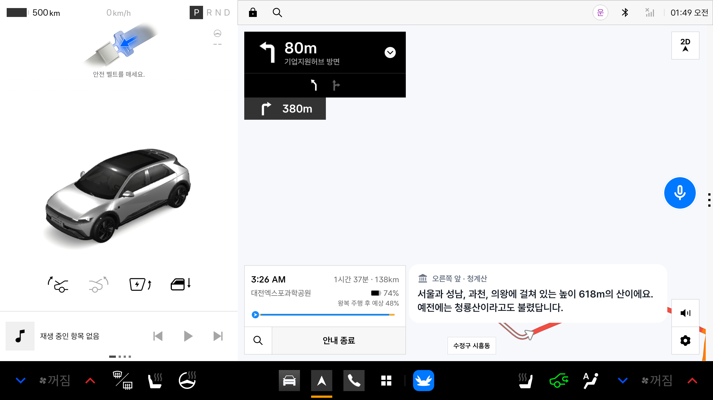

<h1 align="center">
  
  Petasos
</h1>

<p align="center">
  <a href="https://developer.android.com/training/cars"></a>
  <a href="https://document.pleos.ai/"></a>
  
  
  
</p>

<p align="center"><b>창밖 풍경을 살아 있는 박물관으로, 대화가 트이는 차 안의 AI 가이드</b></p>

<p align="center">Pleos 내비게이션, 위치와 연동해 지나는 지역의 이야기를 자동으로 들려주고,<br>궁금할 때는 언제든 말로 물어볼 수 있는 차량 전용 AI 동행 앱입니다.</p>

| 홈 | 내비 위 표시 | 내 여행 |
| --- | --- | --- |
|  |  |  |

## 제출 정보

| 항목 | 내용 |
| --- | --- |
| 앱 이름 | Petasos |
| 한 줄 소개 | 창밖 풍경을 살아 있는 박물관으로, 대화가 트이는 차 안의 AI 가이드 |
| 시연 영상 | https://youtu.be/nvoNckiXXgQ |
| APK | `apk/Petasos_Petasos_release.apk` (약 80MB, clone 하면 함께 받아짐) |
| APK 내려받기 | [Releases v1.0.0-demo](https://github.com/4mealsaday/Petasos/releases/tag/v1.0.0-demo) (저장소의 APK와 같은 빌드) |
| 테스트 환경 | Pleos Connect 2.1.0 에뮬레이터 (Android 14, API 34, ARM64) |
| AVD 기기 프로필 | `Pleos_Connect_v2_0` (2560×1440, mdpi, 가로) |
| 호스트 | macOS (Apple Silicon) |
| 실행 방법 | [설치와 실행](#설치와-실행) → [데모 시연](#데모-시연) |
| 음성 질문 | [질문 응답용 로컬 서버](#질문-응답용-로컬-서버)가 필요 (없어도 나머지 기능은 동작) |

## 무엇을 하는 앱인가

차 안에서 보내는 시간은 길지만, 어느 지역을 지나는지, 그곳이 어떤 곳인지는 모른 채 흘러갑니다. Petasos는 여행 가이드처럼 지나는 지역의 이야기를 들려주고, 듣다가 궁금한 건 손을 들듯 바로 물어볼 수 있게 합니다.

| 기능 | 내용 |
| --- | --- |
| 지역 이야기 | "동행 시작" 한 번이면 시군구가 바뀔 때마다 그 지역 이야기가 자동으로 나옵니다. 고른 관심사(12가지) 이야기를 먼저 들려주고, 끝까지 들은 이야기는 반복하지 않습니다 |
| 질문 | 내비 위 말하기 버튼을 누르고 말로 묻습니다. 방금 들은 이야기를 바탕으로 답한 뒤 듣던 자리로 돌아갑니다 |
| 창밖 안내 | 랜드마크가 창밖에 보일 즈음 "오른쪽 앞으로 한빛탑이 보여요" 같은 한두 문장을 끼워 넣습니다 |
| 내 여행 | 지나온 길과 이야기를 끝까지 들은 지역, 들은 이야기 카드가 지도에 남습니다 |

내비 화면을 떠나지 않도록 말하기 버튼과 자막 카드는 내비 위에 겹쳐 뜨고, 주행 제한 중에는 자막이 한 줄로 줄어듭니다. 이야기와 지역 경계 데이터, 음성 인식과 합성은 모두 기기 안에서 처리해 통신이 끊겨도 이야기가 이어집니다.

### 한 번의 동행

```
동행 시작 ──→ 내비가 앞으로 나오고, 그 위에 말하기 버튼과 자막 카드가 뜸
   │
   ├─ 시군구가 바뀌면 ────→ 전환 멘트 → 그 지역 이야기 → 전환 멘트
   ├─ 이야기 사이 ─────────→ 음악
   ├─ 랜드마크를 지날 때 ───→ 창밖 안내 한 줄 (끝나면 원래 재생으로)
   └─ 말하기 버튼 ─────────→ 질문 → 답변 → 듣던 자리로
   │
동행 끝내기 ─→ "내 여행"에 여정 기록
```

### 설계 원칙

- **답변은 들은 내용에서만.** AI 답변은 사용자가 끝까지 들은 문단의 사실만 근거로 씁니다. 앱이 답변의 근거 ID를 직접 대조하고, 들은 문단이 아니면 버립니다.
- **재생하는 문장은 검수된 것만.** 이야기와 창밖 안내는 출처가 달린 콘텐츠 팩에서만 나오고, 음악은 권리를 확인한 번들 음원만 씁니다. 모델이 즉석에서 만든 문장은 질문 답변에만 쓰이고, 그것도 위 근거 대조를 거칩니다.

## 지금 구현된 것과 대체한 것

| 기능 | 데모에서는 | 대체한 이유 | 실제 제품에서는 |
| --- | --- | --- | --- |
| 창밖 안내 | 팩에 미리 등록한 랜드마크 좌표에 가까워지면 안내 | 주행 중 창밖 실시간 인식은 아직 어려움 | 실시간 인식, POI 연동 |
| 음악 | APK에 넣은 CC BY 4.0 음원, 데모는 1곡 35초 | 저작권과 API 제약 | 사용자의 음악 서비스 연결 |
| 주변 질문 | 들은 이야기 속 사실로만 답변 | 네이버 지도 주변 검색 미연동 | 네이버 지도 API로 실시간 검색 |
| 주행 위치 | `scripts/demo_route.py`가 에뮬레이터에 좌표 주입 | 실차 GPS 대신 | 차량 위치 그대로 |
| 내비 목적지 | 코드에 고정된 "대전엑스포과학공원"을 요청 (`CompanionControls.requestDemoDestinationRoute`) | 목적지 선택 화면이 없고, 시연 경로를 매번 같게 하려고 | 사용자가 고른 목적지 |

- 그래서 내비 목적지는 "대전엑스포과학공원"(한빛탑)으로 뜨고, 주행 스크립트는 조금 더 가서 KAIST 본원에서 끝납니다.
- 실제 코드로 동작하는 것: 이야기 편성(지역 판정, 선택, 재생, 기록), 답변 근거 대조, 내비 연동, 내 여행 지도. 네이버 지도는 내 여행 지도(Maps SDK)와 다음 지역 예측용 길찾기(Directions API)에 쓰고 있습니다.

## 설치와 실행

**필수 조건**

- Pleos Connect 2.1.0 에뮬레이터 (Android 14, API 34, ARM64)
- Android SDK Platform-Tools (`adb`)
- Python 3
- 이 저장소 (초기화 스크립트, 주행 스크립트, 경로 시나리오가 들어 있어 APK만으로는 시연할 수 없음)

> **AVD 기기 프로필은 반드시 `Pleos_Connect_v2_0`.** 일반 Automotive 프로필(1024×768 등)로 만들면 화면이 깨집니다. AVD 이름은 아래 명령과 같게 `Pleos_Connect_v2.1.0`으로 합니다.

사용자 ID가 10이 아니면 `--user` 값을 바꿔 주세요(`adb shell pm list users`로 확인). 에뮬레이터를 재부팅하면 2), 4), 5), 6)을 다시 실행합니다.

```sh
# 1) 저장소 받기
git clone https://github.com/4mealsaday/Petasos.git && cd Petasos

# 2) 에뮬레이터 부팅 (DNS를 지정하지 않으면 내비가 "서비스 연결 중"에서 멈출 수 있음)
~/Library/Android/sdk/emulator/emulator -avd Pleos_Connect_v2.1.0 -no-snapshot-load -no-boot-anim -dns-server 8.8.8.8,1.1.1.1 &
adb wait-for-device
until [ "$(adb shell getprop sys.boot_completed | tr -d '\r')" = 1 ]; do sleep 2; done

# 3) APK 설치 (이전 설치본은 서명이 달라 먼저 삭제)
adb uninstall com.petasos.app 2>/dev/null
adb install --user 10 apk/Petasos_Petasos_release.apk

# 4) 내비 위 표시 권한 (두 줄 모두 필요)
adb shell appops set --user 10 com.petasos.app SYSTEM_ALERT_WINDOW allow
adb shell pm grant --user 10 com.petasos.app android.permission.SYSTEM_ALERT_WINDOW

# 5) Mac 마이크를 에뮬레이터 입력으로
adb emu avd hostmicon

# 6) 출발 위치: 천안역
adb emu geo fix 127.1489 36.8099
```

앱에서 할 일

| 단계 | 할 일 | 주의 |
| --- | --- | --- |
| 7 | 하단 바의 Petasos 아이콘으로 실행 | |
| 8 | 온보딩: 계속하기 → 관심사 선택 또는 건너뛰기 | 위치, 마이크 권한은 앱 화면에서 허용. `pm grant`로 미리 주면 홈 버튼이 안 나타남 |
| 9 | 홈에서 **동행 시작** → 권한 대화상자 모두 허용 | 내비 위에 말하기 버튼과 자막 카드가 뜨면 준비 완료 |
| 10 | 내비에서 **안내 시작** | 안내 중이 아니면 이야기가 나오지 않음. 하단에 "안내 종료"가 보이면 안내 중 |
| 11 | 볼륨 확인 | 차량 볼륨은 부팅마다 20/45로 돌아감(초기화 스크립트가 올려 줌). Mac 출력 볼륨은 85% 이상 권장, 낮을 때 음성 인식이 잘 안 됐음 |

## 데모 시연

천안역 → 한빛탑 → KAIST 본원, 약 7분. 이야기 4편, 음악, 창밖 안내 1곳, 질문 응답이 모두 들어 있습니다.

```sh
# 1) 초기화: 열린 동행 종료, 출발 위치 복귀, 차량 볼륨 최대
./scripts/demo-reset.sh

# 2) 앱에서 동행 시작 → 내비에서 안내 시작

# 3) 주행
python3 scripts/demo_route.py --scenario cheonan-kaist --video
```

> **두 번째 주행부터는 청취 기록을 지워 주세요.** 이미 들은 이야기는 다시 나오지 않습니다. ⚙ 설정 → 청취 기록 초기화 → 한 번 더 눌러 삭제.

### 장면별 진행

| # | 위치 | 나오는 것 | 시연자가 할 일 |
| --- | --- | --- | --- |
| 1 | 천안 동남구 | 이야기 "천안삼거리에서 갈라진 길" (32초) | |
| 2 | 이동 중 | 음악 Prelude No. 1 (35초) | |
| 3 | 청주 흥덕구 | 이야기 "운천동 흥덕사 터" (33초) | |
| 4 | 이동 중 | 음악 | |
| 5 | 대전 대덕구 | 이야기 "신탄진 길목의 식당들" (37초) | 이야기가 끝나면 바로 말하기 버튼 → **"아까 그 칼국수집, 어디 있다고 했지?"** |
| 6 | 이동 중 | 음악 | |
| 7 | 대전 유성구 | 창밖 안내 "오른쪽 앞으로 한빛탑이 보여요…", 이어서 이야기 "박람회가 남긴 과학공원" (36초) | |
| 8 | KAIST 본원 | | **동행 끝내기** → **내 여행**에서 지나온 길과 이야기 카드 확인 |

이야기 앞뒤에는 짧은 전환 멘트가 붙습니다.

**질문할 때**

- 자막 카드 순서: 말씀해 주세요 → 듣고 있어요 → (인식한 질문) 답을 찾고 있어요 → 답변
- 이야기가 끝난 뒤에 물어야 답이 나옵니다. 끝까지 들은 문단만 근거로 쓰기 때문입니다.
- 대덕구 이야기 뒤 한빛탑 안내까지 15초 남짓입니다. 답변이 안내 시점과 겹치면 안내가 취소되니 바로 물어 주세요.
- 로컬 서버를 띄우지 않았다면 "지금은 답변 서버에 연결할 수 없어요."가 나오고 원래 재생으로 돌아갑니다.
- 자막이 내비를 가리면 ⚙ 설정 → 내비 위 자막을 끕니다. 말하기 버튼은 남습니다.

## 질문 응답용 로컬 서버

질문 답변은 Mac에서 도는 로컬 HTTPS 서버(`server/`)가 OpenRouter를 호출해 만듭니다. 서버 없이도 질문을 뺀 나머지는 모두 동작합니다.

**필수 조건**: Python 3.11 이상, OpenRouter API 키

```sh
# 1) 설치와 기기 토큰 (토큰은 24시간 유효)
python3.11 -m venv .local/server-venv && .local/server-venv/bin/pip install -r server/requirements.txt
cp .env.example .env                                   # PETASOS_OPENROUTER_API_KEY 입력 (.env는 git에 올라가지 않음)
python3.11 server/provision-local.py --directory .local/server

# 2) 답변 근거 파일: 기기에 설치된 콘텐츠 팩에서 만듦 (팩이 다르면 답이 나오지 않음)
mkdir -p .local/content/bundles .local/content/evidence
chmod 700 .local .local/content .local/content/bundles .local/content/evidence
cp app/src/main/assets/content/packs/cheonan-kaist.json .local/content/bundles/ && chmod 600 .local/content/bundles/cheonan-kaist.json
PYTHONPATH=server .local/server-venv/bin/python scripts/build-content-bundle.py \
  --evidence-from-bundle .local/content/bundles/cheonan-kaist.json \
  --allow-device-id local-development-device --output .local/content/evidence/cheonan-kaist.json

# 3) 로컬 개발 인증서
PYTHONPATH=server .local/server-venv/bin/python server/dev-local-https.py prepare
```

`.local/server/config.json` 설정

| 항목 | 값 |
| --- | --- |
| `evidenceFile` | 2)에서 만든 파일의 절대 경로 |
| `provider` | 사용할 OpenRouter 모델 정보 |
| `accountContentLoggingDisabled` | OpenRouter 계정 Privacy 설정(ZDR only, 입출력 로깅 OFF)을 직접 확인한 뒤에만 `true`. 서버는 이 값을 그대로 믿습니다 |

서버 실행과 기기 연결 (토큰은 파일로만 전달하고, 앱이 읽어서 암호화 저장소로 옮깁니다)

```sh
PYTHONPATH=server .local/server-venv/bin/python server/dev-local-https.py serve --port 8443 &
curl -sk https://127.0.0.1:8443/v1/health          # {"status":"ok",...}
adb reverse tcp:8443 tcp:8443                       # 에뮬레이터 재부팅마다 다시 실행

adb shell "rm -rf /data/local/tmp/petasos-demo; mkdir -p /data/local/tmp/petasos-demo"
adb push .local/server/device-provisioning.token /data/local/tmp/petasos-demo/demo-server.token
adb push .local/server/dev-tls/ca.pem /data/local/tmp/petasos-demo/demo-server-ca.pem
adb shell chmod -R a+rX /data/local/tmp/petasos-demo
adb shell am start --user 10 -n com.petasos.app/.MainActivity      # 앱이 열릴 때 파일을 읽음
adb shell rm -r /data/local/tmp/petasos-demo                        # 읽은 뒤 평문 토큰 삭제
```

앱은 이 CA를 `localhost` 연결에만 신뢰합니다.

**답변 대신 "잘 못 들었어요"가 나올 때**: `adb logcat -s PetasosTalk`에 원인이 찍힙니다.

| 로그 | 원인 | 해결 |
| --- | --- | --- |
| `AUTHORIZATION` | 기기 토큰(24시간) 만료 | 1)의 `provision-local.py`부터 다시 |
| `NO_EVIDENCE` | 서버 근거 파일이 기기의 콘텐츠 팩과 다름 | 2)를 다시 하고 `evidenceFile` 확인, 서버 재시작 |

## 소스에서 빌드하기

| 도구 | 버전 |
| --- | --- |
| JDK | 17 |
| Android SDK | Platform 36, Build-Tools 35.0.0, Platform-Tools, Emulator |
| Gradle | 8.11.1 (AGP 8.10.1, Kotlin 2.2.21), `./gradlew`가 자동으로 받음 |
| Pleos SDK | 빌드 중 `nexus-playground.pleos.ai`에서 자동으로 받음 |

```sh
# 1) Android SDK 위치 (local.properties는 git에 올라가지 않음. ANDROID_HOME 환경변수로 대신해도 됨)
echo "sdk.dir=$HOME/Library/Android/sdk" > local.properties

# 2) 빌드 (처음엔 의존성을 받느라 몇 분 걸림)
export JAVA_HOME="$(brew --prefix openjdk@17)/libexec/openjdk.jdk/Contents/Home"
./gradlew assembleDebug             # → app/build/outputs/apk/debug/app-debug.apk

# 3) 설치 (제출용 APK와 서명이 달라 먼저 삭제). 이후는 "설치와 실행" 4)부터 동일
adb uninstall com.petasos.app 2>/dev/null
adb install --user 10 app/build/outputs/apk/debug/app-debug.apk
```

- `.env`(지도 키)가 없어도 빌드됩니다. 내 여행 지도만 내장 지도로 대신 뜹니다.
- 제출본과 같은 서명이 필요하면 서명 키(`.local/android/`, 저장소에 없음)가 있어야 합니다. 시연 절차는 debug 빌드로도 똑같이 동작합니다.
- 테스트: `./gradlew :app:testDebugUnitTest`

**코드 구조**

| 폴더 | 내용 |
| --- | --- |
| `playback/` | 이야기, 질문, 복귀, 음악을 오가는 상태 기계 `PlaybackCoordinator`. 앱의 중심 |
| `planning/`, `location/`, `content/` | 지역 편성, 시군구 판정, 창밖 안내 판단(`WindowLandmarks`), 콘텐츠 검증 |
| `platform/` | Pleos TTS, STT, 내비, 위치 어댑터, 미디어 세션, 내비 위 표시(`overlay/CompanionOverlay`), 전체 조립(`runtime/PetasosSessionHost`) |
| `storage/`, `presentation/` | Room 저장소, 홈과 내 여행 화면 |
| `server/` | 답변 생성 서버 (Python ASGI) |
| `docs/` | 콘텐츠 제작 방법 `CONTENT_PIPELINE.md`, 명세 `Petasos_제품명세.md`, `Petasos_동작명세.md` |

## 사용한 Pleos SDK와 Android API

| 구분 | API | 역할 |
| --- | --- | --- |
| Pleos SDK | `TextToSpeech` 3.3.1 (ON_DEVICE) | 이야기, 답변, 창밖 안내를 문장 단위로 읽고 자막과 맞춤 |
| Pleos SDK | `SpeechToText` 3.3.1 | 질문 음성을 글자로 변환 (호스트 마이크 PCM 입력) |
| Pleos SDK | `NaviHelper` 3.0.5 | 내비를 앞으로 가져오기, 목적지 경로 요청, 경로 상태 확인 |
| Pleos SDK | `FusedLocation` 1.1.3, `pleos.car.permission.FUSED_LOCATION` | Pleos 위치 허가를 받아 이야기를 고를 지역 확정 |
| Pleos 권한 | `TTS_SERVICE`, `STT_SERVICE`, `NAVI_ROUTE`, `NAVI_ROUTE_SEARCH`, `NAVI_CUSTOM_MAP` | 위 SDK 호출 허가 |
| Android Car | `READ_CAR_POWER_POLICY`, `CarUxRestrictions` | 전원 상태에 따라 소리 정지, 주행 제한 중 자막을 한 줄로 축소 |
| Android | `WindowManager` `TYPE_APPLICATION_OVERLAY` (`SYSTEM_ALERT_WINDOW`) | 내비 위에 말하기 버튼과 자막 카드 표시 |
| Android | 포그라운드 서비스 (`location`, `microphone`, `mediaPlayback`) | 내비가 앞에 있어도 위치 수신, 마이크, 재생 유지 |
| Android | `LocationManager` | 지나온 길 기록, 시군구 판정 |
| Android | `AudioManager` 오디오 포커스, `AudioAttributes` | 이야기, 음악, 내비 음성 사이 양보. 안내 중 음악 일시 정지 |
| Android | `AudioRecord` | 질문 음성을 PCM으로 모아 STT에 전달 |
| Jetpack | Media3 `ExoPlayer`, `MediaSession` 1.11.1 | 내장 음악 재생, 시스템 미디어 세션 |
| Jetpack | Room 2.8.5 | 여정, 경로, 들은 이야기, 수집 기록 저장 |
| Jetpack | WorkManager 2.12.0 | 대화 요약을 백그라운드에서 생성 |
| Android | Keystore | 서버 토큰과 대화 임시 저장 암호화 |
| 외부 SDK | NAVER Maps SDK 3.24.0 | 내 여행 지도 |

## 알려진 한계

개발 중 직접 겪은 문제 중 시연에서 눈에 띌 만한 것입니다.

| 증상 | 원인 | 대처 |
| --- | --- | --- |
| 내비의 위치 마커가 출발점에서 안 움직임 | 에뮬레이터 2.1.0의 GNSS NMEA 체크섬이 고정값(`*47`)이라 내비가 거부 (`NMEA checksum mismatch`) | 앱은 시스템 위치로 정상 수신하므로 이야기 편성에는 영향 없음 |
| 내비에 "경로 탐색 오류" 창 | 에뮬레이터가 내비 서버에 연결하지 못함 | 창을 닫으면 됨 |
| 홈에 "차량 연결 상태를 확인하고 있어요"만 남고 동행 시작 버튼이 사라짐 | 에뮬레이터를 오래 켜 두면 차량 서비스가 멈춤 (`car_service not ready`) | 재부팅. 시연 전 새로 부팅 권장 |
| 음성 질문이 인식되지 않음 | Mac 출력이나 입력 볼륨이 낮음 | 볼륨을 올림 |
| 창밖 안내가 빠짐 | 읽던 문장이 끝나기 전에 랜드마크를 지나치면 취소 (한 여정에 한 번만 시도) | 시연 시나리오는 한빛탑 구간 속도를 낮춰 둠 |
| 답변이 틀릴 수 있음 | 근거 대조는 출처를 묶어 줄 뿐 문장의 정확성까지 보장하지 않음 | |

그 밖에

- Pleos 음성 서비스가 인식한 문장을 자체 로그에 남깁니다. 플랫폼 동작이라 앱에서 막을 수 없습니다.
- 실제 차량용 정책 검수는 하지 않았습니다.

## 라이선스와 출처

- **글꼴**: Pretendard, SIL Open Font License 1.1 (`app/src/main/assets/licenses/Pretendard-OFL.txt`)
- **음악**: Chris Zabriskie, CC BY 4.0, 원본 그대로 사용. 크레딧은 `app/src/main/assets/music/CREDITS.txt`와 앱의 "데이터 출처" 화면에 있으며, 작곡가의 보증을 뜻하지 않습니다. 네 곡을 넣었고 데모는 "Prelude No. 1"만 씁니다.
  - "Prelude No. 1", *Preludes* (2009)
  - "A New Day In a New Sector", *Music from Neptune Flux* (2016)
  - "The Temperature of the Air on the Bow of the Kaleetan", *Undercover Vampire Policeman* (2012)
  - "I Knew My Way Downtown and Walking Was Deluxe", *I Made This While You Were Asleep* (2020)
- **지역 경계**: 국토지리정보원 연속수치지형도 행정경계(시군구), 브이월드 제공, CC BY 2.0 KR. 화면용으로 단순화
- **이야기와 창밖 안내**: 한국관광공사 TourAPI(공공누리 제1유형, 변경 금지인 제3유형 원문은 미사용), Odii, 문화체육관광부, 농촌진흥청, 국토교통부, 국사편찬위원회(공공누리 제1유형), 한국학중앙연구원 한국민족문화대백과사전(청계산 관련 사실, 사실만 새 문장으로 작성). 출처는 콘텐츠 팩의 `sources`에 있음
- **지도**: NAVER 지도 (NAVER Maps SDK). APK에는 공개 식별자만 포함
- **코드 라이선스**: 추후 결정
