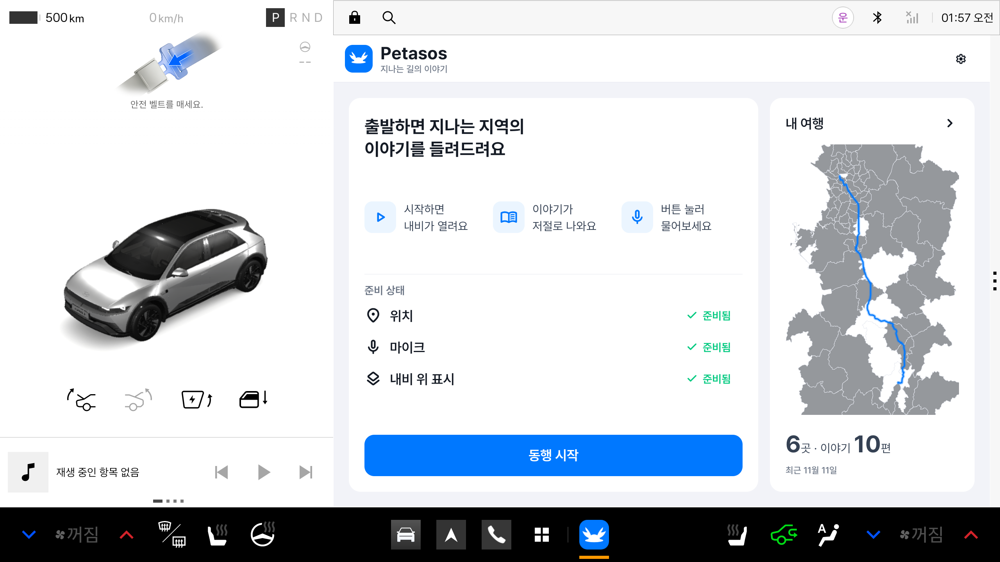
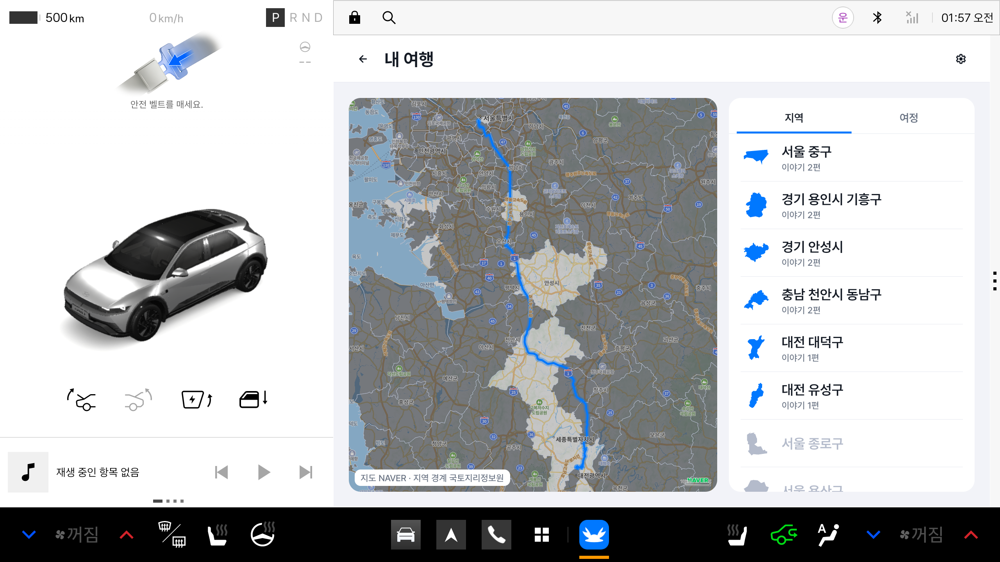

# Petasos

Petasos는 차량 내비게이션 위에서 **지금 지나는 지역의 이야기를 들려주는** Pleos Android 동행 앱이다.
내비 화면 위에 뜨는 말하기 버튼과 자막 카드로 지도를 가리지 않고 듣다가, 궁금하면 버튼을 눌러 AI에게 물어볼 수 있고, 길가에 보이는 곳은 짧게 알려 준다.
이동이 끝나면 지나온 길과 들은 이야기가 "내 여행" 지도에 남는다.
시연 경로는 **천안역 → (한빛탑 경유) → KAIST 본원**이고, 이 한 경로에 이야기 4편·음악 1곡·창밖 안내 1곳·질문 응답을 모두 담았다.
아래 "데모 시연"이 그 경로를 처음부터 끝까지 재현하는 절차다.

> **시연 영상**: (링크 추가 예정)

| 홈 | 내비 위 표시 | 내 여행 |
| --- | --- | --- |
|  |  |  |

## 테스트 환경

| 항목 | 값 |
| --- | --- |
| 실행 대상 | Pleos Connect 2.1.0 에뮬레이터 (Android 14 / API 34, ARM64), AVD `Pleos_Connect_v2.1.0` |
| 앱 | `com.petasos.app` 1.0.0-demo, minSdk 28 / targetSdk 34 |
| 호스트 | macOS, `adb`, Android Emulator (호스트 마이크 사용), Python 3 |
| AI 대화 서버(선택) | Python 3, OpenRouter API 키 |
| 시연 시나리오 | `cheonan-kaist` — 천안역 → 한빛탑 → KAIST 본원, `--video` 프리셋으로 약 7분 |
| 콘텐츠 팩 | `content/packs/cheonan-kaist.json` version 4 (이야기 4편이 시연에 나온다) |

## 설치·실행

사용자 ID가 10이 아니면(`adb shell pm list users`로 확인) 아래 모든 `--user` 값을 바꾼다.
에뮬레이터를 재부팅할 때마다 2)를 뺀 나머지를 다시 한다.

```sh
# 1) 에뮬레이터 부팅 — 호스트 DNS가 막힌 뒤에는 내비가 "서비스 연결 중"에서 멈추므로 DNS를 지정한다
~/Library/Android/sdk/emulator/emulator -avd Pleos_Connect_v2.1.0 -no-snapshot-load -no-boot-anim -dns-server 8.8.8.8,1.1.1.1 &
adb wait-for-device
until [ "$(adb shell getprop sys.boot_completed | tr -d '\r')" = 1 ]; do sleep 2; done

# 2) APK 설치 (이전 설치가 있으면 서명이 달라 먼저 지운다). apk/의 파일은 제출용 최종본이다 — 최신 APK는 GitHub Releases에서 받는다
adb uninstall com.petasos.app 2>/dev/null
adb install --user 10 apk/Petasos_Petasos_release.apk

# 3) 내비 위 표시(overlay) 권한 — 둘 다 필요하다
adb shell appops set --user 10 com.petasos.app SYSTEM_ALERT_WINDOW allow
adb shell pm grant --user 10 com.petasos.app android.permission.SYSTEM_ALERT_WINDOW

# 4) 에뮬레이터가 Mac 마이크를 입력으로 쓰도록 (부팅할 때마다)
adb emu avd hostmicon

# 5) 출발 위치를 천안역에 맞춘다
adb emu geo fix 127.1489 36.8099
```

6. **앱 실행** — 에뮬레이터 하단 바의 Petasos 아이콘(또는 `adb shell am start --user 10 -n com.petasos.app/.MainActivity`).
7. **온보딩** — "계속하기" → 관심사 선택(또는 "건너뛰기"). **권한은 반드시 앱 화면에서 허용한다.** `pm grant`로 위치·마이크를 미리 주면 온보딩이 건너뛰어져 홈 화면의 조작부가 그려지지 않는다.
8. **동행 시작** — 홈에서 **동행 시작**을 누르고 권한 대화상자를 모두 허용한다(오디오 녹음 → "알 수 없는 작업"(Pleos 권한) → 위치). 내비가 앞으로 나오고 오른쪽에 둥근 말하기 버튼, 아래에 자막 카드가 뜬다.
9. **내비에서 "안내 시작"을 누른다.** 경로 후보 화면이 뜨면 반드시 눌러야 한다. 내비가 안내 중이 아니면 앱이 지역 편성 대상을 잡지 못해 **아무 이야기도 나오지 않는다**(내비 하단에 "안내 종료"가 보이면 안내 중이다). "경로 탐색 오류"가 뜨면 **닫기**를 누르고 목적지를 다시 고른다.
10. **소리** — 차량 볼륨은 부팅할 때마다 20/45로 돌아간다. `adb shell 'for i in $(seq 1 50); do input keyevent 24; done'`로 올리거나 에뮬레이터 볼륨 버튼을 올린다(`demo-reset.sh`가 매번 해 준다). Mac 출력 볼륨도 85% 이상으로 둔다(낮으면 음성 인식도 안 된다).

## 데모 시연

`scripts/demo-reset.sh`가 시연 직전 준비를 한 번에 한다. **매 주행 전에 반드시 돌린다.**

```sh
./scripts/demo-reset.sh                 # 기본 시나리오 cheonan-kaist
```

하는 일(출력에 단계가 그대로 찍힌다):

| 단계 | 하는 일 | 이게 없으면 |
| --- | --- | --- |
| 1 | 열려 있는 동행을 **정상 종료**(앱 화면의 "동행 끝내기"를 눌러서) | 음악 도중에 끊긴 동행이 남기는 `musicCheckpoint` 때문에 다음 주행이 IDLE에서 멈추고 첫 이야기가 안 나온다 |
| 2 | 앱 종료 | 초기화가 재생과 경합한다 |
| 3 | 청취·수집 기록 초기화 | 이미 들은 이야기는 조용히 건너뛰어진다 |
| 4 | **기기 DB와 콘텐츠 팩 대조** | 아래 "콘텐츠를 바꿨다면" 참고 |
| 5 | 출발 위치를 시나리오 출발점으로 되돌림 | 지난 주행의 끝 위치에서 시작한다 |
| 6 | 차량 볼륨 최대 | 부팅 기본값(20/45)이라 잘 안 들린다 |
| 7 | 앱 시작 | — |
| 8 | 영상 모드 켜기(지역당 대표 이야기 1편) | 지역마다 준비된 이야기가 모두 나와 데모가 길어진다 |

**콘텐츠를 바꿨다면** — `adb install`은 앱 데이터를 **지우지 않고**, 콘텐츠 설치기는 이미 설치된 팩을 덮어쓰지 않는다. 그래서 새 이야기가 DB에 영원히 들어가지 못하고, 그 지역은 **아무 로그도 없이 조용히 건너뛰어진다.** `demo-reset.sh`의 4단계가 이걸 잡아내 경고한다. 경고가 나오면:

```sh
adb shell pm clear --user 10 com.petasos.app
```

그 뒤 위 "설치·실행" 3)부터(overlay 권한 → 앱 실행 → 온보딩 → 서버 토큰 전달) 다시 한다. `pm clear`는 권한과 서버 토큰까지 지운다.

### 주행

reset이 끝나면 앱에서 **동행 시작** → 내비에서 **안내 시작**을 누른 다음:

```sh
.local/server-venv/bin/python scripts/demo_route.py --scenario cheonan-kaist --video
```

`--video`가 녹화용 속도 프리셋이다. 지역마다 이야기를 들을 만큼 머물고, 창밖 안내 지점(한빛탑)은 실제 주행 속도로 지난다. 약 7분이다.
(GPX로 하려면 Extended controls(⋯) → Location → Routes → Load GPX/KML → `demo/scenarios/cheonan-kaist/route.gpx` → Play route. 이 쪽은 직접 재생해 확인하지 못했다.)

### 장면별 진행

| # | 위치 | 들리는 것 | 시연자가 할 일 |
| --- | --- | --- | --- |
| 1 | 천안 동남구 | 이야기 "천안삼거리에서 갈라진 길" (32초) | — |
| 2 | — | "여기까지 듣고, 잠깐 음악 한 곡 틀어 드릴게요." → 음악 (Prelude No. 1, 35초) | — |
| 3 | 청주 흥덕구 | 이야기 "운천동 흥덕사 터" (33초) — 끊지 않고 자연스럽게 넘어온다 | — |
| 4 | — | 전환 멘트 → 음악 | — |
| 5 | 대전 대덕구 | 이야기 "신탄진 길목의 식당들" (37초) | 이야기가 **끝난 뒤** 말하기 버튼을 누르고 **"아까 그 칼국수집, 어디 있다고 했지?"** 라고 묻는다 |
| 6 | — | 전환 멘트 → 음악 | — |
| 7 | 대전 유성구 (한빛탑 앞) | 그때 재생 중인 이야기나 음악에 🗼 **"오른쪽 앞으로 한빛탑이 보여요. 1993년 대전엑스포를 기념해…"** 가 끼어들고, 끝나면 원래 재생으로 돌아온다. 이어서 이야기 "박람회가 남긴 과학공원" (36초) | — |
| 8 | KAIST 본원 도착 | — | 홈에서 **동행 끝내기** → **내 여행**에서 지나온 길과 들은 이야기 카드를 보여 준다 |

**말하기(5번)**: 오른쪽 둥근 버튼을 누른다. 이야기 중이면 현재 문장이 끝난 뒤, 아니면 바로 **말씀해 주세요 → 듣는 중… → 인식한 질문 → 답변 자막** 순으로 나오고, 답변이 끝나면 이야기(없으면 음악 → 다음 이야기)로 돌아온다. 답변은 **그 이야기에서 끝까지 들은 문단에 있는 사실만** 근거로 쓴다. 그래서 질문은 이야기가 끝난 뒤에 해야 답이 나온다. AI 서버가 없으면 카드에 "지금은 답변 서버에 연결할 수 없어요."가 나온 뒤 돌아온다.

**내비 화면을 가리지 않으려면**: ⚙ 설정 → **내비 위 자막**을 끈다. 말하기 버튼은 그대로 남는다. 자막이 필요한 녹화에서는 켜 둔다.

**재시연**: `동행 끝내기` → `./scripts/demo-reset.sh` → 다시 `동행 시작`. 초기화하면 "내 여행"의 여정 기록도 지워진다.

### (선택) "내 여행" 지도에 여정 여러 개 만들기

녹화 전에 한 번만 한다. 순서: ① `demo-reset.sh` → ② 위 천안→KAIST 주행과 동행 끝내기 → ③ 아래 세 경로를 하나씩 "출발 위치 고정 → 동행 시작 → 안내 시작 → 재생 → 동행 끝내기" → ④ **그 뒤에는 초기화하지 않는다.** 이 세 시나리오는 이야기 없이 경로만 있고, 각각 내 여행의 별도 여정이 된다. 이야기를 듣지 않은 지역은 회색으로 남는다.

```sh
adb emu geo fix 126.9698291 37.5547273 && python3 scripts/demo_route.py --scenario seoul-chuncheon   # 서울역 → 춘천역, 약 6분
adb emu geo fix 126.9698291 37.5547273 && python3 scripts/demo_route.py --scenario seoul-incheon     # 서울역 → 송도 센트럴파크, 약 5분
adb emu geo fix 127.3866 36.3765 && python3 scripts/demo_route.py --scenario daejeon-jeonju          # 대전엑스포과학공원 → 전주 한옥마을, 약 6분
```

> `demo-reset.sh`의 3·8단계(청취 기록 초기화, 영상 모드)는 **debug 빌드 전용 브로드캐스트**다. `apk/`의 release 빌드로 시연할 때는 ⚙ 설정 → "청취 기록 초기화"를 쓰고, 영상 모드가 없어 지역마다 준비된 이야기가 모두 나온다.

## (선택) AI 대화용 로컬 서버

AI 답변은 Mac에서 도는 로컬 HTTPS 서버(`server/`)가 OpenRouter를 호출해 만든다. 서버가 없어도 위 시연은 모두 된다. 서버를 쓰려면 OpenRouter API 키가 필요하다.

```sh
# 1) 의존성과 키
python3.11 -m venv .local/server-venv && .local/server-venv/bin/pip install -r server/requirements.txt   # Python 3.11 이상
cp .env.example .env        # PETASOS_OPENROUTER_API_KEY 만 채우면 된다 (.env는 git에 올라가지 않는다)

# 2) 기기 토큰·설정 생성 (토큰은 24시간 유효, 값은 출력되지 않는다)
python3.11 server/provision-local.py --directory .local/server

# 3) 앱에 번들된 이야기에서 서버용 근거 파일 생성 — 시연에 쓰는 콘텐츠 팩에서 뽑는다.
#    답변은 "끝까지 들은 문단에 있는 사실"만 근거로 쓰므로, 지금 설치된 팩과 같은 팩이어야 질문에 답이 나온다.
mkdir -p .local/content/bundles .local/content/evidence
chmod 700 .local .local/content .local/content/bundles .local/content/evidence   # 출력 폴더는 소유자 전용이어야 한다
cp app/src/main/assets/content/packs/cheonan-kaist.json .local/content/bundles/ && chmod 600 .local/content/bundles/cheonan-kaist.json
PYTHONPATH=server .local/server-venv/bin/python scripts/build-content-bundle.py \
  --evidence-from-bundle .local/content/bundles/cheonan-kaist.json \
  --allow-device-id local-development-device --output .local/content/evidence/cheonan-kaist.json

# 4) 로컬 개발 인증서 생성 (CA 30일, 서버 인증서 7일)
PYTHONPATH=server .local/server-venv/bin/python server/dev-local-https.py prepare
```

5. `.local/server/config.json`을 열어 `evidenceFile`을 `.local/content/evidence/cheonan-kaist.json`의 절대 경로로 바꾸고 `provider`를 채운다. 아래는 개발 중 사용한 값이다. `privacyReviewedUntil`은 미래의 Unix 초이고, **OpenRouter 계정의 Privacy 설정(ZDR only, 입출력 로깅 OFF)을 직접 확인한 뒤에만** `accountContentLoggingDisabled`를 `true`로 둔다. 서버는 이 값만 믿고 호출하므로 확인은 사용자 몫이다.

```json
"provider": {
  "type": "openrouter",
  "model": "anthropic/claude-sonnet-4.6",
  "acceptedModelIds": ["anthropic/claude-4.6-sonnet-20260217"],
  "providerSlug": "amazon-bedrock/global",
  "acceptedProviderNames": ["Amazon Bedrock"],
  "privacyReviewedUntil": 1893456000,
  "accountContentLoggingDisabled": true,
  "maxOutputTokens": 2048
}
```

6. 서버를 띄우고 에뮬레이터에 토큰과 CA를 전달한다. 토큰은 인자·인텐트로 넘기지 않고 파일로만 전달하며, 앱이 읽어 암호화 저장소에 옮긴다.

```sh
PYTHONPATH=server .local/server-venv/bin/python server/dev-local-https.py serve --port 8443 &
curl -sk https://127.0.0.1:8443/v1/health          # {"status":"ok",...}
adb reverse tcp:8443 tcp:8443                       # 에뮬레이터를 재부팅할 때마다 다시 실행

adb shell "rm -rf /data/local/tmp/petasos-demo; mkdir -p /data/local/tmp/petasos-demo"
adb push .local/server/device-provisioning.token /data/local/tmp/petasos-demo/demo-server.token
adb push .local/server/dev-tls/ca.pem /data/local/tmp/petasos-demo/demo-server-ca.pem
adb shell chmod -R a+rX /data/local/tmp/petasos-demo
adb shell am start --user 10 -n com.petasos.app/.MainActivity      # 앱이 실행·재개될 때 파일을 읽는다
adb shell rm -r /data/local/tmp/petasos-demo                        # 읽은 뒤 평문 토큰을 지운다
```

앱은 이 CA를 `localhost` 연결에만 신뢰한다. 토큰이 만료(24시간)되면 2)부터 새로 만들거나 `.local/server/tokens.json`의 `expiresAt`을 늘리고, 인증서가 만료(서버 7일)되면 4)와 CA 전달을 다시 한다.

답변 모델은 `provider.model` 한 줄이다(현재 답변 2~4초). 바꾸면 `acceptedModelIds`도 OpenRouter가 돌려주는 ID로 같이 바꾸고 서버를 재시작한다.

## 사용한 Pleos SDK·Android API

| 구분 | API | 핵심 경험에서의 역할 |
| --- | --- | --- |
| Pleos SDK | `TextToSpeech` 3.3.1 (ON_DEVICE) | 이야기·답변·창밖 안내를 문장 단위로 읽어 자막과 소리를 맞춘다 |
| Pleos SDK | `SpeechToText` 3.3.1 | 말하기 버튼으로 들어온 질문을 글자로 바꾼다(호스트 마이크 PCM 입력) |
| Pleos SDK | `NaviHelper` 3.0.5 | 동행을 켜면 내비를 앞으로 가져오고, 목적지(KAIST 본원) 경로를 요청하고, 경로 상태를 살핀다 |
| Pleos SDK | `FusedLocation` 1.1.3 · `pleos.car.permission.FUSED_LOCATION` | Pleos 위치 사용 허가를 받아 이야기를 고를 지역을 확정한다 |
| Pleos 권한 | `TTS_SERVICE` · `STT_SERVICE` · `NAVI_ROUTE` · `NAVI_ROUTE_SEARCH` · `NAVI_CUSTOM_MAP` | 위 SDK 호출 허가 |
| Android Car | `READ_CAR_POWER_POLICY`, `CarUxRestrictions` | 전원 상태에서 소리를 멈추고, 주행 제한 중에는 자막 카드를 한 줄로 줄인다 |
| Android | `WindowManager` `TYPE_APPLICATION_OVERLAY` (`SYSTEM_ALERT_WINDOW`) | 내비 위에 말하기 버튼과 자막 카드를 겹쳐 띄운다 |
| Android | 포그라운드 서비스(`location`·`microphone`·`mediaPlayback`) | 내비가 앞에 있어도 위치 수신·마이크·재생을 이어 간다 |
| Android | `LocationManager` | GPS를 받아 지나온 길을 기록하고 시·군·구를 판정한다 |
| Android | `AudioManager` 오디오 포커스 · `AudioAttributes` | 이야기·음악·내비 음성이 서로 양보하게 하고, 안내 중 음악을 잠깐 멈췄다 이어 틀게 한다 |
| Android | `AudioRecord` | 질문 음성을 PCM으로 모아 STT에 넘긴다 |
| Jetpack | Media3 `ExoPlayer`·`MediaSession` 1.11.1 | 내장 음악 재생과 시스템 미디어 세션 |
| Jetpack | Room 2.8.5 | 여정·경로·들은 이야기·수집 기록을 기기 안에 저장한다 |
| Jetpack | WorkManager 2.12.0 | 대화 요약을 백그라운드에서 한 번 만든다 |
| Android | Keystore | 서버 토큰과 대화 임시 저장을 암호화한다 |
| 외부 SDK | NAVER Maps SDK 3.24.0 | "내 여행" 지도 바탕 |

## 라이선스·출처

- **글꼴**: Pretendard — SIL Open Font License 1.1 (`app/src/main/assets/licenses/Pretendard-OFL.txt`).
- **음악**: Chris Zabriskie, CC BY 4.0, 원본 파일을 변경 없이 사용. 곡마다 크레딧이 `app/src/main/assets/music/CREDITS.txt`와 앱의 "데이터 출처" 화면에 있다. 이 크레딧이 작곡가의 보증을 뜻하지는 않는다. 네 곡이 번들돼 있고 **데모 빌드는 이야기 사이에 "Prelude No. 1" 한 곡만** 쓴다(`BundledMusicCatalog.DEMO_TRACK_ASSET_ID`).
  - "Prelude No. 1" — 앨범 *Preludes* (2009)
  - "A New Day In a New Sector" — 앨범 *Music from Neptune Flux* (2016)
  - "The Temperature of the Air on the Bow of the Kaleetan" — 앨범 *Undercover Vampire Policeman* (2012)
  - "I Knew My Way Downtown and Walking Was Deluxe" — 앨범 *I Made This While You Were Asleep* (2020)
- **지역 경계**: 국토지리정보원 연속수치지형도 행정경계(시군구), 브이월드 제공 — CC BY 2.0 KR. 화면용으로 단순화했다.
- **이야기·창밖 안내**: 한국관광공사 TourAPI(공공누리 제1유형, 변경 금지인 제3유형 원문은 쓰지 않음)·Odii, 문화체육관광부·농촌진흥청·국토교통부·국사편찬위원회(공공누리 제1유형), 한국학중앙연구원 한국민족문화대백과사전(청계산 사실; 공공저작물, 사실만 새 문장으로 작성). 출처 행은 콘텐츠 팩(`app/src/main/assets/content/packs/cheonan-kaist.json`, `seoul-daejeon.json`)의 `sources`에 있다.
- **지도**: NAVER 지도 (NAVER Maps SDK). 지도 키는 공개 식별자만 APK에 들어간다.
- **코드 라이선스**: 추후 결정.

## 알려진 한계

- **내비 위치 마커**: Pleos 에뮬레이터 2.1.0의 GNSS NMEA 체크섬이 고정값(`*47`)이라 내비의 NMEA 파서가 문장을 거부하고(내비 로그 `NMEA checksum mismatch`), 내비 위치 마커가 주입한 위치를 따라가지 않는다. 앱은 시스템 위치 제공자로 정상 수신한다.
- **하단 바 아이콘 캐시**: 에뮬레이터 하단 바(CarSystemUI)가 패키지별 아이콘을 따로 캐시해서, 앱 아이콘을 바꾼 뒤에도 예전 모양이 남을 수 있다. 앱 목록·내비 위 버튼은 새 아이콘이다.
- **서버 없이는 대화 불가**: AI 답변은 로컬 서버(OpenRouter)가 만든다. 서버가 없으면 이야기·음악·창밖 안내·내 여행은 그대로 되지만 질문에는 "지금은 답변 서버에 연결할 수 없어요."만 나온다.
- **내비 경로 오류 창**: 에뮬레이터 네트워크가 내비 자체 서버에 닿지 않을 때 "경로 탐색 오류"가 뜬다. 닫으면 된다.
- **에뮬레이터를 오래 켜 두면 차량 서비스가 죽는다**: 홈에 "차량 연결 상태를 확인하고 있어요"만 남고 **동행 시작**이 사라진다(로그 `car_service not ready`). 에뮬레이터를 재부팅하면 된다. 시연 전에는 새로 부팅해 두는 게 안전하다.
- **음성 입력**: 호스트 마이크로 들어오는 소리가 작으면 인식이 안 된다. Pleos 음성 서비스가 인식 문장을 자체 로그에 남기는 플랫폼 이슈가 있으며 앱에서 제어할 수 없다.
- **내 여행 첫 진입**: 지도 타일을 처음 받느라 3초가 넘으면 자체 지도(흰 바탕)로 대신 뜰 수 있다. 다음 진입부터는 네이버 지도다.
- **데모 빌드 동작**: 가상(에뮬레이터) 위치를 허용하고, 이야기 사이 음악은 **35초**로 줄여 한 곡만 쓰며(`Media3RuntimeMusic.DEMO_MUSIC_DURATION_MS`), 동행 끝내기가 여정 종료다. 실차용 정책 검수는 하지 않았다.
- **음악 길이를 더 늘리면 이야기가 밀린다**: 음악 길이는 다음 이야기 시작 시각 계산에 그대로 들어간다. 45초로 올리면 지역을 벗어나기 전에 이야기가 들어갈 자리가 없어 그 지역 이야기가 통째로 빠진다. 반대로 "한 곡만 틀고 더 안 틀기"처럼 음악 제안을 **철회**하면 다음 이야기 시각을 계산할 근거가 없어져 재생이 아예 멈춘다. 둘 다 실제로 겪어 되돌렸다.
- **콘텐츠**: 시연 경로(천안~대전)의 이야기 4편·창밖 안내 1곳과, 이전 서울~대전 경로의 이야기 10편·창밖 안내 4곳이 있다. 모델 답변은 틀릴 수 있다.
- **질문 응답의 근거 범위**: 답변은 **끝까지 들은 문단**에 있는 사실만 근거로 쓴다. 이야기 도중에 물으면 아직 못 들은 내용은 답에 쓰이지 않는다. 서버의 `evidenceFile`이 기기에 설치된 팩과 다르면 어떤 질문에도 근거가 없어 답이 나오지 않는다.
- **음악 전환 멘트**: 이야기 → 음악 전환에만 멘트가 붙는다(`strings.xml`의 `handoff_story_to_music`, 세 문장을 돌려 쓴다). 음악 → 이야기는 이야기 자체의 첫 문장이 이어받게 두었다. 곡이 시작하는 순간에 바로 말하면 에뮬레이터의 `CarAudioFocus`가 앱 자신의 포커스를 회수해 `FOCUS_LOST`로 재생이 멈추는 일이 있어, 전환 1.5초 뒤에 말하도록 미뤘다(`HANDOFF_DELAY_MS`).
- **창밖 안내가 가끔 빠진다**: 안내는 말하던 문장이 끝난 뒤에 끼어든다. 그 사이 차가 랜드마크를 지나가 버리면 `window done DROPPED`로 조용히 취소된다(한 여정에 한 번뿐이라 다시 시도하지 않는다). 그래서 시연 시나리오는 한빛탑 구간 속도를 16 m/s로 낮추고 전후 구간을 800 m/400 m로 넓혀 두었다(`demo/scenarios/cheonan-kaist/scenario.json`의 `video`).
- **GPX 재생**: Extended controls의 GPX 재생은 직접 재생해 확인하지 못했다. 검증된 경로는 `scripts/demo_route.py`이다.

## APK

- **최신 APK는 [GitHub Releases](https://github.com/ByungwooChoi/Petasos/releases)**에서 받는다. `apk/`에는 **제출용 최종본**(`apk/Petasos_Petasos_release.apk`)만 두며, 개발 중 새로 빌드한 APK로 교체하지 않는다. 로컬 release 키로 서명한 데모용 빌드이며 위 "DEMO" 동작이 켜져 있다. 용량이 커서(약 80 MB) 교체는 꼭 필요할 때만 한다(교체할 때마다 git 이력이 그만큼 커진다).

---

# 개발자용

## 개발 환경 구성

macOS(Apple Silicon) 기준이다. Windows에서 다른 명령은 괄호로 적었다(Windows 명령은 이 저장소에서 실행해 보지 않았다). 팀원이 새 컴퓨터에서 처음부터 따라 하는 순서다.

### 필요한 도구

| 도구 | 버전 | 설치 |
| --- | --- | --- |
| JDK | 17 | `brew install openjdk@17` (Windows: Temurin 17 설치 프로그램) |
| Android SDK | Platform 36(`android-36`), Build-Tools 35.0.0, Platform-Tools, Emulator | Android Studio → SDK Manager (Windows도 동일) |
| Gradle | 8.11.1 (AGP 8.10.1, Kotlin 2.2.21) | 저장소의 `./gradlew`가 알아서 받는다. 따로 설치하지 않는다 |
| Python | 3.11 이상 (3.11·3.14에서 서버 테스트 통과) | `brew install python@3.11` (Windows: python.org 설치 프로그램, 이후 `python3` 대신 `py -3.11`) |
| Pleos Connect 에뮬레이터 | 2.1.0 (Android 14 / API 34, ARM64) | [공식 설치 가이드](https://document.pleos.ai/docs/connect/guide/getting-started/application-development/setup-connect-sdk-emulator) |
| Git | 2.x | `brew install git` |

Pleos 에뮬레이터는 SDK Manager → SDK Update Sites에 `https://nexus-playground.pleos.ai/repository/raw-releases/connect-avd/2.x/crp-arm64-sys-img.xml`을 추가한 뒤, API 34의 Pleos Connect 이미지를 설치하고 AVD를 만든다(Automotive → Pleos Connect, RAM 4 GB, **Cold boot**). AVD 이름은 아래 명령과 같게 `Pleos_Connect_v2.1.0`으로 한다.

**기기 프로필을 꼭 `Pleos_Connect_v2_0`으로 고른다**(2560×1440, mdpi, 가로). 일반 Automotive 프로필(1024×768 등)로 만들면 Pleos UI가 깨져 보이고 앱 화면도 제대로 안 뜬다. 명령으로 만들 때는 `avdmanager create avd -d "Pleos_Connect_v2_0" ...`이고, `~/.android/avd/<이름>.avd/config.ini`에 `hw.initialOrientation=landscape`, `hw.ramSize=4096`, `hw.gpu.enabled=yes`, `disk.dataPartition.size=6442450944`가 있어야 한다. Windows용 이미지 주소는 공식 가이드를 따른다. Pleos SDK(Maven)는 빌드가 `nexus-playground.pleos.ai`에서 받는다.

### 순서

```sh
# 1) 받기
git clone https://github.com/ByungwooChoi/Petasos.git && cd Petasos

# 2) .env 받기 — 팀 안에서 따로 전달받아 프로젝트 루트에 둔다. git에 올라가지 않으며 커밋하지 않는다.
#    항목 설명은 .env.example. 없어도 빌드·실행된다(지도 키가 없으면 내장 지도, AI 서버 키가 없으면 대화만 불가).
cp /받은/경로/.env .env                                   # (Windows: copy C:\받은\경로\.env .env)

# 3) local.properties — Android SDK 위치(비추적 파일). 환경변수 ANDROID_HOME으로 대신해도 된다.
echo "sdk.dir=$HOME/Library/Android/sdk" > local.properties  # (Windows: sdk.dir=C\:\\Users\\<이름>\\AppData\\Local\\Android\\Sdk 를 이 파일에 적는다)

# 4) JDK 17 지정 후 debug 빌드 — 처음에는 의존성을 받느라 몇 분 걸린다
export JAVA_HOME="$(brew --prefix openjdk@17)/libexec/openjdk.jdk/Contents/Home"   # (Windows: set JAVA_HOME=C:\Program Files\Eclipse Adoptium\jdk-17...)
./gradlew assembleDebug                                    # (Windows: gradlew.bat assembleDebug)
# 결과: app/build/outputs/apk/debug/app-debug.apk
```

debug 서명 키는 `.local/android/debug.keystore`가 있으면 그것을, 없으면 Android 기본 debug 키(`~/.android/debug.keystore`, 첫 빌드에 자동 생성)를 쓴다. release 서명 키는 개발자 개인 키라 팀원에게는 없으며, 없으면 release 변형이 만들어지지 않고 debug만 빌드된다(빌드 로그에 안내가 나온다). `./scripts/gradle.sh`는 JDK 17 탐색·프로젝트 안 캐시를 대신해 주는 선택 래퍼이다(macOS·Linux).

```sh
# 5) 에뮬레이터 부팅 — adb가 PATH에 있어야 한다: export PATH="$HOME/Library/Android/sdk/platform-tools:$PATH"
#    (Windows: %LOCALAPPDATA%\Android\Sdk\platform-tools 를 PATH에 추가, 실행 파일은 emulator.exe)
~/Library/Android/sdk/emulator/emulator -avd Pleos_Connect_v2.1.0 -no-snapshot-load -no-boot-anim -dns-server 8.8.8.8,1.1.1.1 &
adb wait-for-device
until [ "$(adb shell getprop sys.boot_completed | tr -d '\r')" = 1 ]; do sleep 2; done   # (Windows PowerShell: 부팅 완료까지 adb shell getprop sys.boot_completed 가 1이 될 때까지 반복 확인)

# 6) 설치·권한 — 사용자 ID가 10이 아니면(`adb shell pm list users`) --user 값을 바꾼다.
#    저장소의 release APK(apk/)와 서명이 달라 서로 덮어쓸 수 없으므로 먼저 지운다.
adb uninstall com.petasos.app 2>/dev/null
adb install --user 10 app/build/outputs/apk/debug/app-debug.apk
adb shell appops set --user 10 com.petasos.app SYSTEM_ALERT_WINDOW allow
adb shell pm grant --user 10 com.petasos.app android.permission.SYSTEM_ALERT_WINDOW
adb emu avd hostmicon                                      # 호스트 마이크 입력(부팅할 때마다)
adb emu geo fix 127.1489 36.8099                           # 출발 위치: 천안역 (시연 시나리오 cheonan-kaist)
adb shell am start --user 10 -n com.petasos.app/.MainActivity
```

앱을 처음 켜면 "계속하기" → 관심사 선택(또는 "건너뛰기") → 홈에서 **동행 시작**을 누르고 권한을 허용한다(위 "설치·실행" 8단계).

**서버(선택)** — AI 대화를 쓸 때만 필요하다. `.env`에 `PETASOS_OPENROUTER_API_KEY`가 있어야 하고, 앱이 `https://localhost:8443`으로 고정 연결하므로 포트는 8443을 쓴다. 각 단계의 설명과 provider 설정(5단계의 JSON, 개인정보 설정 확인 책임)은 위 "(선택) AI 대화용 로컬 서버" 절을 따른다.

```sh
python3.11 -m venv .local/server-venv                      # (Windows: py -3.11 -m venv .local\server-venv, 이후 .local\server-venv\Scripts\python)
.local/server-venv/bin/pip install -r server/requirements.txt
python3.11 server/provision-local.py --directory .local/server
mkdir -p .local/content/bundles .local/content/evidence
chmod 700 .local .local/content .local/content/bundles .local/content/evidence   # 근거 파일 출력 폴더는 소유자 전용이어야 한다
cp app/src/main/assets/content/packs/cheonan-kaist.json .local/content/bundles/ && chmod 600 .local/content/bundles/cheonan-kaist.json
PYTHONPATH=server .local/server-venv/bin/python scripts/build-content-bundle.py --evidence-from-bundle .local/content/bundles/cheonan-kaist.json \
  --allow-device-id local-development-device --output .local/content/evidence/cheonan-kaist.json
PYTHONPATH=server .local/server-venv/bin/python server/dev-local-https.py prepare      # (Windows: set PYTHONPATH=server 후 실행)
git restore app/src/debug/res/raw/dev_local_generation_ca.pem                          # prepare가 덮어쓴 추적 파일은 커밋하지 않는다(서버 연결은 CA 파일 전달로 된다)
# .local/server/config.json 의 evidenceFile(절대 경로)과 provider 를 채운 뒤:
PYTHONPATH=server .local/server-venv/bin/python server/dev-local-https.py serve --port 8443 &
curl -sk https://127.0.0.1:8443/v1/health                  # {"status":"ok",...}
adb reverse tcp:8443 tcp:8443                              # 에뮬레이터를 재부팅할 때마다
# 토큰·CA를 에뮬레이터로 전달하는 adb push 명령은 위 "(선택) AI 대화용 로컬 서버" 6)과 같다
```

```sh
# 7) 데모 재생 — 먼저 ./scripts/demo-reset.sh 를 돌리고, 앱에서 동행 시작 → 내비에서 안내 시작을 누른 뒤. 약 7분
.local/server-venv/bin/python scripts/demo_route.py --scenario cheonan-kaist --video   # (Windows: py scripts\demo_route.py --scenario cheonan-kaist --video)
```

**테스트**: `./gradlew :app:testDebugUnitTest`(앱), `PYTHONPATH=server .local/server-venv/bin/python -m unittest discover -s server/tests -t .`(서버).

**브랜치 규칙**: `main`은 항상 빌드되는 상태로 두고, 작업은 브랜치에서 하고 PR로 합친다.

## 빌드

```sh
./gradlew assembleDebug                           # app/build/outputs/apk/debug/app-debug.apk
./gradlew assembleRelease                         # app/build/outputs/apk/release/app-release.apk (release 서명 키가 있을 때만)
./gradlew :app:testDebugUnitTest
```

빌드 유형은 debug/release 둘뿐이고 둘 다 `BuildConfig.DEMO=true`다. debug에는 개발용 도구(`app/src/debug`)와 로그가 더 있다. `.env`의 `PETASOS_NAVER_MAPS_ANDROID_KEY_ID` 같은 공개 지도 식별자만 APK에 들어가고 서버 비밀값은 들어가지 않는다.

release 서명은 `.local/android/release.keystore`와 `.local/android/release-signing.properties`(`storePassword`, `keyPassword`, `keyAlias`)가 모두 있을 때만 쓰며, 하나라도 없으면 release 변형을 만들지 않는다(`./gradlew assemble`은 debug만 빌드하고, `assembleRelease`를 직접 부르면 `Task 'assembleRelease' not found`로 끝난다). 새 키는 `keytool -genkeypair -keystore .local/android/release.keystore -storetype PKCS12 -alias petasos-release -keyalg RSA -keysize 2048 -validity 9125`로 만든다. 새로 빌드한 release APK는 `apk/`에 복사하지 말고 GitHub Releases에 올린다(`apk/`에는 제출용 최종본만 있어야 이력이 커지지 않는다).

호스트 디스크가 부족하면 `rm -rf app/build`로 회수한다(재생성됨).

## debug 전용 도구

```sh
# 청취 이력 초기화 (재시연용)
adb shell am broadcast --user 10 -f 0x20 -p com.petasos.app -a com.petasos.app.debug.RESET_LISTENING_HISTORY
# 영상 프리셋: 지역당 대표 이야기 1편만 재생 (목록은 DemoVideoMode.REPRESENTATIVE_STORY_IDS)
adb shell am broadcast --user 10 -f 0x20 -p com.petasos.app -a com.petasos.app.debug.SET_VIDEO_MODE --ez enabled true
```

새 이야기를 팩에 넣고 영상 모드로 시연하려면 그 `storyId`를 `DemoVideoMode.REPRESENTATIVE_STORY_IDS`에도 넣어야 한다. 넣지 않으면 **아무 로그도 없이** 그 지역이 조용히 건너뛰어진다.

서버 토큰·CA 전달은 위 "(선택) AI 대화용 로컬 서버" 절의 파일 방식이 debug/release 공통이다(debug에는 `PROVISION_SERVER` 브로드캐스트도 남아 있으며 `run-as`로 앱 cache에 둔 토큰을 읽는다). `-f 0x20 --user 10 -p <패키지>`는 강제 종료된 패키지에도 브로드캐스트를 전달하기 위해 필요하다. debug 로그는 `adb logcat -s PetasosTalk`로 본다(상태 전이, STT 인식, 답변 지연).

## 콘텐츠 팩

앱이 쓰는 팩은 `BundledStoryCatalog.ASSET`/`SHA256` 한 쌍으로 고정된다. 지금은 `app/src/main/assets/content/packs/cheonan-kaist.json`(version 4, 이야기 12편·랜드마크 1곳)이고, 이전 경로의 `seoul-daejeon.json`도 asset에 남아 있다. 구조와 만드는 방식은 `docs/CONTENT_PIPELINE.md`에 있다.

```sh
PYTHONPATH=server .local/server-venv/bin/python server/tools/build_pack.py --scenario cheonan-kaist --version 5 --install
```

`demo/scenarios/cheonan-kaist/scenario.json`의 `landmarks.include`(허용 목록)·`notes`(intro 강조 메모)·`curatedSources`(변경 금지 원문 대체 출처)·`storyGroups`(지역 코드 묶음)·`videoStorySeconds`(지역에 머무는 시간)를 고친 뒤 다시 만들고, 검토표 `demo/packs/cheonan-kaist.review.md`를 읽어 확정한다. `--install`이 팩을 앱 asset으로 복사하면 출력되는 SHA-256을 `BundledStoryCatalog.SHA256`에 넣는다. 이미 설치된 (이야기, 버전)은 바뀔 수 없으므로 내용을 바꾸면 `version`을 올린다. TourAPI·OpenRouter 키가 필요하고 출처 응답은 `.local/content/cache`에 캐시된다.

**팩을 바꾼 뒤 반드시 할 일** — ① `BundledStoryCatalog.SHA256` 갱신 ② 새 이야기의 `storyId`를 `DemoVideoMode.REPRESENTATIVE_STORY_IDS`에 추가 ③ 기기에서 `adb shell pm clear --user 10 com.petasos.app`(안 하면 새 이야기가 DB에 안 들어간다) ④ 서버 근거 파일을 새 팩에서 다시 만들기(위 "AI 대화용 로컬 서버" 3단계). 네 가지 중 하나라도 빠지면 그 지역이 조용히 건너뛰어지거나 질문에 답이 안 나온다.

**이야기 프롬프트 고치고 비교하기** (`server/tools/story_lab.py`, 에뮬레이터 불필요, 서버 설정·OpenRouter 키 필요. 아래 `lab` = `PYTHONPATH=server .local/server-venv/bin/python server/tools/story_lab.py`)
1. 고치기 전 결과를 만든다: `lab generate --prompt-version <지금 버전>`(지금 버전은 `server/prompts/story.md` 첫 줄, 결과는 `server/eval/out/<버전>/`, git 제외).
2. `server/prompts/`의 `guide_persona.md`(말투)·`story.md`(구성)·`examples/`를 고치고, 세 곳 첫 줄의 version을 같은 새 값으로 올린다.
3. `lab generate --prompt-version <새 버전>` → `lab compare --a <이전> --b <새>` → `server/eval/out/compare-<이전>-<새>.md`를 읽는다(지역 5곳 나란히, 검증 실패 사유 포함).
4. 마음에 드는 이야기만 `lab approve --pack cheonan-kaist --story S01 --from <새 버전> --install`로 팩에 넣고, 출력된 SHA-256을 `BundledStoryCatalog.SHA256`에 넣는다(팩 version +1).
5. `approve`는 **이미 있는 이야기를 고쳐 쓴다.** 없던 지역에 이야기를 새로 넣을 때는 `lab add`를 쓴다. 평가셋이 없는 지역은 먼저 `lab build-eval --region <코드>`로 만든다.

## 스크립트

- `scripts/demo-reset.sh`: **시연 직전 준비 한 번에**(동행 정상 종료 → 기록 초기화 → 기기 DB와 팩 대조 → 출발 위치 → 볼륨 → 앱 시작 → 영상 모드). 인자로 시나리오 ID를 받는다(기본 `cheonan-kaist`). 위 "데모 시연" 참고.
- `scripts/fetch-scenario-route.py`: 시나리오 경로를 서버의 네이버 길찾기로 1회 조회해 `route.json`으로 고정(이미 있으면 덮어쓰지 않음). `scenario.json`의 `waypoints`(천안→KAIST는 한빛탑)도 함께 넘긴다.
- `scripts/demo_route.py`: GPS 재생. `--scenario`(기본 seoul-daejeon, 시연은 `cheonan-kaist`), `--video`(영상 프리셋 속도), `--gpx demo/scenarios/cheonan-kaist/route.gpx`(타임스탬프 GPX 내보내기), `--speed`, `--pause`.
- `server/tools/build_pack.py`: 시나리오 경로 주변 장소를 모아 콘텐츠 팩과 랜드마크 검토표를 만든다.
- `scripts/build-region-dataset.py`, `scripts/region-boundaries.py`: 시·군·구 경계 데이터 변환.
- `server/provision-local.py`, `server/dev-local-https.py`: 로컬 서버 설정과 HTTPS 개발 서버.
- 에뮬레이터를 재부팅하면 `adb reverse`, `adb emu avd hostmicon`, overlay 권한을 다시 확인한다. 부팅은 `emulator -avd Pleos_Connect_v2.1.0 -no-snapshot-load -no-boot-anim`.

## 구조

- `app/src/main/java/com/petasos/app/playback/`: 이야기·말하기·복귀·음악 상태기계(`PlaybackCoordinator`).
- `runtime/`: 직렬 효과 실행, 타이머, 자막(`CaptioningRuntimeSpeech`) 등 플랫폼 독립 포트.
- `platform/`: Pleos TTS/STT·내비·위치 어댑터, 미디어 세션, 동행 서비스, `overlay/CompanionOverlay`, `runtime/PetasosSessionHost`(전체 조립).
- `planning/`, `location/`, `music/`, `content/`: 지역 편성, 지역 판정, 창밖 안내 판단(`WindowLandmarks`), 음악(`AutomaticMusicPlaybackBridge`가 다음 한 곡을 대기시킨다), 콘텐츠 검증. 내비 위 자막 켜고 끄기는 `planning/OverlayCaptionSetting`.
- `generation/`: 서버 HTTPS 클라이언트와 `DemoServerSetup`(DEMO 서버 연결).
- `storage/`: Room 스키마, 암호화 저장소, 기록·수집 증명.
- `presentation/`: 홈·나의 기록 화면.
- `server/`: 답변·요약 생성 서버(Python ASGI). `docs/Petasos_제품명세.md`, `docs/Petasos_동작명세.md`가 명세, `docs/reference/pleos/`가 Pleos SDK 가이드다.
- `DEMO_PLAN.md`: 데모 단계별 계획과 진행 현황.
