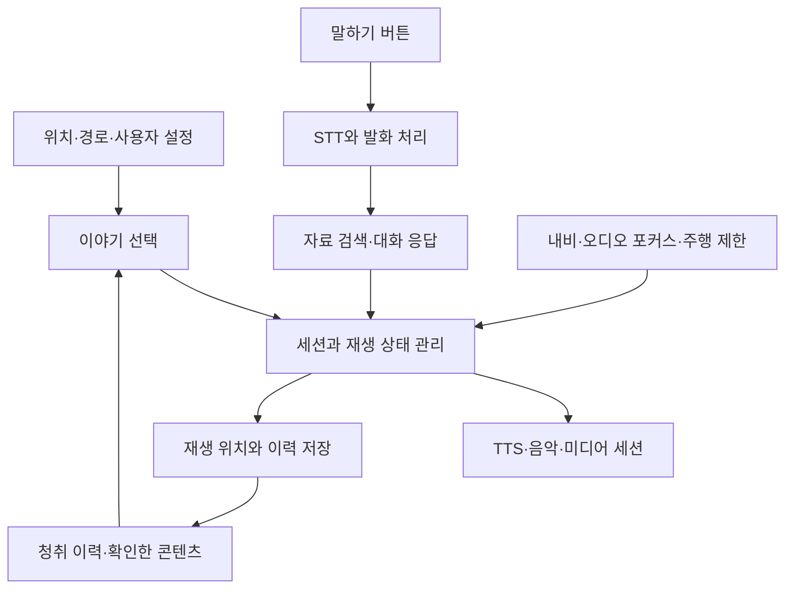

# v0.7 원본 보관 — 현행 명세 아님

2026-11-06 재구성 직전 Notion 원문. 현재 상태·정책은 v0.8 문서를 따른다.

# Petasos — 주제 기획 및 개발 검토

작성일: <date start="2026-11-05" /> (KST) · 버전: 0.7 · 브랜드: Petasos

<b>현재 상태:</b> 사용자가 이 방향으로 주제 문서화를 선택했다. 아래의 제품 원칙은 대화에서 합의한 방향이며, 세부 기능·구현 방식·일정은 개발 제안이다. SDK는 공식 문서까지 확인했으며 계정별 사용 권한, 에뮬레이터 실행, 실제 차량 연동은 아직 검증하지 않았다. 이번 사용자 결정에 따라 Gleo 생성 가능성 검증 후 불가 시 OpenRouter API로 대체하고, 문단 종료 후 사용자 입력, 주요 랜드마크 예외 삽입, 정밀 경로·대화 요약 저장, 지역·이야기 수집을 반영했다. 추가 수치와 미결정 정책은 별도 명세로 구분한다. 후속 결정으로 한 번 누르면 한 발화, 음악 중 말하기 시 일시정지, 통과 지역·청취 이야기 카드, 기기 로컬 보관을 채택했다. 사용자 발화 중 지나친 랜드마크 자동 안내는 폐기하며, 정밀 경로·대화 요약·청취·수집 기록은 보관 기한과 자동 삭제 없이 전부 유지한다. 음식점·카페는 P1 요청형 검색으로 확정하고 첫 데모에서는 제외한다. 구체적인 상태와 남은 구현 값은 19\~21절을 따른다. 21절은 공식 문서에 근거한 기술 보완이며 앱 실행 검증은 아직 완료하지 않았다. 후속 조사와 사용자 답변은 22절에 반영했다. 요약 전 인식 텍스트의 암호화 임시 보관·요약 성공 후 정리를 확정했고, 서울→대전을 대표 시나리오 기준안으로 선정했다. 비용보다 품질·응답 속도를 우선하며 필요한 API는 사용자가 발급할 수 있다.

공모전 공통 자료: <mention url="https://app.notion.com/p/16acf80747f283259d6481938eae3e02">현대자동차 공모전</mention>. 로컬 참고 자료는 <code>COMPETITION_CONTEXT.md</code>와 <code>outputs/pleos-research-2026-11-04/ideas.json</code>이다.

## 1. 주제와 해결하려는 문제

> <b>Petasos — 지나가는 지역의 이야기를 함께 듣고, 이동 자체를 즐기는 차 안의 여행 가이드.</b>

### 문제: 이동하는 동안 지나치는 장소를 알아갈 기회가 적다

출퇴근, 나들이, 장거리 여행에서 자동차 안의 시간은 목적지에 도착하기를 기다리는 시간으로 느껴질 수 있다. 여러 지역을 지나지만 표지판에서 이름만 접하고, 어떤 곳인지와 어떤 이야기가 있는지는 모른 채 지나가기도 한다. 운전자는 그때마다 검색하기 어렵고, 동승자도 미리 알지 못했던 장소의 이야기를 직접 찾아야 한다.

사용자가 예로 든 오창·망향처럼 도로 표지판이나 휴게소에서 접하는 이름은 호기심의 출발점이 될 수 있다. 실제 콘텐츠를 만들 때는 행정 지명과 시설명을 정확히 구분하고, 명칭의 유래나 지역 특징을 확인한 뒤 이야기한다. 이 문서에서는 두 명칭의 구체적인 유래를 사실로 제시하지 않는다.

이 기획의 문제는 지식을 충분히 공부하지 않는다는 데 있지 않다. <b>이동 중에 자연스럽게 즐기고, 발견하고, 함께 나눌 이야기를 만날 기회</b>에 초점을 둔다. 자동차에서 보내는 시간을 모두 무의미하다고 규정하거나 항상 생산적으로 써야 한다고 요구하지 않는다.

### 출발 경험: 여행 가이드 덕분에 즐거웠던 이동

사용자는 일본·대만 여행의 당일 투어에서 가이드가 지역의 유래, 재미있는 이야기, 여행 팁을 들려주어 이동 시간을 지루하지 않게 보낸 경험을 공유했다. 목적지에 도착하기 전부터 그곳을 이해하고 여행을 즐길 수 있었다는 경험이 이 기획의 출발점이다.

<b>제품 가설은 그 경험을 국내 자동차 이동으로 가져오는 것이다.</b> 가이드가 동행하지 않는 이동에서도 지금 지나는 곳의 이야기를 흥미롭게 들을 수 있다면, 운전자와 동승자가 이동 자체를 더 즐길 수 있을 것이다. 사용자의 개인 경험은 기획의 동기이며, 일반적인 수요·효과는 별도 검증한다. 당시 졸리지 않았다는 개인 경험을 제품의 졸음운전 방지 효과로 확대하지 않는다.

### 제품: 함께 듣는 지역 이야기, 원할 때 참여하는 대화

앱은 지역의 유래·사람들의 삶·음식·산업·문화·여행 팁 중 들려줄 만한 소재를 골라, 여행 가이드처럼 친근하게 풀어준다. 정보량보다 이야기의 재미와 이해하기 쉬운 전달을 우선한다. 운전자뿐 아니라 함께 탄 아이나 어르신도 화면을 조작하지 않고 같은 이야기를 들을 수 있는 경험을 지향한다.

기본은 듣기다. 사용자는 필요할 때만 <b>‘말하기’ 버튼으로 발언권을 얻어</b> 질문, 추억, 의견, 감상을 보탤 수 있다. 이는 가이드에게 손들고 말을 거는 경험을 돕는 기능이다. 버튼을 누르지 않아도 콘텐츠의 가치는 완성되어야 한다.

Petasos는 지금 지나가는 지역에 맞는 이야기를 기본으로 제공한다. 사용자는 듣기만 해도 즐길 수 있으며, 원할 때 대화에 참여해 질문하거나 자신의 경험을 보태고 이야기의 전개를 바꿀 수 있다.

지역 이야기가 제품의 중심이지만 매 순간 지역에 묶일 필요는 없다. 관심사에 따라 다른 이야기로 이어가고, 같은 길에서는 이미 들은 설명을 반복하지 않으며, 적절한 소재가 없거나 사용자가 원하면 듣던 음악으로 돌아간다.

- <b>핵심 이용자:</b> 자동차로 이동하면서 지나가는 곳의 이야기를 즐기고 싶은 운전자와 동승자. 아이·어르신을 포함하되 가족 전용 앱으로 한정하지 않는다.
- <b>우선 시연 상황:</b> 나들이·장거리 이동에서 처음 접하는 지역을 함께 알아가는 장면. 같은 경로의 출퇴근에서도 반복 방지와 관심사·음악 전환을 별도로 검증한다.
- <b>핵심 가치 가설:</b> 무심히 지나쳤던 장소를 알아가는 즐거움과 함께 들을 이야기를 제공해 이동 경험을 풍부하게 한다.
- <b>보조 가치:</b> 콘텐츠를 직접 찾는 부담 감소, 궁금할 때만 참여하는 대화, 반복 경로에서도 원치 않는 설명을 강요하지 않는 청취.
- <b>차량에서의 가치:</b> 실제로 지나는 지역과 이야기의 시점이 연결되고, 같은 공간의 탑승자가 함께 듣는다. 위치·경로·내비 안내·미디어 조작이 이를 뒷받침한다. 휴대폰에서 구현할 수 없다는 주장은 하지 않는다.
- <b>개인화:</b> 정밀 이동 경로와 주행 기록 지도·통계를 저장한다. 지난 대화는 원음을 보관하지 않고 LLM으로 요약하여 다음 대화와 콘텐츠 선택에 활용한다. 지역·이야기 수집, 스탬프·배지·캐릭터 등의 게이미피케이션을 검토하되 주행 중 조작 게임이나 경쟁형 미션은 제외한다.

### 기획서 도입문 초안

> 자동차로 이동하는 동안 우리는 수많은 지역을 지나지만, 그곳이 어떤 곳인지 모른 채 목적지로 향하곤 합니다. 반면 여행 가이드가 지역의 유래와 재미있는 이야기, 여행 팁을 들려주는 투어에서는 이동 시간도 여행의 즐거운 일부가 됩니다. Petasos는 이 경험을 일상의 자동차 이동으로 가져옵니다. 지금 지나가는 곳에 얽힌 이야기를 친근한 음성으로 들려주고, 궁금하면 버튼을 눌러 질문하거나 자신의 경험을 나눌 수 있습니다. 운전자부터 함께 탄 아이와 어르신까지, 지나치던 길을 알아가는 즐거움을 함께 누리는 것이 목표입니다.

## 대화에서 정한 제품 원칙

<table header-row="true">
<colgroup>
<col width="353.5" />
<col width="353.5" />
</colgroup>
<tr>
<td>
원칙
</td>
<td>
제품에 반영할 내용
</td>
</tr>
<tr>
<td>
이동 자체를 즐겁게 만드는 것이 중심이다
</td>
<td>
지역의 이야기를 재미있게 전달하는 경험을 먼저 검증한다. 버튼 대화·취향 설정·음악 전환은 이를 돕는다.
</td>
</tr>
<tr>
<td>
운전자와 동승자가 함께 듣는다
</td>
<td>
기본 대본부터 쉬운 말과 명료한 설명을 사용한다. 참여나 학습 성과를 요구하지 않는다.
</td>
</tr>
<tr>
<td>
아무 말도 하지 않아도 된다
</td>
<td>
질문에 답하거나 대화를 유지하지 않아도 완결된 콘텐츠를 들을 수 있다.
</td>
</tr>
<tr>
<td>
버튼을 누르면 내 이야기도 한다
</td>
<td>
버튼은 검색이나 질의응답에 한정되지 않는 ‘말하기’다. 가이드에게 손을 드는 느낌을 지향한다.
</td>
</tr>
<tr>
<td>
지역 이야기를 중심에 두되 억지로 묶지 않는다
</td>
<td>
주변 장소에서 관심사로 연결하고, 익숙한 길에서는 다른 이야기나 음악도 선택한다.
</td>
</tr>
<tr>
<td>
같은 길에서 같은 설명을 강요하지 않는다
</td>
<td>
들은 주제는 제외하거나 다른 주제를 고른다. 적절한 소재가 없으면 음악을 유지한다.
</td>
</tr>
<tr>
<td>
앱이 계속 말할 필요는 없다
</td>
<td>
음악과 조용한 시간도 정상적인 사용 상태다. 침묵을 실패로 보지 않는다.
</td>
</tr>
<tr>
<td>
발화와 콘텐츠 제작을 사용자에게 떠넘기지 않는다
</td>
<td>
이용자 사연 모집이나 운전자 커뮤니티 없이도 처음부터 작동해야 한다.
</td>
</tr>
<tr>
<td>
‘이음’은 공통 재생 기능이다
</td>
<td>
안내·통화 등으로 끊긴 이야기를 적절히 이어주는 기능으로 사용한다. 별도 주제로 포장하지 않는다.
</td>
</tr>
</table>

## 3. 대표 사용 경험

### A. 처음 지나는 지역이 궁금해지는 이동

1. Petasos를 시작한다. 기본 구성으로 바로 들을 수 있고, 원하면 관심사와 이야기 빈도를 설정한다.
2. 지역을 지나면서 ‘이곳은 왜 이런 이름일까?’, ‘어떤 사람들이 어떤 일을 하며 살아왔을까?’처럼 호기심을 만드는 이야기로 시작한다. 사용자에게 답을 요구하는 퀴즈는 아니다.
3. 확인한 유래·지역 생활·음식·산업 이야기 중 하나를 풀어준다. 관심사에 따라 항구에서 음식 운송이나 무역으로 연결하는 식의 전개도 가능하다.
4. 사용자가 반응하지 않아도 이야기 자체가 마무리된다. 매번 질문하고 답을 기다리지 않는다.
5. 지역이 바뀌었다는 이유만으로 진행 중인 이야기를 끝내지는 않는다. 다만 주요 랜드마크가 주변에 있을 때는 예외적으로 짧은 설명을 끼워 넣을 수 있다. 이미 지나쳐 의미가 없어진 안내는 건너뛰며, 데모는 선정한 주요 랜드마크만 현재 문단 뒤에 삽입한다. 사용자 발화를 끊지 않으며, 발화 중 지나친 지점의 자동 안내는 폐기한다. 반경과 중복 안내 간격은 실행 검증으로 정한다.

위 소재 연결은 기획 예시다. 실제 대본은 사실 확인과 출처 연결을 거쳐 작성한다.

### B. 손들듯 버튼을 눌러 내 이야기하기

1. 시장에 관한 이야기를 듣다가 사용자가 ‘말하기’를 누른다.
2. 앱은 현재 문단을 끝내고 하던 말을 자연스럽게 마무리하는 짧은 연결 문장을 덧붙인 뒤, 질문이나 경험을 말할 수 있도록 유도한다. 음성 입력이 준비되면 짧은 소리와 상태 표시로 알린다. 버튼 접수와 실제 입력 시작을 구분한다.
3. 사용자가 “우리 할머니도 시장에서 국밥집 하셨는데”라고 이야기한다.
4. 앱은 개인적인 경험을 먼저 받아준다. 곧바로 국밥의 역사를 설명하거나 사용자의 기억을 임의로 만들어내지 않는다.
5. 사용자와 상호작용한 뒤 LLM이 대화 내용·현재 경로·재생 이력을 보고 복귀 위치 또는 새 주제를 판단하고, 자연스러운 연결 문장으로 이어간다. 사용자에게 매번 같은 시작 부분을 반복하지 않는다.

### C. 같은 출근길에서 다른 이야기 또는 음악

어제 들은 지역 설명을 오늘 다시 재생하지 않는다. 새로운 관심사 이야기가 있으면 선택하고, 사용자가 음악을 원하거나 좋은 이야깃거리가 없으면 음악을 유지한다. 새로운 장소나 키워드가 생겨도 음악을 반복해서 중단하지 않는다.

### D. 안내와 통화로 끊긴 이야기

플랫폼에서 제공하는 오디오·내비 이벤트에 따라 재생을 조정한다. 통화와 정지는 재개 가능한 중단으로 처리하고 실제 재생 위치와 중단 이유를 보존한다. 재개 시점의 상황을 LLM에 전달하여 복귀 위치와 연결 문장을 판단한다. 사용자 정지는 명시적인 재개 요청 전까지 유지한다. 통화 종료 후에는 재생 의도가 유지되고 오디오 포커스가 회복된 경우에 재개한다. 다른 앱으로 전환한 경우의 세부 정책은 실행 검증으로 정한다.

### E. 아이·어르신과 함께 듣는 이동

같은 차에 탄 사람들이 같은 지역 이야기를 듣는다. 아이는 낯선 장소를 알아가고, 어르신은 자신의 경험을 떠올려 이야기할 수 있다. 앱이 세대별 반응을 가정하거나 발화를 요구하지는 않는다. 쉬운 용어와 명료한 발음, 짧게 완결되는 설명을 기본으로 하고, 자세한 이야기는 요청했을 때 이어간다. 여러 세대가 함께 듣는 가치와 별도의 가족 모드 구현은 구분한다.

## 4. 버튼 대화의 구체적인 설계

<b>확정된 진입 순서는 ‘말하기 요청 → 현재 문단 완료 → 자연스러운 마무리·발화 유도 → 음성 입력 → 상호작용 → 자연스러운 이야기 재개’다.</b> 버튼을 누른 뒤 계속 누르고 있을 필요는 없다. 데모는 버튼 한 번에 발화 한 번을 받고, 응답 후 마이크를 닫은 상태로 청취에 복귀한다. 다시 말하고 싶으면 버튼을 다시 누른다. 자유 연속 대화는 확장안으로 남긴다.

위의 진입 순서와 한 발화 방식은 확정 사항이다. 음악 중 말하기 요청은 곡을 일시정지하고 입력 준비 안내 후 발화를 받는다. 입력 대기·입력 중 재입력은 취소로 처리하며, 답변 중 새 말하기 등 세부 동작은 21.2절을 따른다.

<table header-row="true">
<colgroup>
<col width="353.5" />
<col width="353.5" />
</colgroup>
<tr>
<td>
항목
</td>
<td>
기본 동작
</td>
</tr>
<tr>
<td>
버튼 명칭
</td>
<td>
‘말하기’. 시각적인 손 모양은 사용할 수 있지만 실제 손동작 인식은 하지 않는다.
</td>
</tr>
<tr>
<td>
입력 시작
</td>
<td>
현재 문단과 마무리·유도 문장을 끝낸 뒤 STT request()를 호출한다. 실제 준비/인식 시작 이벤트를 확인하여 입력 가능 신호를 준다. 그 전에는 아직 듣고 있지 않음을 표시한다.
</td>
</tr>
<tr>
<td>
입력 종료
</td>
<td>
최종 인식 결과·인식 종료 이벤트를 처리하고 마이크를 닫는다. 무음·취소·오류도 종료 경로를 가진다.
</td>
</tr>
<tr>
<td>
두 번 누르기
</td>
<td>
짧은 중복 입력은 디바운스한다. 입력 대기 중 또는 입력 중 다시 누르면 현재 입력을 취소한다. 답변 중 새 말하기와 취소 후 복귀는 21.2\~21.3절을 따른다.
</td>
</tr>
<tr>
<td>
질문
</td>
<td>
방금 들은 내용과 출처를 바탕으로 답하고, 부족한 정보는 단정하지 않는다.
</td>
</tr>
<tr>
<td>
개인 경험·감상
</td>
<td>
경험을 받아주고 관련 대화를 이어간다. 사용자의 발화를 외부 사실의 근거로 삼지 않는다.
</td>
</tr>
<tr>
<td>
재생 요청
</td>
<td>
‘다음 이야기’, ‘음악으로’, ‘그만’, ‘다시 들려줘’는 앱이 허용한 동작으로 처리한다.
</td>
</tr>
<tr>
<td>
새로운 주제
</td>
<td>
관심사 콘텐츠나 근거를 확보한 답변으로 전환한다. 지역으로 억지로 돌아오지 않는다.
</td>
</tr>
<tr>
<td>
응답 뒤
</td>
<td>
응답 뒤 마이크를 자동으로 다시 열지 않고 청취로 복귀한다. 다음 발화는 새로운 버튼 입력으로 시작한다. 후속 발화를 강요하는 질문을 상습적으로 붙이지 않는다.
</td>
</tr>
<tr>
<td>
입력 실패
</td>
<td>
짧게 알리고 이전 청취 상태로 돌아간다. 자동 재시도로 입력을 반복하지 않는다.
</td>
</tr>
</table>

<b>물리 버튼은 우선 기술 검증 항목이다.</b> 공식 미디어 가이드는 핸들 키의 기본 재생 제어를 설명하지만 임의의 버튼을 앱 전용 음성 입력에 할당할 수 있다고 보장하지 않는다. Vehicle의 SteeringWheel API에도 현재 확인한 목록에는 각도·열선 기능이 있으며 버튼 재매핑은 확인되지 않았다. 초기 검증은 앱의 큰 ‘말하기’ 버튼으로 수행하고, 허용되는 하드웨어 입력 경로를 별도로 확인한다. 기본 재생·일시정지·다음 버튼의 의미를 임의로 바꾸지 않는다. [미디어 가이드](https://document.pleos.ai/en/docs/pleos-only/vehicle-app-developer-guide/music-audio-app-developement-guide), [SteeringWheel API](https://document.pleos.ai/docs/pleos-only/connect-sdk-pleos/Vehicle/vehicle/ai.pleos.playground.vehicle.api/steering-wheel/entry)

## 5. 무엇을 말하고, 언제 음악으로 돌아갈 것인가

### 콘텐츠 선택 순서

1. 사용자의 정지·음악·주제 변경 요청을 우선한다.
2. 이야기나 대화가 진행 중이면 기본적으로 흐름을 유지한다. 단순 지역 변경은 중단 사유가 아니지만, 주요 랜드마크는 예외적으로 짧게 끼어들 수 있다. 사용자가 말하는 동안에는 삽입하지 않는다. 발화 종료 시 이미 지나친 지점의 자동 안내는 폐기하고, 여전히 유효한 지점만 다음 재생 후보로 남긴다.
3. 다음 이야기를 고를 때 현재 지나는 지역에서 들려줄 만한 소재를 먼저 검토하고, 관심사·이전 청취·사실 근거·이야기 길이를 함께 확인한다. 사용자가 특정 주제를 선택했다면 그 의도를 따른다.
4. 적절한 지역 소재가 없으면 지역과 무관한 관심사 콘텐츠도 후보에 넣는다.
5. 좋은 후보가 없거나 이야기 빈도를 이미 채웠으면 음악을 이어가거나 기다린다. 일반적인 음악→이야기 전환은 현재 곡을 끝까지 들은 뒤 수행한다. 다음 이야기가 곡 도중 준비되어도 그 곡을 먼저 마친다. 통화·정지와 명시적인 말하기 요청은 곡 종료를 기다리지 않고 일시정지할 수 있다. 랜드마크 자동 안내는 곡을 중간에 끊지 않는다.

<b>이야기 길이 원칙:</b> 사용자의 흥미가 끊기지 않을 정도로 짧게 구성한다. 기존 45\~90초는 실험 후보이며 확정 길이가 아니다. 16절의 30분은 이동·편성 예시이지 한 이야기의 길이가 아니다. 전체 이야기와 사용자가 기다려야 하는 문단의 최대 길이를 각각 정한다. 지나가는 모든 장소를 설명하지 않는다.

### 반복 방지와 취향

- 장소 ID뿐 아니라 주제 ID·핵심 질문·사용한 사실을 기록한다. 같은 내용을 말투만 바꿔 새 이야기로 취급하지 않는다.
- 주제·문장 단위 재생 이력과 사용자가 직접 한 넘기기·더 듣기 요청을 구분한다.
- 끝까지 재생됐다는 이유만으로 좋아하거나 이해했다고 단정하지 않는다. 위치를 지나쳤다는 사실도 청취 완료와 다르다.
- 처음 입력한 키워드는 수정·삭제할 수 있다. 발화에서 추측한 취향을 조용히 영구 저장하지 않는다.
- 장소를 확인할 수 없으면 ‘지금 보이는 건물’이라고 말하지 않는다. 좌표로 확인한 인근 지역과 실제 시야를 구분한다.

### 음악 연동은 두 단계로 검증

| 범위 | 목표 | 구현·검증 방침 |
| --- | --- | --- |
| 앱 내부 음악 | 일반 이야기 전환은 곡 완료 후 수행. 통화·정지로 끊긴 음악은 재개 가능 | 사용 권리를 확보한 데모 음원으로 먼저 구현한다. 재생 위치와 사용자의 정지 의도를 직접 관리할 수 있다. |
| 다른 앱에서 듣던 음악 | 사용자가 실제로 듣던 음악으로 돌아가기 | 외부 앱별 허용 API·미디어 세션·포커스 반응을 검증한다. 자동 재개가 안 되면 명시적 미디어 전환 경로를 제공한다. |

외부 음악 복귀는 제품이 지향하는 경험에 포함한다. 다만 내부 음원 시연을 외부 스트리밍 앱 연동이 완료된 것처럼 제시하지 않는다. 다른 앱의 곡 종료 시점이나 재생 위치를 읽을 수 없다면 ‘곡이 끝날 때만 이야기 시작’도 보장할 수 없다.

오디오 포커스는 충돌을 조정하는 장치이며, 모든 음악 앱을 원하는 곡·위치로 제어하는 권한은 아니다. 우리 앱의 콘텐츠 유형에 맞는 오디오 속성을 사용하고, 우선권을 얻기 위해 일반 해설을 내비 안내나 긴급음으로 위장하지 않는다. [Pleos Audio Focus](https://document.pleos.ai/en/docs/pleos-only/vehicle-app-developer-guide/audio-focus-development-guide/audio-focus-development)

## 6. Pleos SDK와 플랫폼 기능의 연결

아래의 ‘확인’은 2026-11-05 공식 문서 확인이다. 실제 사용 가능 여부 및 품질을 의미하지 않는다.

| 기능 | 공식 문서에서 확인한 수단 | 제품에서의 용도 | 추가 검증 |
| --- | --- | --- | --- |
| 위치 | FusedLocation 1.1.3: 마지막 위치, 위치 구독, 영역 진입·이탈 | 이야기 후보 지역 선택 | isSupported(), 권한, 위치 신선도·정확도, 에뮬레이터 이벤트 |
| 이동 경로 | NaviHelper 3.0.5: 경로·목적지·위치·TBT 관련 이벤트 | 경로 변경 시 후보 갱신, 도착 전 새 긴 이야기 제한 | 실제 제공 이벤트, 잔여 시간 필드, 내비 앱별 차이 |
| 음성 출력 | TextToSpeech 3.3.1: 초기화·합성·재생·중지 | 해설과 대화 응답 음성 | 한국어 품질, 지연, 완료 콜백, 오디오 포커스와의 관계 |
| 버튼 음성 입력 | SpeechToText 3.3.1: request(), stop(), 결과 리스너 | 요청한 순간만 사용자 발화 입력 | 한국어 자유 발화, 소음, 인식 종료, 긴 발화, 동시 발화 |
| 차량 상태 | Vehicle 2.3.2 / Service 2.3.21: capability·조회·구독 | 지원되는 상태를 콘텐츠 시작 판단에 보조 사용 | 필요한 상태의 실제 API·권한을 먼저 확인. 차량 제어는 핵심 범위에서 제외 |
| 기본 미디어 제어 | MediaSession 및 미디어 탐색 서비스 | 백그라운드 재생, 시스템 미디어 조작 | Media3 서비스와 Pleos 미디어 브라우저의 호환성 |
| 주행 화면 제한 | CarUxRestrictions | 주행 시 글·입력·설정 표시 조정 | 지역·플랫폼이 전달하는 ActiveRestrictions 반영 |
| Gleo 앱 명령 | App Schema 및 action/callback | 라디오 시작·정지·다음 이야기·저장 등 앱 기능 호출 | 스키마 등록·검토 및 에뮬레이터 반영 |

출처: [FusedLocation](https://document.pleos.ai/docs/pleos-only/connect-sdk-pleos/FusedLocation/intro), [NaviHelper](https://document.pleos.ai/docs/pleos-only/connect-sdk-pleos/NaviHelper/intro), [Navi 이벤트](https://document.pleos.ai/docs/pleos-only/connect-sdk-pleos/NaviHelper/event-listeners), [TTS](https://document.pleos.ai/docs/pleos-only/connect-sdk-pleos/TextToSpeech/intro), [STT](https://document.pleos.ai/docs/pleos-only/connect-sdk-pleos/SpeechToText/intro), [Vehicle](https://document.pleos.ai/docs/pleos-only/connect-sdk-pleos/Vehicle/intro), [주행 제한](https://document.pleos.ai/en/docs/pleos-only/vehicle-app-developer-guide/driving-restriction-development-guide).

### 구현 전에 풀어야 할 문서상 불확실성

1. <b>SDK 제공 상태:</b> SDK 개별 기능 문서는 있지만 신청 안내는 FusedLocation·TTS·STT·Vehicle Control을 준비 중, Vehicle State·NaviHelper를 사용 가능으로 표시한다. 계정과 설치된 서비스에서 확인한다. [사용 신청 안내](https://document.pleos.ai/docs/pleos-only/create-my-project)
2. <b>온디바이스 음성과 AI 대화는 별개:</b> TTS/STT는 ON\_DEVICE 모드를 설명하지만, 이것이 생성형 AI 응답도 오프라인으로 된다는 뜻은 아니다. 서버 음성 모드는 별도 앱 등록·연결 조건을 갖는다.
3. <b>STT와 명령 실행은 별개:</b> STT는 인식 문자열을 돌려준다. 앱 동작 선택과 대화 문맥 관리는 우리 앱이 구현한다. request()는 차량 마이크 인식을 시작하고 stop()은 종료한다. [인식 시작·종료](https://document.pleos.ai/docs/pleos-only/connect-sdk-pleos/SpeechToText/start-and-stop), [인식 이벤트](https://document.pleos.ai/docs/pleos-only/connect-sdk-pleos/SpeechToText/result-listeners)
4. <b>생성 엔진 선택:</b> 먼저 Gleo AI로 필요한 콘텐츠 생성·대화 상호작용이 가능한지 검증한다. 공식 앱 함수 연동 설명만으로 자유 생성 API가 제공된다고 단정하지 않는다. 요구 기능을 구현할 수 없으면 우선 OpenRouter API로 대체한다. 두 경로를 같은 생성 인터페이스 뒤에 두고, Gleo 앱 명령 연동의 역할과 구분한다. [Gleo 개념](https://document.pleos.ai/docs/pleos-only/app-integration-guide/guide/core-concepts), [스키마 전달](https://document.pleos.ai/docs/pleos-only/app-integration-guide/guide/deliver-schema)
5. <b>내비 이벤트와 오디오 이벤트:</b> 모든 내비 발화가 반드시 포커스 상실을 만들지는 않는다. 실제 콜백을 관찰하고 구현 가능한 중단·감쇠·재개 정책을 정한다. ‘회전 몇 초 전 자동 정지’는 필요한 필드가 확인될 때만 약속한다.

Music/Audio 분류를 우선 검토한다. 브랜드는 Petasos로 통일하고, 실제 제공 형태에 맞춰 에피소드와 음악의 미디어 탐색 구조를 구분한다. 앱 연결만으로 무조건 재생하지 않고 사용자의 시작 또는 시스템 재개 요청에서 세션을 시작한다. 미디어 서비스는 Media3 기반 후보로 잡고, 공식 가이드의 MBS 호환 요구를 에뮬레이터에서 확인한다. [Music/Audio 개발 가이드](https://document.pleos.ai/en/docs/pleos-only/vehicle-app-developer-guide/music-audio-app-developement-guide)

## 7. 콘텐츠와 대화의 품질을 만드는 방법

### 확보할 수 있는 원천

| 원천 | 확인한 제공 범위 | 활용 제안 |
| --- | --- | --- |
| [한국관광공사 국문 관광정보](https://www.data.go.kr/data/15101578/openapi.do) | 지역·위치·키워드 기반 관광정보, 상세 정보 등 | 장소 후보와 좌표·기본 설명. 실제 필드·호출량은 키 발급 후 확인 |
| [관광지 오디오 가이드정보](https://www.data.go.kr/data/15101971/openapi.do) | 오디의 음성·대본·사진, 위치·키워드 기반 정보 | 지역 이야기의 근거 및 참고 구조 |
| [관광 스토리텔링 DB](https://www.data.go.kr/data/3041768/fileData.do) | 스팟·오디오명·대본·재생시간을 포함한 1,624행 파일 | 초기 소규모 대본 검토. 전체 행 수가 서로 다른 한국어 이야기 수를 뜻하지는 않음 |
| 주제별 기관·박물관·연구기관 자료 | 소재에 맞춰 개별 확인 필요 | 음식·과학·경제·문화로 연결할 근거 |

관광 스토리텔링 파일은 2016년 기준 자료로 표시되어 있다. 페이지 수정일이 최신이라고 내용 전체가 최신이라는 뜻은 아니다. 공공데이터의 제공 조건과 원천별 표시·변형·재배포 조건을 기록한다. 국문 관광정보의 사진은 별도 조건이 안내되어 있으므로 텍스트와 동일하게 취급하지 않는다. 초기 제품은 사진 없이도 성립한다.

### 제작 흐름

1. 처음에는 한 경로의 장소 5곳과 관심사 3개만 선정한다.
2. 이야기마다 ‘핵심 질문 하나 → 확인한 사실 → 흥미로운 연결 → 짧은 마무리’를 작성한다. ‘이곳의 이름은 어디서 왔을까’, ‘왜 이 산업이나 음식이 자리 잡았을까’처럼 지역을 이해하는 소재를 우선한다.
3. 사실마다 출처 URL과 확인 날짜를 연결하고, 전승·설화·의견은 사실 설명과 구분한다.
4. 편집한 대본을 소리 내어 검토한다. 도입이 길거나 지명을 나열하는 대본은 줄인다. 어려운 용어는 풀어 말하고, 지역을 모르는 동승자도 이해할 수 있는지 확인한다.
5. AI는 근거 자료를 바탕으로 표현과 연결을 조정한다. 사실 생성과 말투 생성을 구분한다.
6. 자유 질문은 확보한 자료에서 답하고, 근거가 부족하면 한계를 짧게 밝힌다. 출처가 있다는 이유만으로 모든 생성 문장을 검증됐다고 표시하지 않는다.

여행 팁은 이야기와 관련된 맥락에서 선택적으로 제공한다. 운영시간·요금처럼 바뀌는 정보는 확인 날짜와 최신성을 관리한다. ‘유명한 맛집’ 같은 평가나 지명 유래를 근거 없이 단정하지 않으며, 앱이 모든 이야기를 방문·예약·구매 권유로 끝내지 않게 한다.

지역·관심사별 콘텐츠 후보를 미리 준비하되 짧은 문단 단위로 재생한다. 사용자 대화, 랜드마크 삽입, 경로 변경 이후의 연결 문장은 상황에 맞게 생성한다. 미래 위치를 시간만으로 확정하지 않고 재생 직전에 실제 경로·위치를 다시 확인한다. 생성 엔진은 Gleo 기능 검증 후, 불가하면 OpenRouter API를 우선 사용한다.

### 최소 데이터 항목

- <b>이야기:</b> ID, 주제 ID, 장소 ID(선택), 관심사 태그, 핵심 질문, 사실·출처 연결, 대본 버전, 예상 길이, 음원·문장 경계, 확인 날짜.
- <b>재생 이력:</b> 재생된 문장·구간, 중단 이유, 마지막 위치, 사용자의 명시적인 넘기기·저장·더 듣기.
- <b>설정:</b> 사용자가 선택한 키워드, 이야기 빈도, 음성 설정, 위치 사용 선택.
- <b>대화:</b> 현재 세션 문맥, LLM으로 요약한 과거 대화, 해당 요약의 출처 세션·날짜. 원음은 저장하지 않는다. 아직 재생하지 않은 대본을 이미 들었다고 가정하지 않는다.
- <b>경로:</b> 시각·좌표·위치 정확도를 포함한 정밀 이동 경로와 경로 버전, 통과 지역 및 거리 집계. 데모는 기기에 저장하고 클라우드 동기화는 하지 않는다. 정밀 경로·대화 요약·청취·수집 기록은 보관 기한을 두지 않고 전부 유지하며 자동 삭제하지 않는다.

## 8. 앱 구조와 재생 상태

다음은 구현 제안이며 작성된 코드 구조가 아니다.

| 상태 | 의미 | 중요한 전환 |
| --- | --- | --- |
| 대기/종료 | 사용자 시작을 기다리거나 세션이 종료됨 | 위치 이벤트만으로 무조건 재생하지 않음 |
| 이야기 재생 | 지역 또는 관심사 이야기 청취 | 버튼 → 현재 문단·연결 문장 완료 → 입력, 주요 랜드마크 → 조건부 삽입, 통화·정지 → 중단 |
| 음악 | 내부 음악 재생 또는 검증된 외부 미디어 전환 | 다음 이야기 준비 시 현재 곡 완료 후 전환. 통화·정지는 즉시 중단. 말하기 요청은 음악 일시정지 후 음성 입력 |
| 음성 입력 | 사용자가 요청한 발화 수신 | 완료 → 응답 준비, 취소·오류 → 입력 종료 |
| 응답 준비/재생 | 생성 결과를 기다리거나 답변 청취 | 취소·정지·새 요청이 들어오면 오래된 결과 폐기 |
| 재개 가능한 중단 | 통화 또는 사용자 정지 | 중단 이유·재생 위치를 저장하고, 재개 조건 충족 후 LLM의 복귀 판단을 적용 |

‘사용자가 정지함’, ‘통화’, ‘다른 앱으로 전환함’을 별도 이유로 저장한다. 통화·정지는 재개 가능한 중단이다. 경로가 바뀌면 이전 경로에 의존하는 예약 콘텐츠를 폐기하고 자연스럽게 화제를 전환한다. 일반 설명은 현재 문단 뒤에 자연스럽게 전환하고, 현재 위치를 잘못 가리키는 설명은 더 빨리 정리한다. 비동기 STT·생성·TTS 결과에는 세션/요청/경로 버전을 붙여 폐기된 결과가 뒤늦게 재생되지 않게 한다.

장문 TTS를 통째로 읽기보다 문단·음악 트랙 등의 콘텐츠 객체로 관리한다. LLM은 현재 상황·과거 대화 요약·재생 이력·유효한 경로를 바탕으로 돌아올 위치와 연결 문장을 판단한다. 앱은 반환된 대상 ID가 존재하고 현재 경로에 유효한지 확인한 뒤 실행한다. 통화·정지 처리는 생성 응답이나 콘텐츠 목록 순서를 기다리지 않는 별도 제어 경로로 둔다. TTS는 문단 완료 checkpoint를 기본으로 사용하며 정확한 offset·seek·음원 파일 확보는 미확인 기능이다. 음악은 플레이어가 제공하는 재생 위치로 복원한다. 상세 규칙은 21.2절을 따른다.

## 9. 부가 기능의 우선순위

| 우선순위 | 기능 | 이유 |
| --- | --- | --- |
| P0 | 가이드처럼 재미있게 들려주는 지역 이야기 | 제품의 중심 가치. 버튼을 한 번도 누르지 않아도 성립해야 함 |
| P0 | 함께 듣기 쉬운 대본과 음성 | 아이·어르신을 포함한 동승자의 경험을 기본 콘텐츠에서 고려 |
| P0 | 관심사 이야기·음악으로 자연스러운 전환 | 익숙한 길과 콘텐츠 공백에서도 강제 해설을 피함 |
| P0 | 말하기 버튼, 질문·개인 경험·재생 요청 처리 | 사용자가 참여하는 방식 |
| P0 | 청취 이력과 중복 방지 | 같은 길에서 반복 설명을 줄임 |
| P0 | 내비·오디오 중단 처리와 적절한 재개 | 차량에서 청취 흐름 유지 |
| P0 | 권리 확보한 내부 음원으로 복귀 | 음악 전환 경험을 확실히 검증 |
| P0 | 기본 미디어 제어·주행 화면 제한·권한 거부 처리 | 차량 앱의 필수 동작 기반 |
| P1 | 사용자 요청형 음식점·카페 검색 | 별도 검색 결과·원문 링크로 제공. 첫 데모 제외, 검색 결과의 AI 입력 제외 |
| P1 | 외부 음악 앱 복귀 | 실제 사용에서 중요한 기술 검증 과제. 초기부터 가능성을 확인하되 성공 전에는 지원을 약속하지 않음 |
| P1 | 물리 버튼으로 말하기 | 시선·조작 부담을 줄일 후보. 허용된 입력 연결 여부를 먼저 확인 |
| P0 | Gleo 생성 가능성 검증과 OpenRouter 대체 경로 | 생성·대화 엔진의 구현 가능성 우선 확보 |
| P0 | 정밀 이동 경로·대화 요약 저장 및 활용 | 경로 지도, 반복 이동 대응, 과거 대화 문맥 활용 |
| P1 | Gleo 명령 연결 | 생성 엔진 선택과 별도로 앱 실행·정지·다음·저장 명령 연동 |
| P1 | ‘이 이야기 저장’과 도착 후 출처 보기 | 운전 중 자세히 볼 필요 없이 나중에 확인 |
| P1 | 사용자 선택 사전 다운로드 확장 | P0는 배포한 준비 콘텐츠·내부 음악과 실패 안내로 기본 단절 대응. 다운로드 관리 기능은 P1 |
| P0 | 통과 지역·들은 이야기 카드 수집 | 자동 적립을 데모에 포함. 칭호·캐릭터·도로 수·거리 배지는 확장안 |
| P2 | 가족별 세부 설정, 다국어, 여러 경로 | 기본적인 공동 청취는 P0. 별도 연령별 모드는 추후 검토하며 좌석 신호로 나이·신원을 추정하지 않음 |
| 확장안·데모 제외 | ccNC 테마 보상 | 장기 구상으로만 보존하며 실제 시스템 연동 가능성 별도 검증 |
| 보류 | 여러 AI 진행자, 실시간 뉴스, 자유 연속 대화 | 제작·검증·지연·운영 부담을 늘림. 한 명의 좋은 진행자로 먼저 검증 |
| 제외 | 주행 중 조작 게임·경쟁형 미션, 운전자 사연 커뮤니티, 일정 비서, 감정·피로 진단, 차량 분위기 제어 | 지역·이야기 수집은 포함하되 이 범위와 구분 |

## 10. 운영에서 고려할 요소

- <b>주행 중 UI:</b> 현재 재생 상태와 최소 조작에 집중한다. 긴 대본·출처 열람·키워드 편집은 플랫폼 주행 제한에 맞춘다. 속도가 0이라는 이유만으로 주차 상태라고 판단하지 않는다. 음성 경험도 주의를 요구할 수 있으므로 ‘오디오라서 안전하다’고 주장하지 않는다.
- <b>마이크와 기록:</b> 버튼을 누른 세션에서만 입력한다. 원음은 저장하지 않으며, 대화는 LLM 요약으로 저장·활용한다. 외부 음성·AI 서비스의 전송·보관 정책은 별도로 확인한다. 원음 미저장과 외부 전송 없음은 다르다.
- <b>취향과 개인 이야기:</b> 정밀 이동 경로와 지난 대화의 LLM 요약을 저장하고 다음 이용에 활용한다. 데모는 기기 로컬에 보관 기한 없이 전부 저장하고 자동 삭제와 클라우드 동기화는 적용하지 않는다. 대화 기억은 차량/세션 공용이며 개인을 자동 식별하지 않는다. 화자 식별 전에는 동승자의 발화를 운전자 개인의 취향으로 확정하지 않는다.
- <b>서버 역할:</b> 콘텐츠 근거 검색, 대화 생성, 비용 제한을 담당한다. 일반 모델 서비스의 서버 키를 APK에 넣지 않는다. SDK 인증 정보는 공식 등록 방식과 별도로 관리한다.
- <b>권한·통신 실패:</b> 위치 거부 시 관심사 이야기·음악은 유지한다. 통신 단절 시 캐시 콘텐츠를 재생하고 새로운 자유 질문은 처리 가능한 범위를 알린다. 실패를 일반 답변처럼 꾸미지 않는다.
- <b>비용:</b> ‘회차당 콘텐츠 생성·합성 비용 + 발화당 인식·생성 비용 + 저장·전송 비용’을 기록한다. 준비된 이야기 재사용과 명시적 발화에만 실시간 호출하는 방식으로 관리한다. 아직 실제 단가·사용량·월 비용을 산출하지 않았다.
- <b>확장 사업:</b> 반복 이용과 지불 의사를 확인한 뒤 콘텐츠 팩이나 구독을 검토한다. 초기에는 광고를 넣어 지역 이야기의 선정 기준을 흐리지 않는다. 확보하지 않은 제휴나 MAU를 실적으로 제시하지 않는다.

## 11. 기존 서비스와 심사 관점

공개 소개 자료 기준 비교이며 실제 앱의 완성도나 성능을 평가한 결과가 아니다.

| 선행 사례 | 이미 제시된 기능 | 우리 기획에서 검증할 차이 |
| --- | --- | --- |
| [Roadio — 차창 밖 이야기](https://github.com/WhoisHOO/pleos-app-challenge) | 경로에 따른 장소 이야기와 차량 미디어 재생 | 함께 듣고 싶은 이야기의 전달, 관심사 전개, 사용자의 경험 참여, 음악으로 물러나는 흐름 |
| [Road Docent](https://github.com/728haven-oss/road-docent) | 대화체 지역 해설, 심화 설명, 이동 상황별 콘텐츠 | 관광 코스 외의 반복 출퇴근, 자유 발화 이후의 이야기 변화 |
| [Passenger Seat](https://www.passengerseat.app/features) | 위치 기반 해설, 스타일 선택, 이전 이야기 반복 방지 | 반복 방지만으로는 차별화가 안 됨. 듣기·참여·음악 전환의 실제 경험을 비교 |
| [HearHere History](https://www.hearherehistory.com/) | 장소 이야기와 후속 질문 | 질의응답 이외의 개인 경험·감상까지 자연스럽게 수용하는지 검증 |

<b>여행 가이드 경험을 재현한다는 동기는 필요성을 설명하지만, 그 자체가 새로운 기능이라는 뜻은 아니다.</b> 먼저 듣고 싶은 지역 이야기와 공동 청취 경험을 만들고, 이야기 선택·대화 반응·음악 복귀로 완성도를 높이는 것이 현재의 경쟁 전략이다. 차별성이 충분한지는 시연과 사용자 비교 전까지 미확정이다.

| 공식 평가 항목 | 제출물에서 보여줄 내용 | 현재 약점과 검증 |
| --- | --- | --- |
| 차량특화성 | 지금 지나는 지역을 탑승자가 함께 알아가며, 이동·미디어 흐름에 맞춰 이야기를 들음 | 위치만 붙인 모바일 앱에 머물지 않도록 통합 시연 필요 |
| 창의성 | 가이드의 이야기처럼 듣다가 경험을 보태면 전개가 바뀌고, 필요 없을 때 음악을 유지 | 기존 가이드와 기능 중복이 큼. 동기와 차별성의 증거를 구분해 검증 |
| 기술 활용성 | FusedLocation·NaviHelper·음성·미디어 제어가 핵심 경험에 기여 | 계정/서비스 지원 상태와 실제 동작 확인 필요 |
| 사업성 | 나들이·장거리 이동의 공동 청취 수요와 반복 경로에서의 재사용 이유 | 여행 때만 쓰는 앱에 머무는지, 음악·팟캐스트 대비 선택 이유와 비용·지불 의사 검증 필요 |

세부 배점은 공개되어 있지 않다. [공식 심사 기준](https://appdevchallenge.auto-hmg.io/guide/judging-awards)

## 13. 검증과 시연

### 기술 검증 — 아직 수행하지 않은 체크리스트

- [ ] 계정에서 SDK 상태 확인, 설치된 에뮬레이터·서비스 버전 기록.
- [ ] 위치 수신과 위치 없음/오래된 위치/지원 불가 처리.
- [ ] 내비 목적지·경로 변경·도착 및 실제 전달 필드 확인.
- [ ] 버튼 입력 후 STT 준비→시작→최종 결과→마이크 종료 확인.
- [ ] 짧은 명령뿐 아니라 한국어 개인 경험 발화도 인식되는지 확인.
- [ ] 사용자가 정지·취소한 후 늦게 도착한 AI/TTS 결과가 재생되지 않는지 확인.
- [ ] 앱 내부 음악의 곡 완료 후 이야기 전환, 통화·정지 뒤 음악 재개와 수동 정지 의도 보존.
- [ ] 외부 음악 앱에서 포커스 상실·복귀·앱 전환을 별도 측정.
- [ ] 내비 안내·통화·다른 미디어·주행 제한 상황에서 실제 이벤트와 반응 기록.
- [ ] 백그라운드 재생, 시스템 기본 미디어 조작, 프로세스 복원 확인.
- [ ] 물리 버튼의 사용자 정의 입력 허용 범위 확인. 불가하면 지원 기능에서 제외.

반응 시간은 버튼→입력 준비, 발화 종료→첫 응답 음성으로 나눠 중앙값과 느린 경우를 기록한다. 아직 달성한 지연 수치나 인식률은 없다.

### 경험 검증

초기 5\~8명에게 정차·동승·시뮬레이션 환경에서 음악만 듣기, 고정 해설 듣기, 본 앱 듣기를 비교하게 한다. 작은 탐색 평가이며 시장 수요나 운전 안전성을 입증하는 연구로 제시하지 않는다.

관찰할 것은 ‘질문을 많이 했는가’나 ‘지역 정보를 얼마나 외웠는가’가 아니다. 말없이 들어도 재미있는지, 지나가는 장소에 관심이 생기는지, 동승자와 함께 듣기 좋은지, 다시 켜고 싶은지, 원치 않는 끼어들기가 있는지를 확인한다. 버튼 동작과 마이크 종료 이해도도 별도로 본다. 실제 반복 사용은 이후 여러 날짜의 재사용으로 따로 측정한다.

## 16. 구현 계획 — 사용자 결정 반영

### 콘텐츠 생성과 경로 편성

1. 관심사는 유래·사람들의 삶·음식·산업·문화·여행·스포츠·이슈 등이며 설정은 선택 사항이다.
2. 지역 정보와 이야기의 근거 자료는 공공데이터·기관 자료·서비스를 조사하여 확보한다. 네이버 지도는 지도·장소·경로 중 실제 지원 범위를 확인한 뒤 연결한다.
3. 앞으로 지날 지역의 콘텐츠 후보를 준비하고, 실제 위치·경로와 준비 상태를 보고 재생한다. 서울→이천→평창의 ‘30분’은 편성 예시이며 이야기 길이의 요구사항이 아니다.
4. 이야기 길이는 흥미를 잃지 않도록 구성한다. 문단 단위로 끊어 재생하며, 전체 길이와 문단 최대 길이는 청취 평가로 정한다.
5. 단순 지역 변경만으로 하던 이야기를 끝내지 않는다. 선정한 주요 랜드마크가 주변에 있으면 현재 문단 뒤에 예외적으로 짧게 삽입할 수 있다. 사용자 발화 중에는 삽입하지 않고, 그동안 지나친 지점의 자동 안내는 폐기한다. 음악은 곡 완료 규칙을 유지한다. 위치만으로 실제로 보이는 건물이라고 단정하지 않는다.
6. 말하기 버튼을 누르면 현재 문단을 끝내고 자연스러운 마무리·유도 문장을 추가한 뒤 사용자 입력을 받는다. 상호작용 후에는 LLM이 상황에 맞는 복귀 위치와 연결 문장을 판단한다.
7. 이야기 문단·음악·연결 문장 등을 공통 콘텐츠 객체로 관리한다. 순서와 분기·합류를 표현하되, 통화·정지 등의 제어 이벤트는 콘텐츠 순서를 기다리지 않고 처리한다.
8. 음악에서 이야기로의 일반 전환은 현재 곡을 끝까지 들은 뒤 수행한다. 다음 이야기가 중간에 준비돼도 현재 곡은 완료한다. 통화·정지는 재개 가능한 중단으로 처리한다. 명시적인 말하기 요청도 음악을 일시정지하고 발화를 받는 예외다.
9. 경로 변경 시 이전 경로에 의존하는 예정 콘텐츠를 폐기하고 자연스럽게 화제를 전환한다. 단순히 예정 시간이 지났다는 이유로 다음 지역에 도착한 것으로 처리하지 않는다.
10. Gleo AI로 콘텐츠 생성·대화 상호작용이 가능한지 먼저 검증한다. 요구 기능 구현이 불가능하면 우선 OpenRouter API로 대체한다. 앱 명령 연동과 자유 생성 엔진의 역할은 구분한다.

### 기록과 게이미피케이션

- 정밀 이동 경로를 저장하여 가본 길·지역 지도와 이동 거리 등 통계를 구성한다. 데모는 경로·대화 요약·청취·수집 기록을 기기에 보관 기한 없이 전부 유지하고 자동 삭제하지 않는다. 클라우드 동기화는 제외한다.
- 지난 대화는 원음을 저장하지 않고 LLM 요약으로 저장·활용한다. 이야기·대화 요약 모음집을 제공할 수 있다.
- 데모는 통과한 지역과 들은 이야기의 카드를 자동 수집한다. 스탬프, 지역별 마스코트·로고, 배지·캐릭터·칭호는 확장안으로 둔다.
- 검토할 수집 조건은 이동 거리, 통과·방문 지역 수, 도로 수, 지역별 방문 횟수, 자연·특정 주제 애호가 등이다. 통과와 실제 방문의 판정은 구분해 정한다.
- 주행 중 조작 게임이나 경쟁형 미션은 제외한다.
- 일정 횟수 이용 시 ccNC 테마를 제공하는 구상은 확장안으로 남기며 데모에는 구현하지 않는다.
- 브랜드 이름은 Petasos로 통일한다.

## 17. 이야기 근거자료 조사와 확보 계획

조사 기준일: <date start="2026-11-05" />. 아래는 공식 문서에서 확인한 제공 범위와 활용 제안이다. 실제 인증키 발급, API 응답 검증, 콘텐츠 일괄 수집은 아직 수행하지 않았다.

<b>권장 구성:</b> 오디의 해설 대본 + TourAPI의 장소·위치 정보로 시작하고, 국가유산청·한국민족문화대백과사전으로 역사와 지명 이야기를 보강한다. 모든 지역에서 충분한 이야기가 확보된다고 가정하지 않는다.

### 17.1. 사용할 수 있는 자료

| 자료 | 확인한 제공 내용 | Petasos에서의 역할 | 접근·이용 조건과 남은 확인 |
| --- | --- | --- | --- |
| [한국관광공사 오디 API](https://www.data.go.kr/data/15101971/openapi.do) | 관광 해설 대본·음성·사진, 관광지와 이야기의 위치·키워드 검색 | <b>1순위 이야기 원천</b>. 근거가 있는 해설을 대화형 대본으로 구성 | 무료, JSON/XML, 개발 자동승인·운영 심의. 포털상 이용허락범위 제한 없음. 실제 응답의 언어·위치·대본·음원 필드 확인 필요 |
| [한국관광공사 국문 관광정보 API](https://www.data.go.kr/data/15101578/openapi.do) | 지역·위치·키워드 검색, 장소 상세·소개·행사 정보 | <b>1순위 장소 후보·좌표·기본 사실</b>. 오디 이야기와 장소를 연결 | 무료, JSON/XML, 개발 자동승인·운영 심의. 사진은 공공누리 1·3유형 등이 별도로 적용되므로 텍스트와 분리 |
| [국가유산청 전국 지정문화재 현황](https://www.data.go.kr/data/15034324/openapi.do) | 목록·위치·상세 설명 등 | 주요 랜드마크, 문화유산·역사 이야기 보강 | 무료 XML/LINK API. [공식 명세](https://www.khs.go.kr/html/HtmlPage.do?mn=NS_04_04_03&pg=%2Fpublicinfo%2Fpbinfo3_0202.jsp)에 목록·상세 조회와 식별자 명시. 좌표 0은 위치 없음으로 처리 |
| [한국민족문화대백과사전](https://encykorea.aks.ac.kr/Guide/OpenApiUse) | 한국 문화·역사·지리의 항목 콘텐츠, OpenAPI 신청 경로 | 지명, 인물, 산업·문화 배경을 설명하는 <b>보강 자료</b> | API 인증키 신청 필요. [공식 이용 안내](https://www.aks.ac.kr/com/cmm/EgovContentView.do?menuNo=4010164000)는 본문 텍스트를 공공누리 1유형으로 안내. 항목명·기관 출처 표시. 사진은 별도 유형 확인 |
| [관광 스토리텔링 DB 파일](https://www.data.go.kr/data/3041768/fileData.do) | 스팟 ID·명칭·대본·재생시간 등 1,624행 CSV | 키 발급 전 대본 구조와 초기 콘텐츠를 검토하는 보조 자료 | 파일은 로그인 없이 다운로드 가능하다고 안내. 2016년 기준 자료이므로 변동 정보 재확인. 1,624개 한국어 이야기라는 뜻은 아님 |
| [한국향토문화전자대전](https://gimcheon.grandculture.net/korea/Guide/Policy)·지자체 향토 자료 | 세부 지명·마을·지역 생활사 자료 후보 | 오창처럼 관광명소 밖의 지역을 다룰 때 선택적으로 보완 | 항목별 공공누리 유형을 확인. 변경금지·미표시 자료를 일괄 재작성용으로 수집하지 않음. 전자대전의 범용 수집 API는 이번 조사에서 확인하지 못함 |

TourAPI와 오디는 포털에 개발계정 트래픽 1,000으로 표시되어 있다. 신청 시 실제 일일 한도와 증설 조건을 확인한다. 운영시간·가격·행사 일정은 역사적 배경과 다른 갱신 주기로 관리한다.

자료 확보와 이야기 완성은 구분한다. 대본이 이미 있는 오디도 Petasos의 관심사 연결, 사용자 경험에 대한 반응, 중단 이후 복귀까지 제공하는 것은 아니다. 이것이 자체 콘텐츠 편성과 대화 로직이 필요한 부분이다.

### 17.2. 초기 콘텐츠 확보 절차 — 개발 제안

1. 시연 경로 1개를 고르고 통과 지역·랜드마크 5곳을 정한다. 오창·망향을 쓰려면 행정 지명, 시설명, 실제 이동 위치를 먼저 구분한다.
2. 장소마다 대표 이야기 1개와 다른 관심사로 이어지는 이야기 1개씩, <b>총 10개를 초기 검토 목표</b>로 삼는다. 실제 확보 수량이 아니다.
3. 원천 ID·URL·기관·확인일·이용 조건·좌표·핵심 사실을 저장한다. 서로 다른 서비스의 ID를 동일하다고 가정하지 않고 장소 연결표를 만든다.
4. 문장별 근거를 연결하고, 설화·전승은 그렇게 소개한다. 출처에 없는 지명 유래나 인과관계를 LLM이 보충하지 않도록 한다.
5. 원문을 통째로 읽지 않고 질문·발견·짧은 설명으로 편집한다. 지역과 관련 없는 관심사 이야기에도 별도 근거 자료가 있어야 한다.
6. 근거가 부족한 장소에서는 다른 확인된 주제 또는 음악으로 전환한다. 확보한 경로 밖의 전국 서비스 가능성을 데모 성과로 주장하지 않는다.

## 18. Gleo·OpenRouter 및 네이버 연계 검토

### 18.1. Gleo 콘텐츠 생성 검토 결과

<b>공개 문서만으로 Petasos가 요구하는 자유 생성 API는 확인되지 않았다. 불가능하다고 확정한 것은 아니다.</b> [Gleo Interface](https://document.pleos.ai/docs/pleos-only/app-integration-guide/guide/core-concepts)는 사용자의 음성 명령으로 앱 함수를 호출하고 앱의 결과를 받아 응답하는 구조다. 이 응답 생성과, 앱이 먼저 이야기 생성을 요청해 문단·재개 위치·발화 타이밍을 통제하는 기능은 구분해야 한다.

문서에서 추가 확인한 제약:

- [App Schema](https://document.pleos.ai/docs/pleos-only/app-integration-guide/guide/app-capability): actionCalls 최대 3개, 설명은 영어, 지원하는 파라미터 형식에 제한이 있다. 여러 앱 명령을 나열한 기획을 그대로 함수 수로 옮기지 않는다.
- [Callback Schema](https://document.pleos.ai/docs/pleos-only/app-integration-guide/guide/action_callback): Action은 7초 후 타임아웃으로 취소된다. 앱이 자체 음성을 내보낼 때 silent 모드를 사용할 수 있다. 일반 생성 작업의 완료 시간을 이 안에 보장한다고 가정하지 않는다.
- [스키마 전달](https://document.pleos.ai/docs/pleos-only/app-integration-guide/guide/deliver-schema): assets/schema.json과 Action 수신 설정, 스키마 검토·승인 절차가 안내되어 있다.

<b>Gleo 검증 항목:</b> 앱에서 먼저 생성 요청을 보낼 수 있는지, 근거 자료·지난 대화 요약을 입력할 수 있는지, 생성 텍스트/구조화 결과를 앱이 받을 수 있는지, 문단별 재생·취소·복귀를 앱이 제어할 수 있는지. 담당자 답변 또는 실행 가능한 샘플로 확인한다. 전부 충족하지 못하면 사용자 결정에 따라 생성 엔진을 OpenRouter로 대체한다.

<b>현재 개발 추천:</b> 공개적으로 확인 가능한 OpenRouter를 우선 연결할 수 있게 엔진을 분리하고, Gleo는 앱 실행·재생 제어 같은 명령 연결부터 검증한다. 이는 Gleo가 제공하지 않는 기능을 있다고 전제하지 않으면서 개발을 진행하기 위한 제안이다.

### 18.2. OpenRouter 대체 구현

[공식 시작 가이드](https://openrouter.ai/docs/quickstart)와 [구조화 출력](https://openrouter.ai/docs/guides/features/structured-outputs) 문서에서 일반 텍스트 생성과 JSON Schema 출력 경로를 확인했다. Chat Completions의 /api/v1/chat/completions에 response\_format을 주는 방식을 구현 후보로 둔다. 모델·제공자별 지원이 달라 require\_parameters 설정과 앱 측 결과 검증이 필요하다.

- Android 앱 → Petasos 서버 → OpenRouter 구조를 제안한다. 일반 서버 API 키를 APK에 넣지 않는다.
- 내부 인터페이스는 generateStory, replyToUser, planResume, summarizeConversation으로 나눈다. <b>이 이름은 Petasos 설계안이며 공식 SDK 메서드가 아니다.</b>
- 주 모델·대체 모델은 한국어 청취 품질, 첫 응답 지연, 구조화 출력, 비용을 같은 예제로 비교한 뒤 고른다. 현재 특정 모델이나 비용을 확정하지 않는다.
- [제공자 라우팅](https://openrouter.ai/docs/guides/routing/provider-selection)에서 data\_collection: deny, zdr: true 등을 검토한다. [현재 ZDR 안내](https://openrouter.ai/docs/guides/features/zdr)상 Safety Retention 허용 여부는 계정·가드레일 설정의 영향도 받으므로 zdr 하나로 완전한 무보관을 보장한다고 쓰지 않는다.
- 정밀 경로를 저장하는 것과 전체 좌표 이력을 매번 LLM에 보내는 것은 별개다. 기본 입력은 현재 지역·관련 장소·필요한 대화 요약으로 제한하는 설계를 권장한다.

### 18.3. 네이버에서 연결할 부분

| 기능 | 활용 가능성 | Petasos 적용 제안 |
| --- | --- | --- |
| [Mobile Dynamic Map](https://navermaps.github.io/android-map-sdk/guide-ko/0.html) | Android 지도, 위치·마커·경로선 표시 | 직접 수집한 이동 경로와 지역·이야기 수집 결과를 도착 후 지도에 표시. Pleos AAOS 실행·앱 심사 적합성은 별도 검증 |
| [Reverse Geocoding](https://api.ncloud-docs.com/docs/application-maps-reversegeocoding) | 좌표를 법정동·행정동·주소로 변환 | 현재 지역명 확인 후보. 위치마다 무조건 호출하지 않고 지역 변화 감지와 호출 예산을 설계. 결과 저장·재사용 조건은 Maps 계약 기준으로 확인 |
| [Directions 5](https://api.ncloud-docs.com/docs/application-maps-directions5) | 출발·도착·경유지에 따른 자동차 경로·거리·소요시간 | 목적지가 있는 경우 예상 경로를 계산하는 보조 후보. 차량 내비가 실제 선택한 경로와 같다고 가정하지 않음 |
| [지역 검색](https://api.ncloud-docs.com/docs/naver-api-hub-search-local) | 업체·기관 이름, 주소·분류·좌표 등 키워드 검색 | 필요한 경우 별도 검색 결과 화면. 전국 이야기 수집이나 리뷰 원문 확보 수단으로 사용하지 않음 |
| 지도 앱 URL Scheme | 설치된 네이버 지도 앱 호출 | 휴대전화 확장안 후보. Pleos에 해당 앱이 설치·지원된다는 전제는 두지 않음 |

<b>검색 데이터의 AI 입력은 제외한다.</b> [네이버 개발자센터 현행 약관](https://developers.naver.com/products/terms/)의 검색 API 특약 2.3은 데이터를 AI에 입력하거나 학습·개선·평가 등에 사용하는 것을 금지한다. 제한적인 임시 캐시는 2.4의 예외가 있으므로 모든 일시 저장까지 금지된다고 단순화하지 않는다. 이야기 생성용 DB·임베딩·요약 입력과는 구분된다.

같은 약관의 경과조치에 따라 신규 검색 API 신청은 NAVER API HUB로 이관되었다. 새 프로젝트는 [Hub 신청 안내](https://guide.ncloud-docs.com/docs/apihub-application)를 기준으로 봐야 한다. 후속 조사에서 [NAVER API HUB 공식 약관 개정 공지](https://www.ncloud.com/support/notice/all/2243)를 확인했다. Hub 검색 API도 결과를 AI에 입력하는 것을 금지하며, 독립적인 검색결과 표시와 제한된 임시 캐시만 명시한 범위에서 허용한다. 따라서 Hub 결과를 LLM·임베딩·이야기 요약에 넣지 않는다. <b>Maps와 검색 API의 약관도 서로 동일하다고 취급하지 않는다.</b>

권장 범위는 <b>실제 위치·주행 맥락은 Pleos, 이야기 근거는 공공·기관 자료, 네이버는 지도 표시 등 보조 기능</b>이다. 처음부터 네이버를 이야기 생성의 필수 의존성으로 두지 않는다. Maps 요금은 사용하는 API·대표 계정 여부·호출량에 따라 산정해야 하며 현재 예산은 미산정이다.

### 18.4. 음식점·카페 정보 활용 — P1 확장 기능

<b>제품 제안:</b> 음식점·카페는 사용자가 원할 때 찾아보는 부가 기능으로 두는 것이 적합하다. 지역 음식 이야기를 듣다가 “그럼 어디서 먹을 수 있어?”라고 물으면 장소 탐색으로 연결한다. 기본 이야기마다 가게를 소개하거나 경로 변경을 권하지 않는다. 사용자가 이 방향을 채택했으며 P1 확장 기능으로 확정했다. 첫 데모에는 포함하지 않는다.

[네이버 지역 검색 API](https://api.ncloud-docs.com/docs/naver-api-hub-search-local)는 음식점·카페를 검색할 수 있고, 상호·분류·주소·좌표·설명·상세 링크를 반환한다. 결과는 최대 5개이고, 확인한 요청 필드는 키워드 중심으로 GPS 반경 검색을 직접 제공하지 않는다. 확인한 응답에는 리뷰 본문·평점·메뉴 가격·영업시간·대기시간이 없으며 전화번호 필드는 값을 반환하지 않는다. 리뷰 개수순 정렬이 맛의 품질이나 실제 방문 추천을 검증하지는 않는다.

<b>채택 범위:</b> 데모는 지도 표시·지역 확인을 우선한다. 음식점·카페는 사용자 요청형 P1 검색으로 두고, 네이버를 사용한다면 출처와 원문 링크를 갖춘 별도 검색 결과 화면에서 원래 결과를 표시한다. 결과를 LLM에 넣어 요약·재정렬·추천하거나 개인화 기억에 복사하지 않는다. 음성으로 결과를 읽는 방식도 일반 검색결과 표시와 동일하게 허용된다고 가정하지 않고 별도로 확인한다.

대화 속에서 실제 음식점까지 자연스럽게 설명하고 싶다면 [TourAPI](https://www.data.go.kr/data/15101578/openapi.do)나 직접 이용권리를 확보한 장소 자료에서 해당 지역 음식점의 정보·좌표·갱신일을 먼저 검증하는 방안을 검토한다. 전국 음식점·카페의 충분한 정보가 확보됐다고 전제하지 않는다. 지역 음식의 유래를 설명하는 기능과 특정 가게를 추천하는 기능은 별개로 평가한다.

## 19. 확정한 기본안과 남은 구현 값

사용자가 이전 추천안을 채택했다. 다음 표의 방향은 확정이며, 구체적인 장소·모델·판정 수치와 실행 검증 결과는 별도로 채운다.

| 항목 | 확정한 기본안 | 남은 구현 값 |
| --- | --- | --- |
| 시연 범위 | 서울→대전 대표 시나리오, 5개 지역·장소 묶음과 이야기 소재 10개를 기준안으로 선정 | 22.2절의 소재·근거로 실제 경로·좌표·권리·대본 확정 필요. 서울/대전 시내는 확장 후보 |
| 대화 단위 | 버튼 1회→발화 1회→응답→청취 복귀. 응답 뒤 마이크 자동 재개 없음 | 취소 규칙·타임아웃 시작값은 21.2절, 실제 이벤트 순서·지연 측정 필요 |
| 음악 중 말하기 | 명시적 말하기 요청은 음악을 일시정지하고 입력받음. 자동 이야기 전환은 곡 완료 후 | 실제 재생 위치 복원·이벤트 검증 |
| 랜드마크 | 선정한 주요 지점을 현재 문단 뒤에만 자동 삽입. 사용자 발화를 끊지 않음. 발화 중 지나치면 자동 안내 폐기. 음악은 곡 완료 규칙 유지 | 접근/통과 판정·유효기간·중복 안내 간격 |
| 이야기 길이 | 문단 10\~15초·이야기 45\~90초를 실험 시작값으로 채택. 청취 평가로 조정 | 실제 음성 길이·흥미·버튼 대기 시간 측정 |
| 통화·정지 | 통화 종료·포커스 회복 후 재생 의도가 유지되면 재개. 수동 정지는 재개 요청까지 유지 | 플랫폼 이벤트와 외부 미디어 간섭 확인 |
| 경로 변경 | 이전 경로 의존 예약·생성 결과는 폐기. 일반 설명은 문단 뒤 전환, 잘못된 현재 위치 설명은 더 빨리 정리 | 취소·전환 경계와 지연 측정 |
| 기록 보관 | 정밀 경로·대화 요약·청취·수집 기록은 기기에 기한 없이 전부 보관. 자동 삭제·데모 기록 삭제 기능·클라우드 동기화 없음. 원음 미저장 | 요약 전 텍스트 암호화 임시 보관·성공 후 정리는 확정. 22.4절에 복구 규칙, 수신 주기·용량은 실측 |
| 기억 범위 | 차량/세션 공용 기억. 화자 자동 식별과 개인별 기억 분리 제외 | 서로 다른 탑승자의 주장·취향 충돌 처리 |
| 수집 | 통과한 지역과 들은 이야기 카드를 자동 적립 | 21.5절의 지역 코드·필수 문단 완료·고유 키 기준 적용. 경계 판정 수치와 원천 데이터 확인 필요 |
| 음악·버튼 | 권리 확보한 내부 음원과 화면 말하기 버튼으로 데모 | Carefree를 음원 후보로 조사. 실제 파일·곡별 권리 확인 후 채택. 외부 음악·물리 버튼은 검증 후 확장 |
| 모델·오프라인 | 한국어 품질 비교 후 주/대체 모델 선정. 오프라인은 준비된 콘텐츠·음악과 사용 가능한 온디바이스 음성 범위 | Sonnet 4.6·Gemini 2.5 Flash 비교 후 모델 확정, 실제 온디바이스 지원 검증. 비용은 현재 선정 제약 아님 |

<b>폐기와 기록 보관의 구분:</b> 지나친 랜드마크의 안내는 재생 대기열에서 제거하거나 만료 처리하며 뒤늦게 자동 안내하지 않는다. 콘텐츠 원천과 여행·대화 기록을 삭제한다는 의미가 아니다. 사용자가 지나간 장소를 직접 질문하면 확보한 근거로 답할 수 있다.

기본 관심사·안내 빈도·반복 기준의 초기 구현안은 21.7절에 정리했다. 키워드를 선택하지 않아도 기본 지역 이야기를 들을 수 있다. 음식점·카페는 18.4절의 P1 요청형 검색으로 확정하며 첫 데모에서 제외한다.

## 20. 개발 명세 초안과 필요한 정보

### 20.1. 모듈과 책임

- <b>차량 연결:</b> 위치와 내비 이벤트, 주행 화면 제한을 정규화한다. 권한 없음·지원 불가·오래된 좌표도 이벤트로 표현한다.
- <b>근거 저장소:</b> 기관 자료와 출처·권리를 관리하고 장소·관심사별로 검색한다.
- <b>이야기 편성:</b> 들은 주제, 현재 맥락, 랜드마크, 관심사로 다음 콘텐츠 후보를 고른다.
- <b>대화·생성 엔진:</b> 근거를 이용한 대본, 답변, 요약, 복귀 계획을 생성한다.
- <b>재생 제어:</b> 이야기·음악·입력·중단 상태와 우선순위를 관리한다. 통화·정지 처리는 LLM을 기다리지 않는다.
- <b>기록·수집:</b> 정밀 이동 경로, 실제 청취 이력, 대화 요약과 수집 조건을 저장한다.

### 20.2. 데이터 모델에 적을 필드

다음은 논리 모델 초안이며 실제 데이터베이스 테이블·타입·필수값은 구현 시 확정한다.

<table header-row="true">
<colgroup>
<col width="353.5" />
<col width="353.5" />
</colgroup>
<tr>
<td>
모델
</td>
<td>
최소 필드
</td>
</tr>
<tr>
<td>
SourceEvidence
</td>
<td>
sourceId, provider, sourceUrl, title, fetchedAt, sourceUpdatedAt, license, allowedUses, attribution, contentHash, 검토 상태
</td>
</tr>
<tr>
<td>
Place
</td>
<td>
placeId, 기관별 원천 ID 연결표, 이름·별칭, 행정 지역, WGS84 좌표, 좌표 정확도/근거, landmarkRank
</td>
</tr>
<tr>
<td>
Story
</td>
<td>
storyId, placeId/regionId, topicId, interestTags, claim별 sourceIds, 사실/전승 구분, scriptVersion, paragraphs, 예상 길이, 유효기간
</td>
</tr>
<tr>
<td>
ContentItem
</td>
<td>
contentId, kind(story/music/transition), sessionId, requestId, cancelEpoch, routeDependency(none/routeVersion), storyId, paragraphId, text, audioRef(nullable), status, expiresAt
</td>
</tr>
<tr>
<td>
Trip / RoutePoint
</td>
<td>
tripId, 기록 시작·종료·종료 사유, sourceTimestamp와 확인된 단위, receivedAt, latitude/longitude, accuracyMeters(nullable·지원 확인 필요), providerConfidence, qualityStatus, 위치 제공자, routeVersion. 예상 경로와 실제 수신 위치 기록은 별도
</td>
</tr>
<tr>
<td>
PlaybackCheckpoint
</td>
<td>
contentId, paragraphId, lastCompletedParagraphId, musicPositionMs(nullable), speechOffset(nullable·기본 미지원), 재생 확인 상태(completed/partial\_unknown), interruptionReasons, playIntent, 중단 시각
</td>
</tr>
<tr>
<td>
ConversationSummary
</td>
<td>
summaryId, tripId, profileScope, summary, 사용자 주장/검증 사실 구분, 미해결 질문, 원천 turnId·turnVersion, createdAt, summaryVersion, summaryStatus(pending/saved/failed/interrupted). 영구 요약 자동 삭제 없음
</td>
</tr>
<tr>
<td>
PendingConversation
</td>
<td>
turnId, tripId, turnVersion, ciphertext, nonce, keyVersion, createdAt, summaryStatus, attemptCount, 실제 응답 재생 이력 참조. 요약 저장 성공 후에만 임시 텍스트 정리
</td>
</tr>
<tr>
<td>
CollectionRecord
</td>
<td>
collectionType, regionId/storyId, 판정 규칙 버전, 근거 tripId/청취 이력, 획득 시각, 중복 방지 키
</td>
</tr>
<tr>
<td>
ResumePlan
</td>
<td>
resume/skip/switch/wait, 유효한 targetContentId와 paragraphId, transitionText, reason, sessionId, requestId, cancelEpoch, routeDependency(none/routeVersion)
</td>
</tr>
</table>

원음은 저장 필드를 만들지 않는다. 영구 대화 기록의 기본 단위는 LLM 요약이다. 정밀 경로·모든 대화 요약·청취 이력·수집 기록은 기기에 보관 기한 없이 전부 유지하며, 데모에는 자동 만료와 기록 삭제 기능을 두지 않는다. 클라우드 동기화는 하지 않는다. 일시적인 STT 버퍼와 처리용 원문 텍스트는 영구 기록 대상과 구분한다. 최종 인식 텍스트는 암호화 임시 보관하고 요약 저장 성공 후 정리하는 예외를 사용자가 채택했다. 실패한 요약의 원문을 먼저 지우지 않으며 22.4절의 복구 규칙을 따른다. 이 보관 규칙은 앱 자체 기록에 적용하며, 외부 검색 데이터의 보관 조건까지 바꾸지는 않는다.

### 20.3. 재생·대화 이벤트 규칙

| 이벤트 | 확정 규칙 또는 구현안 | 반드시 남길 상태 |
| --- | --- | --- |
| 단순 지역 경계 통과 | 현재 이야기 지속 가능. 다음 후보만 갱신 | 현재 지역, 후보 갱신 시각 |
| 말하기 요청 | 요청 접수 표시→현재 문단 완료→마무리/유도 문장 완료→STT request()→실제 준비/시작 이벤트 확인→입력 가능 표시 | pendingTalk, 문단 ID, STT 준비/시작 상태, turnId |
| 발화 종료 | 입력 종료→응답→LLM 복귀 계획→유효성 확인 후 이어 듣기 | turn ID, 실제 들은 이력, 요약, 복귀 대상 |
| 주요 랜드마크 접근 | 선정한 지점을 현재 문단 뒤 삽입. 사용자 발화 중에는 대기하고 지나치면 폐기. 음악은 곡 완료 후에도 유효할 때만 삽입 | 위치 정확도, 접근 방향, 만료 시점, 이미 안내했는지 |
| 다음 이야기 준비 | 음악 중이면 현재 곡의 완료 이벤트를 기다림 | track ID, 다음 콘텐츠 준비 상태 |
| 통화 / 사용자 정지 | 재생·입력 중단, 재개 가능한 checkpoint 보관. 사용자 정지는 다른 중단 사유가 해제되어도 유지 | 차단 사유 집합, playIntent, interactionIntent, 입력 취소 상태 |
| 경로 변경 | 이전 경로에 의존하는 예약·생성 결과 폐기, 자연스러운 전환 준비 | 새 routeVersion, 취소된 request ID |
| 네트워크/생성 실패 | 확보된 콘텐츠 또는 음악/대기로 전환하는 복구안. 실패한 답변을 만들어내지 않음 | 실패 단계, 재시도 횟수, fallback 이유 |

재개 시 LLM에는 실제로 재생된 내용과 유효한 후보 ID만 전달한다. 존재하지 않는 콘텐츠·폐기된 경로·이미 취소된 요청을 가리킨 결과는 앱이 거부한다. LLM이 실패하면 고정 checkpoint 복귀 또는 대기로 처리하는 복구 정책을 정한다. 재생 가능 여부는 앱이 판단하고, 이야기상 어디로 돌아갈지는 LLM이 판단한다.

### 20.4. 생성·검색 계약

- <b>입력:</b> 현재 지역과 위치 신뢰도, 유효 경로 맥락, 사용자 선택 관심사, 실제 청취 이력, 관련 대화 요약, 사용 가능한 근거 목록.
- <b>출력:</b> 문단 목록, 문단별 sourceIds, 예상 길이, 연결 문장, 다음 이야기 후보 또는 복귀 계획. 음원 길이를 제공받으면 보정하고, 그렇지 않으면 TTS 시작·완료 이벤트의 실제 재생 시간으로 추정치를 보정한다. 합성 파일을 얻을 수 있다고 전제하지 않는다.
- <b>사실 기준:</b> 근거에 없는 내용을 확정적 사실로 만들지 않는다. ‘근처에 있음’과 ‘차창에서 보임’을 구분한다. 사용자가 말한 경험은 공인된 지역 사실로 저장하지 않는다.
- <b>구조 검증:</b> 타입·필수값·ID 존재·세션/요청/경로 버전·길이 한도를 앱에서 확인한다. JSON Schema 통과가 사실 검증을 의미하지는 않는다.
- <b>취소와 재시도:</b> 새 요청·정지·경로 변경마다 이전 요청의 유효성을 재판정한다. 늦게 도착한 응답이나 TTS가 저절로 재생되지 않아야 한다.
- <b>성능과 비용:</b> 버튼→입력 가능, 발화 종료→첫 응답 음성, 이야기 준비→재생 가능을 별도 측정한다. 모델·입출력 토큰·합성량·API 호출량을 여행별로 집계하되 개인 대화·좌표를 일반 오류 로그에 복제하지 않는다.

### 20.5. 위치·경로와 수집 판정

수신 위치는 제공자 시각·수신 시각·확인 가능한 품질 정보와 함께 저장한다. SDK가 미터 단위 정확도를 제공한다고 전제하지 않는다. 기록 시작·종료, 터널/좌표 튐/권한 해제, 프로세스 종료 후 복구는 21.5\~21.6절을 따른다. 정밀 위치를 수집한다는 결정과 모든 점이 정확하다는 주장은 다르다.

지역 경계 부근에서는 한 번의 좌표로 반복 진입을 판정하지 않도록 재확인·중복 억제 규칙이 필요하다. 랜드마크 반경만으로 실제 접근 방향이나 도로 연결성을 보장하지 않는다. 예상 경로가 없으면 현재 위치 기반 모드로 작동한다.

‘통과’는 유효한 위치 기록, ‘들은 이야기’는 필수 문단의 정상 재생 완료로 판정하며 상세 기준은 21.5절을 따른다. ‘방문’은 별도 체류·정차 기준이 필요하다. 고유 도로 수는 도로 구간 데이터와 GPS 매칭이 필요하므로 경로 점 개수로 대체하지 않는다. 좌표계·지역코드·동일 장소 연결 규칙과 데이터 권리를 먼저 확정한다.

### 20.6. SDK 실행 검증과 준비할 정보

| 준비할 정보 | 확인 목적 |
| --- | --- |
| Pleos 프로젝트·패키지명, 에뮬레이터/서비스 버전, SDK별 계정 상태 | 실제 지원 기능과 실행 환경 고정 |
| 위치·내비·TTS·STT 최소 호출 결과와 이벤트 예제 | 문서와 실행 차이, null·미지원·권한 실패 처리 |
| Gleo 앱 연동 승인 상태와 생성 기능 답변/샘플 | 생성 엔진 선택과 명령 연동 범위 결정 |
| 공공데이터포털의 TourAPI·오디 활용신청 상태와 인증키 설정 위치 | 실제 필드·응답·한도 확인 |
| 필요 시 한국민족문화대백과사전 API 키 | 보강 자료 검색·본문 취득 범위 확인 |
| OpenRouter 서버 키, 사용 가능한 모델, 제공자 보관 설정, 예산 | 생성 PoC와 비용 측정 |
| 네이버 Maps 사용 항목·앱 식별 설정·요금 조건 | 지도 실행과 호출량 산정. 검색 API 키와 혼용하지 않음 |
| 시연 경로, 내부 음원과 이용권리, 초기 이야기 목록 | 재현 가능한 데모 구성 |
| 로컬 저장 구조·기록 시작/종료·용량과 장애 복구 | 기한 없이 전체 보관·자동 삭제 없음·차량/세션 공용 기억·클라우드 동기화 제외를 구현 |

[FusedLocation](https://document.pleos.ai/docs/pleos-only/connect-sdk-pleos/FusedLocation/intro)은 지원 여부와 오래된/null 위치를 처리해야 한다. [NaviHelper](https://document.pleos.ai/docs/pleos-only/connect-sdk-pleos/NaviHelper/intro)의 실제 이벤트는 내비 앱 구현·상태에 따라 달라질 수 있다. [SDK 신청 안내](https://document.pleos.ai/docs/pleos-only/create-my-project)는 일부 SDK를 준비 중으로 표시하므로 기능 문서의 존재만으로 계정에서 실행된다고 확정하지 않는다.

[TTS](https://document.pleos.ai/docs/pleos-only/connect-sdk-pleos/TextToSpeech/intro)·[STT](https://document.pleos.ai/docs/pleos-only/connect-sdk-pleos/SpeechToText/intro)의 서버 모드는 앱 등록이 필요하다. OpenRouter는 이 음성 SDK의 대체가 아니라 이야기·대화 생성의 대체다. 외부 음악의 곡 완료 감지·일시정지·복귀와 물리 버튼 매핑도 각각 실행 검증한다.

### 20.7. 구현 순서와 완료 판단

1. <b>연결 검증:</b> 위치·내비·TTS·STT·LLM을 각각 최소 예제로 확인한다. 사용할 수 없는 기능은 실제 지원 대안과 데모 모의 기능을 구분한다.
2. <b>콘텐츠 세로 흐름:</b> 실제 근거 1건→대본→문단 재생→버튼 발화→답변→이야기 복귀를 연결한다.
3. <b>중단 처리:</b> 통화, 정지, 경로 변경, 늦은 생성 결과, 음악 곡 완료를 재현한다.
4. <b>기억과 반복 사용:</b> 정밀 경로·요약·청취 이력을 저장하고, 다음 실행에서 이야기 선택이 달라지는지 확인한다.
5. <b>수집과 지도:</b> 합의한 획득 기준으로 적립하고 도착 후 기록을 확인한다.
6. <b>시연 통합:</b> 처음 가는 길, 같은 길 재이용, 질문, 개인 경험, 랜드마크, 통화, 경로 변경, 오프라인을 한 테스트 시나리오 묶음으로 검증한다.

완료 기준에는 문단·유도 문장 이전 마이크 미작동, 일반 전환 시 곡 중간 중단 없음, 수동 정지 후 임의 재생 없음, 폐기된 경로 응답 재생 없음, 원음 저장 없음, 실제 청취만 이력 반영, 이야기별 근거 추적 가능을 포함한다. 동작·지연·비용 측정 전에는 달성했다고 표시하지 않는다.

## 21. 기술 검토와 구현 규칙

검토일: <date start="2026-11-05" />. 공식 Pleos·Android 문서와 현재 기획을 대조했다. 아래는 구현 계약과 검증 계획이며, SDK 실행·앱 구현 완료를 뜻하지 않는다. 음식점·카페는 사용자 요청 시 별도 검색 결과를 보여주는 P1 확장 기능으로 확정하며 첫 데모에는 넣지 않는다.

### 21.1. 먼저 확인해야 할 실행 조건

| 항목 | 확인 결과와 적용 |
| --- | --- |
| 작업 폴더 | 기획·조사 문서만 있으며 Android 앱·서버 코드, Gradle 프로젝트와 실행 테스트는 아직 없음 |
| 로컬 Android 환경 | 기본 SDK 경로에 platform-tools, build-tools 35.0.0, android-36 플랫폼이 있음. 해당 경로의 emulator·system-images와 기본 AVD 폴더는 없음. 다른 설치 경로까지 없다는 뜻은 아니며 Pleos 실행 환경은 미검증 |
| Pleos 권한 | 위치 FUSED\_LOCATION, TTS TTS\_SERVICE, STT STT\_SERVICE, 내비 읽기 NAVI\_ROUTE의 실제 등록·승인·동작 확인 필요. 이름에는 [pleos.car](http://pleos.car).permission. 접두사를 사용 |
| 내비 권한 범위 | P0는 내비 정보 읽기만 필요. 이야기 편성을 위해 실제 목적지·경로를 변경하지 않으며 NAVI\_ROUTE\_SEARCH·NAVI\_CUSTOM\_MAP을 기본 요구하지 않음 |
| Gleo / 생성 | 자유 생성 기능 확인 결과로 엔진 선택. 미충족 시 OpenRouter로 연결. Gleo 앱 명령 연동과 별개 |
| 배포 환경 | 앱 패키지명, Pleos 이미지·서비스·SDK 버전, JDK·Gradle·AGP·compile/target SDK 조합, 서명·설정 방법을 최소 프로젝트 실행 후 고정. API 36 설치 사실이 Pleos 호환성을 의미하지 않음 |

권한 이름은 [FusedLocation](https://document.pleos.ai/docs/pleos-only/connect-sdk-pleos/FusedLocation/declaring-permissions), [TTS](https://document.pleos.ai/docs/pleos-only/connect-sdk-pleos/TextToSpeech/declaring-permissions), [STT](https://document.pleos.ai/docs/pleos-only/connect-sdk-pleos/SpeechToText/declaring-permissions), [NaviHelper](https://document.pleos.ai/docs/pleos-only/connect-sdk-pleos/NaviHelper/declaring-permissions)의 공식 문서 기준이다. 요청할 수 있는 권한과 실제 승인된 권한을 구분한다. 초기화·지원 여부·연결 해제·재연결을 SDK별 어댑터의 상태로 관리한다.

### 21.2. TTS·STT 연결과 버튼의 정확한 동작

<b>문단 완료:</b> 데모는 한 문단을 하나의 완료 가능한 TTS 요청으로 보낸다. 마지막 입력에 isFinal=true를 사용하고 onDone에서 해당 문단의 정상 완료를 확정한다. onStop·onError는 완료로 적립하지 않는다. 전체 이야기의 문단을 미리 재생 큐에 쌓아 버튼 뒤에도 다음 문단이 시작되는 구조는 피한다. [TTS 시작·중지](https://document.pleos.ai/docs/pleos-only/connect-sdk-pleos/TextToSpeech/start-and-stop), [TTS 이벤트](https://document.pleos.ai/docs/pleos-only/connect-sdk-pleos/TextToSpeech/event-listeners)

<b>복구 단위:</b> 확인한 TTS API에는 정확한 재생 offset·seek·합성 파일 내보내기 기능이 명시되지 않았다. 따라서 문단 완료 이력과 중단된 문단 ID를 기본 checkpoint로 사용한다. 중단 문단의 정확한 청취 범위는 unknown으로 남기고, 재개 시 문단 처음 또는 유효한 문단과 연결 문장을 선택한다. 음악은 플레이어가 제공하는 실제 positionMs로 복원한다. 음원 길이·audioRef는 얻을 수 있을 때만 채우며 TTS 재생 시간은 onStart/onDone으로 측정할 수 있다.

<b>정상 입력 순서:</b> 말하기 요청 접수 → 현재 이야기 문단 완료 → 짧은 마무리·유도 문장 완료 → STT request() → 실제 인식 준비/시작 이벤트 확인 → 입력 가능 표시 → 최종 결과 확정 → 마이크 종료 확인 → 응답 재생. request() 자체가 차량 마이크 인식을 시작하므로 문단이나 유도 문장을 재생하면서 미리 호출하지 않는다. SDK 초기화와 인식 시작을 구분한다. 음악 중 요청은 즉시 음악을 일시정지하고 같은 입력 절차에 들어간다. [STT 시작·종료](https://document.pleos.ai/docs/pleos-only/connect-sdk-pleos/SpeechToText/start-and-stop), [STT 결과 이벤트](https://document.pleos.ai/docs/pleos-only/connect-sdk-pleos/SpeechToText/result-listeners)

- onUpdated의 completed=true인 유효 결과를 turnId당 한 번만 제출한다. onEndedRecognition을 별도의 두 번째 발화로 제출하지 않는다. 종료가 먼저 온 경우 짧은 유예 동안 최종 결과를 기다리고 없으면 실패로 처리한다. 이벤트 순서와 유예 시간은 실측한다.
- 반복 버튼은 디바운스한다. 접수 대기·입력 중 다시 누르면 해당 입력을 취소한다. 취소로 새 입력을 시작하지 않는다. 답변 생성·재생 중 새 말하기는 이전 응답 작업을 무효화하고, 재생 중이면 현재 문단과 짧은 연결 문장 뒤 새 입력으로 전환한다.
- 입력 무음·취소·인식 실패에는 마이크를 자동으로 다시 열지 않는다. 이전 재생 의도가 유효할 때만 청취로 복귀한다.
- TTS 중지 확인 전 STT를 시작하지 않고, STT 종료 확인 전 답변 TTS를 시작하지 않는다. SDK 종료가 확인되지 않으면 다음 음성 작업을 보류하고 어댑터를 복구한다.
- 문단 종료 뒤 연결 문장 생성이 지연되면 고정 안내 문장으로 입력을 연다. 사용자를 무한히 기다리게 하지 않는다.
- 시작 실험값은 STT 시작 대기 3초, 첫 발화 무음 5초, 최대 입력 60초다. SDK 제한·실차 소음·사용자 경험에 따라 조정하며 지원이 확인된 값으로 표현하지 않는다.

<b>콜백 식별:</b> 확인한 TTS 콜백에는 앱 requestId가 없다. ID를 데이터 모델에 추가하는 것만으로 늦은 콜백 문제가 해결되지 않는다. 어댑터당 활성 요청 하나를 유지하고 종료 확인 뒤 다음 요청을 보낸다. 취소 세대와 리스너 수명을 관리하며 종료 확인 실패 시 어댑터 재연결을 거친다. 이전 onDone이 새 문단 완료로 처리되지 않는지 반드시 검증한다.

### 21.3. 중단이 겹쳐도 일관된 재생 상태

하나의 PlaybackCoordinator가 모든 이벤트를 직렬 처리한다. 아래 명칭은 Petasos 내부 설계이며 SDK API 이름이 아니다.

- <b>의도:</b> playIntent는 사용자가 청취를 계속 원했는지, interactionIntent는 현재 버튼 대화의 허용 여부다. 말하기 진입 전 의도를 보존하고 대화가 끝나면 복원한다. 정지 상태에서 질문했다고 배경 이야기를 자동 시작하지 않는다.
- <b>차단 사유:</b> focusTransient, focusLost, suspended, serviceUnavailable 등을 집합으로 관리한다. 한 사유가 해제되어도 나머지가 남으면 재생하지 않는다. 사용자 정지는 playIntent와 진행 중 interactionIntent를 해제하고 명시적 재개 전까지 유지한다.
- <b>전이 우선순위:</b> 사용자 정지·시스템 재생 불가 → 진행 중 사용자 입력 → 접수한 말하기 → 명시적 콘텐츠 선택 → 유효한 랜드마크 → 일반 이야기 편성. 주행 화면 제한은 별도 UI 정책이며 항상 음성 전체 정지를 뜻하지 않는다.
- <b>포커스:</b> 실제 오디오 포커스를 얻은 경우에만 출력한다. 영구 상실과 일시 상실을 구분하고, gain만으로 새 세션을 자동 시작하지 않는다. 내비의 동시 출력·duck 가능성은 플랫폼 정책을 따른다. 일반 이야기에 내비/긴급음 usage를 부여하지 않는다.
- <b>통화:</b> 포커스 이벤트만으로 통화였다고 단정하지 않는다. 직접 통화 상태를 확인할 수 없으면 일반 일시 중단으로 기록한다. 통화·포커스 복구 뒤에도 사용자 정지와 다른 차단 사유가 없어야 재개한다.
- <b>입력 중 중단:</b> 마이크를 종료하고 해당 입력은 취소한다. 통화 종료나 앱 복귀로 마이크를 자동 재개하지 않는다. 다시 말하기를 눌러야 한다.
- <b>앱·차량 수명주기:</b> 화면 종료와 서비스 종료를 구분한다. suspend/IGN off와 시스템 종료 시 출력·입력을 중단하고 checkpoint를 보존한다. 재시작 시 기록을 복구하되 사용자 또는 허용된 시스템 재개 요청 없이 음성·마이크를 시작하지 않는다.

[Audio Focus](https://document.pleos.ai/en/docs/pleos-only/vehicle-app-developer-guide/audio-focus-development-guide/audio-focus-development)에는 내비와 미디어의 동시 출력 가능성이 있다. [Suspend 가이드](https://document.pleos.ai/en/docs/pleos-only/vehicle-app-developer-guide/audio-focus-development-guide/suspend-mode-audio-focus)의 개념적 종료 예제를 실제 공개 이벤트 등록 API로 오인하지 않고, 설치 환경에서 사용할 수 있는 훅을 확인한다.

<b>비동기 결과 계약:</b> sessionId, requestId, turnId, cancelEpoch와 의존성을 기록한다. routeDependency는 none 또는 특정 routeVersion이다. 경로 변경은 이전 경로에 의존하는 예약·생성 결과만 폐기한다. 무관한 질문 답변·일반 이야기를 일괄 취소하지 않는다. 사용자 정지·세션 종료·새 발화는 관련 요청을 무효화한다. 응답 수신과 실제 재생 직전에 모두 유효성을 검사한다.

### 21.4. 미디어 서비스·음악·주행 화면

<b>서비스 구성:</b> Media3 MediaLibraryService와 MediaSession을 기본 후보로 사용하여 Pleos의 미디어 탐색 요구와 백그라운드 재생을 충족시킨다. 에피소드와 음악의 탐색 분류를 나누고 시스템 재생·일시정지·정지·다음 명령을 같은 Coordinator로 보낸다. FOREGROUND\_SERVICE, FOREGROUND\_SERVICE\_MEDIA\_PLAYBACK 및 mediaPlayback 서비스 유형 등은 target SDK에 맞춰 선언·검증한다. [Pleos Music/Audio 가이드](https://document.pleos.ai/en/docs/pleos-only/vehicle-app-developer-guide/music-audio-app-developement-guide), [Media3 백그라운드 재생](https://developer.android.com/media/media3/session/background-playback)

TTS 서비스와 음악 플레이어는 서로 다른 출력 경로다. 시스템 MediaSession의 재생 상태·제어가 두 출력 모두와 일치하도록 어댑터를 둔다. 음악 플레이어 상태만 노출한 채 TTS가 계속 말하는 구현은 허용하지 않는다. TTS 요청자의 포커스와 실제 출력 서비스의 포커스 관계는 최소 예제로 확인한다.

<b>곡 완료:</b> 내부 음악은 데모에서 한 번에 한 트랙, 반복 OFF로 재생하여 정상 STATE\_ENDED를 현재 곡 완료로 판정한다. isPlaying=false는 일시정지·버퍼링·오류에도 발생하므로 곡 완료가 아니다. 여러 곡 큐로 확장하면 자동 전환·사용자 건너뛰기를 별도로 구분해야 한다. [Player 이벤트](https://developer.android.com/media/media3/exoplayer/listening-to-player-events)

- 곡 종료 시 이야기가 준비되지 않았으면 다음 음악을 시작할 수 있다. 그 곡 도중 이야기가 준비돼도 새 곡이 끝날 때까지 기다린다.
- 사용자 다음/이전/음악 요청은 명시적 조작으로 처리하며 자동 곡 완료와 구분한다. 다음은 현재 항목을 건너뛰고, 이전은 데모에서 현재 이야기/곡의 시작으로 돌아간다. 건너뛰기는 청취 완료로 적립하지 않는다.
- 음악 중 질문 뒤에는 원래 곡과 위치로 복귀하는 것을 기본으로 한다. 사용자가 다른 콘텐츠를 명시적으로 선택하거나 재생 불가인 경우만 변경한다.
- 외부 음악 제어·곡 완료 감지·핸들 버튼을 말하기로 연결하는 기능은 P1 검증 항목이다. 일반 미디어 컨트롤러의 명령으로 마이크를 임의 시작할 수 없도록 허용 명령과 호출자를 제한한다.

<b>화면과 권한:</b> 첫 화면부터 현재 CarUxRestrictions를 적용하고 변경 이벤트를 구독한다. 출처·대본·지도·검색 결과·설정의 상세 화면은 해당 제한이 허용할 때만 제공한다. 동승자가 있다는 이유로 전면 디스플레이 제한을 해제하지 않는다. [주행 제한 가이드](https://document.pleos.ai/en/docs/pleos-only/vehicle-app-developer-guide/driving-restriction-development-guide)

Pleos STT 서비스 권한과 앱이 직접 AudioRecord로 녹음하는 권한은 다르다. 후자로 대체할 경우 Android 마이크 런타임 권한·microphone 서비스 유형·백그라운드 시작 제한을 별도 검증한다. 미디어 서비스가 켜져 있다는 이유만으로 녹음 가능하다고 전제하지 않는다. [Foreground service 유형](https://developer.android.com/develop/background-work/services/fgs/service-types)

### 21.5. 위치·여행·랜드마크·수집 판정

<b>실제 경로와 예상 경로:</b> 정밀 이동 기록은 수신한 위치 이벤트로 만들고, 내비 경로 정보와 분리한다. 공개 이벤트 목록만으로 전체 경로 polyline이나 일정한 GPS 수신 주기가 보장되지 않는다. 내비 경로가 없거나 도착·취소되면 현재 위치 모드로 전환하며 새로운 경로를 강제로 검색하지 않는다. [FusedLocation](https://document.pleos.ai/docs/pleos-only/connect-sdk-pleos/FusedLocation/intro), [Navi 이벤트](https://document.pleos.ai/docs/pleos-only/connect-sdk-pleos/NaviHelper/event-listeners)

<b>기록 범위:</b> 사용자가 Petasos 이동 세션을 시작하면 위치 기록을 시작한다. 재생 일시정지는 위치 기록 종료와 구분한다. 명시적 이동 세션 종료·서비스 종료·suspend에서 기록 구간을 닫고, 비정상 종료 뒤에는 interrupted 구간으로 표시한다. 앱을 열기만 하거나 종료한 뒤에도 상시 추적하는 기능은 데모 범위가 아니다. 기록 중임을 화면에 표시한다. 일시정지·백그라운드에서 위치 구독을 유지할 수 있는지와 필요한 서비스/권한은 실행 검증 항목이다. Pleos는 표준 Android 위치 권한·백그라운드 동작을 이 SDK의 보장으로 제시하지 않는다. mediaPlayback 서비스만으로 장시간 위치 기록이 허용된다고 가정하지 않으며, 지원되지 않는 상태는 누락 구간으로 표시한다.

- 동일한 제공자 이벤트의 중복 전달만 제거하고, 수신 위치는 원본 좌표·제공자 시각·수신 시각·품질 정보와 함께 저장한다. 값이 없거나 의심스러운 경우 품질 상태를 남기며 지도·수집 판정에는 사용하지 않는다. 수신되지 않은 구간을 정밀 이동 기록처럼 보간하지 않는다.
- LocationData의 timestamp·confidence 등 필드 형식과 단위를 실제 SDK로 확인한다. accuracyMeters가 제공된다고 전제하지 않고 nullable로 둔다. UTC 저장 시각과 단조 증가 경과 시간을 구분하고, 제공자 timestamp의 단위를 확인한 뒤 변환한다.
- 오래된 마지막 위치·권한 해제·터널·좌표 튐에는 새 자동 안내와 수집 판정을 보류한다. 위치 신선도 10초는 초기 실험값이며 confidence의 의미·단위와 함께 조정한다.
- 지역 카드는 시연 범위의 법정 시·군·구 코드로 통일한다. 읍·면·동과 장소는 이야기의 세부 태그로 둔다. 지역 판정의 원천·좌표계·버전을 기록하고 경계 부근에서 한 좌표만으로 통과를 확정하지 않는다. 국가 전체의 경계 데이터 확보를 완료했다고 가정하지 않는다.
- 주요 랜드마크는 선정 목록·접근 방향·거리 변화·경로 맥락으로 판정한다. 반경 안이라는 이유만으로 실제 접근 가능하거나 보인다고 말하지 않는다. 위치가 불확실하면 자동 삽입을 보류한다.
- 자동 랜드마크 후보는 동시에 최대 1개를 유지한다. 사용자 발화 중 통과한 후보는 즉시 만료시키고 뒤늦게 안내하지 않는다. 발화가 끝났거나 곡이 끝나도 이미 지난 후보는 부활시키지 않는다. 남은 후보도 재생 직전 위치로 다시 검사한다.
- 통과 지역은 검증된 위치 판정으로, 이야기 카드는 필수 문단들의 정상 재생 완료로 적립한다. 단순히 생성·예약·재생 시작한 것만으로 적립하지 않는다. 지역코드 또는 storyId에 unique 제약을 두고 재진입·앱 재시작으로 중복 적립하지 않는다. 대본 버전 변경만으로 새 카드를 지급하지 않는다.

### 21.6. 무기한 로컬 보관·요약·장애 복구

<b>저장 계약:</b> 앱 전용 저장소의 Room/SQLite를 기본 후보로 사용한다. RoutePoint는 tripId와 시간으로 조회하고, 청취 이벤트·요약·수집은 안정된 ID와 생성 시각을 가진다. checkpoint와 청취 완료·수집 반영은 트랜잭션으로 처리한다. 화면은 페이지 단위로 조회하며 전체 경로·대화를 매번 메모리나 LLM 입력으로 읽지 않는다. 스키마 변경에서 destructive migration으로 기록을 초기화하지 않는다.

- 원음 저장 필드·녹음 파일·오류 로그의 원음 첨부를 만들지 않는다. SDK 내부 처리와 외부 음성 서비스의 보관 여부는 별도로 확인한다. 배포한 음악·준비 음성 자산과 사용자 음성 기록을 구분한다.
- 자동 삭제 없이 기존 기록을 유지한다. 저장 공간이 부족하면 과거 기록을 지우지 않고 신규 저장 실패를 알린다. 기록 실패·위치 누락 구간을 표시하며, 저장에 실패한 항목을 저장 완료로 보여주지 않는다. 무기한 보관은 유한한 디스크에서 무한한 수집 성공을 보장한다는 뜻이 아니다.
- 각 문단 완료·정지·여행 상태 변경에서 checkpoint를 저장하고 위치는 짧게 묶어 트랜잭션으로 기록한다. onDestroy만 기다리지 않는다. 강제 종료 직전 아직 커밋되지 않은 구간은 손실될 수 있으며 실제 손실 창을 측정한다.
- Android 백업 경로가 활성화된 환경에서도 로컬 전용 정책이 유지되도록 앱 데이터 백업을 제외한다. allowBackup 설정과 OS 버전에 맞는 dataExtractionRules/백업 제외 규칙을 함께 검토한다. 기기 간 전송의 제조사 차이도 검증한다. 앱 삭제·OS 데이터 초기화까지 기록 보존을 보장하지 않는다. [Android Auto Backup](https://developer.android.com/identity/data/autobackup)
- 요약은 turnId 기반으로 중복 저장을 막고 사용자 경험·주장과 검증된 지역 사실을 구분한다. 서로 다른 발화의 취향이 충돌해도 특정 개인의 취향으로 자동 확정하지 않는다. 명시적 관심사 수정은 현재 설정만 바꾸고 과거 기록을 소급 삭제하지 않는다.
- 요약 저장 실패는 재생 실패와 분리한다. 응답을 들었다는 기록과 대화 기억이 저장됐다는 상태를 따로 표시하고, 관련 요약만 검색해 다음 대화에 사용한다.

<b>확정 정책 — 요약 전 장애 복구:</b> 최종 인식 텍스트를 기기에 암호화해 임시 보관하고, 요약 저장 성공 후 임시 텍스트만 정리한다. 요약 저장과 텍스트 제거는 한 DB 트랜잭션으로 처리한다. 실패·오프라인에는 임시 텍스트를 유지하고 재시도하며, turnId로 중복 저장을 막는다. 영구 요약·경로·청취·수집 기록은 계속 보관하고 원음은 저장하지 않는다. 복구 대상은 최종 텍스트가 디스크에 커밋된 이후의 요약 작업이며, 인식 중 발화·커밋 전 종료·키 소실까지 무손실을 보장하지 않는다. 상세 구현과 검수는 22.4절을 따른다.

### 21.7. 생성 서버·출처·편성 계약

<b>생성 요청:</b> schemaVersion, requestId, sessionId, turnId, cancelEpoch, routeDependency와 검증된 근거 목록·관련 대화 요약을 보낸다. story/answer/resume/summary 작업을 구분한다. 서버 API와 이 필드명은 내부 설계안이며 Pleos의 공식 API가 아니다.

<b>생성 결과:</b> 문단별 ID·대본·근거 ID, 사실/전승 구분, 후보 콘텐츠 ID와 복귀 계획을 반환한다. 없는 출처 ID·장소 ID·허용하지 않은 동작은 거부한다. 검색 본문이나 사용자 경험을 시스템 지시로 실행하지 않는다. 스트리밍 중인 불완전한 JSON을 바로 TTS에 넣지 않고 재생 단위 검증을 마친 뒤 사용한다. 구조 검증과 사실 검증은 별도다.

- 서버 키는 APK와 문서·저장소에 넣지 않는다. 서버의 사용자/기기 접근 제어·요청 제한·비용 상한이 없는 상태로 공개 배포하지 않는다. 차량 공용 프로필 ID는 서버 인증 수단이 아니다.
- 모델 ID·제공자·파라미터·프롬프트 버전을 고정하여 품질과 비용을 비교한다. 타임아웃·429·서버 오류·형식 오류를 구분하고, 유효한 요청만 제한적으로 재시도한다. 같은 requestId의 결과를 중복 재생·저장하지 않으며 재시도 비용이 0이라고 가정하지 않는다.
- 생성 대기 한도 15초, 재시도 최대 1회, 복귀 계획 대기 3초를 초기 실험값으로 둔다. 재시도도 동일한 전체 대기 한도 안에서 수행한다. 복귀 계획 실패는 유효 checkpoint 또는 대기로 처리한다. 이미 취소된 질문의 답을 나중에 재생하지 않는다.
- 네트워크 단절 시 배포한 검증 콘텐츠·내부 음악을 사용한다. 온디바이스 TTS/STT 지원이 없으면 미리 권리를 확보해 준비한 음성 자산 또는 음악만 사용한다. OpenRouter가 오프라인 음성 인식까지 대신한다고 표현하지 않는다.
- Naver 검색 결과는 검색 화면·원문 링크 경로에만 둔다. 생성 프롬프트·임베딩·요약·개인화 기억·복귀 계획에 전달하지 않는다. P1 구현 때 Maps와 검색의 이용 조건, 좌표계 변환·좌표 유효성, 호출 예산·오류 처리를 따로 확인한다.

<b>초기 편성값:</b> 선택 키워드가 없으면 일반 청중용 지역 이야기부터 시작한다. 동일 storyId와 핵심 사실의 자동 반복은 기본 제외하며, 사용자가 다시 요청하면 허용한다. 새 근거·다른 주제까지 같은 지역이라는 이유로 배제하지 않는다. 기본 편성은 한 이야기 뒤 음악 한 곡을 쉬는 구간으로 두는 실험안이며, 명시적 질문·유효한 주요 랜드마크는 기존 예외 규칙을 따른다. 음악을 계속 듣겠다는 요청은 다음 명시적 이야기 재개까지 유지한다. 말투·속도·안내 빈도·반복 기준은 설정 버전과 함께 관리한다.

### 21.8. 구현 검수 시나리오와 통과 조건

아래는 아직 실행하지 않은 검수 계획이다. 정상 경로뿐 아니라 이벤트 순서가 바뀌는 경우를 확인한다.

| ID | 시나리오 | 통과 조건 |
| --- | --- | --- |
| A01 | 이야기 중 말하기 → 연속 버튼 입력 | 문단·유도 문장 뒤 한 번만 입력 시작. 취소하면 마이크 미작동 |
| A02 | STT 종료와 최종 결과 순서 역전·중복 | 발화 제출·답변·요약 각각 1회 이하. 최종 결과가 없으면 실패 표시 |
| A03 | 사용자 발화 중 주요 랜드마크 통과 | 사용자 입력을 끊지 않고, 이후 자동 안내 대기열에 남지 않음 |
| A04 | 음악 중 이야기 준비·말하기·다음 버튼 | 자동 전환은 곡 완료 후. 명시적 말하기는 일시정지 후 원래 위치 복귀. 다음은 완료 적립 안 함 |
| A05 | 일시 포커스 상실 → 사용자 정지 → 포커스 복귀 | 임의 재생·마이크 재개 없음 |
| A06 | 경로 변경 뒤 이전 생성·TTS 콜백 도착 | 폐기한 경로 콘텐츠는 출력되지 않고 무관한 질문 답변은 보존 |
| A07 | TTS 중지 뒤 늦은 onDone | 다음 문단을 잘못 완료 처리하거나 수집하지 않음 |
| A08 | 위치 없음·오래된 좌표·경계 왕복·터널 | 잘못된 현재 위치 발언·중복 지역 수집 없음. 기록 누락 구간 표시 |
| A09 | 생성 실패·요약 실패·통신 단절 | 실패 답변을 지어내지 않음. 재생과 저장 상태 구분, 무한 재시도 없음 |
| A10 | 앱 강제 종료·suspend·다시 실행 | 저장된 checkpoint·카드 복구. 임의 자동 재생·녹음 없음. 미커밋 구간 확인 |
| A11 | 저장 공간 부족·DB 마이그레이션 | 기존 기록 자동 삭제 없음. 저장 실패를 감추지 않고 완료 적립 중복 없음 |
| A12 | 시스템 미디어 정지·주행 제한 전환 | TTS/음악 모두 실제 중단, 상세 화면 제한 즉시 적용 |
| A13 | P1 네이버 장소 검색 | 결과가 생성·요약 요청이나 영구 대화 기억에 섞이지 않음 |
| A14 | 동일 경로 재주행·명시적 다시 듣기 | 자동으로 같은 사실을 반복하지 않으며 직접 재요청은 가능 |

각 검수에는 앱/SDK/서비스 버전, 입력 이벤트 순서, 예상·실제 상태, 성공/실패와 재현 방법을 기록한다. 버튼→입력 가능, 발화 종료→첫 응답 음성, 실제 문단 길이, API 비용, 1시간 위치 기록 용량을 측정한다. 상태 로그에는 ID·시각·오류 코드만 기본 기록하고 원문 발화·정밀 좌표를 중복 복제하지 않는다.

### 21.9. 개발 전에 채워야 할 정보

1. 서울→대전 시나리오와 5개 묶음·10개 소재는 22.2절을 따른다. 실제 경로·좌표·지역 코드, 원천 이용권리·완성 대본과 음원 파일은 확보·검증해야 한다.
2. 사용자는 Pleos 가입·프로젝트 생성 전이다. 등록 후 프로젝트/패키지명·SDK 상태·이미지/서비스 버전과 최소 호출 결과를 확인한다. Gleo 생성 기능 답변 또는 샘플도 필요하다.
3. OpenRouter 모델 비교·서버 설정·인증 방법과 공공데이터/Maps 키의 설정 위치. 비용은 당장 선정 제약으로 두지 않으며 필요한 API는 사용자가 발급할 수 있다. 비밀 키 값은 문서에 적지 않는다.
4. 위치 품질 필드와 콜백 주기, TTS/STT 이벤트 순서, 미디어·포커스·suspend의 실제 동작. 이를 확인한 뒤 임계값을 조정한다.
5. 요약 전 텍스트의 암호화 임시 보관·성공 후 정리는 확정했다. 남은 것은 22.4절의 저장·재시도·중복 방지·장애 복구 구현과 검증이다.

기획 차원의 주요 누락과 요약 복구 정책을 보완했다. 그러나 실제 자원·SDK/API 실행·저장 복구 검증은 아직 남아 있으므로 구현 완료나 전체 기록의 무손실 보존을 선언하지 않는다.

## 22. 세 가지 준비 과제의 순차 조사와 결정

조사일: <date start="2026-11-05" />. <mention url="https://app.notion.com/p/ce7cf80747f283d4a3848106d478aabe" />과 공식 문서를 대조했다. 사용자는 Pleos 가입·프로젝트 생성 전이며, 필요한 API는 발급할 수 있다고 답했다. 비용은 현재 모델 선정의 우선 제약으로 두지 않는다. 지역은 자료에 따라 추천하고 우선 하나의 시나리오부터 정하되 여러 경로로 확장할 수 있다. 요약 전 텍스트의 암호화 임시 보관과 요약 성공 후 정리를 채택했다.

### 22.1. 첫 번째 — Pleos 실행 환경과 최소 검증

<b>조사 결론:</b> 기능 문서는 있지만 계정별 사용 가능 여부는 아직 확인할 수 없다. [프로젝트·SDK 신청 안내](https://document.pleos.ai/docs/pleos-only/create-my-project)는 Vehicle State·NaviHelper를 신청 없이 사용 가능, FusedLocation·TTS·STT·Vehicle Control을 준비 중으로 표시한다. 가입 뒤 My Project에 표시되는 실제 상태를 기록하고, 준비 중인 항목을 승인 완료로 가정하지 않는다.

<b>프로젝트 입력 초안:</b> 이름 Petasos, 카테고리 Music/Audio 후보. 설명은 “지금 지나가는 지역의 이야기를 함께 듣고, 원할 때 버튼으로 질문과 경험을 보태는 차량용 오디오 가이드”. 개발사명/팀명과 고유 앱 패키지명은 등록 시 실제 팀 정보로 정한다. 서버 음성에 필요한 Client ID·Client Secret은 프로젝트에서 발급받되 문서·채팅에 기재하지 않는다.

<b>환경 구성 순서:</b> Android Studio 준비 → 공식 Mac ARM64 SDK Update Site 추가 → API 34의 Pleos Connect v2.1.0 이미지와 Automotive AVD 생성 → RAM 4 GB·Cold boot → 호스트 마이크 입력 허용 → Virtual Console 연결. CRN은 안내상 Emulator 2.1.0 이후 입력이 필요 없다. [설치 문서](https://document.pleos.ai/docs/connect/guide/getting-started/application-development/setup-connect-sdk-emulator), [설정 문서](https://document.pleos.ai/docs/connect/guide/getting-started/application-development/configure-pleos-connect-emulator)

현재 장비는 ARM64다. 일반 설치 위치 두 곳에서 Android Studio 앱을 찾지 못했고 기본 SDK 경로에는 Emulator·시스템 이미지가 없었다. java\_home에는 OpenJDK 26.0.1이 표시되었다. 다른 설치 위치까지 조사한 것은 아니며, 이 Java 버전을 그대로 프로젝트에 사용한다고 확정하지 않는다. 설치한 Android Studio와 선택한 AGP·Gradle이 지원하는 JDK 조합으로 빌드를 검증한다. 공식 GPU 표는 Windows/Linux 외장 GPU 중심이므로 Mac에서 같은 조건을 충족한다고 수치만으로 판단하지 않는다.

| 순서 | 최소 기능 검증 | 통과 증거 / 실패 시 처리 |
| --- | --- | --- |
| 1 | 빈 앱 설치·실행, SDK 초기화·권한 상태 | APK 실행 및 버전 기록. 빌드와 계정 권한 실패를 분리 |
| 2 | FusedLocation 지원·위치 1점·연속 수신 | timestamp·품질 필드·수신 간격 기록. 미지원이면 원인을 확인하고 데모 모의 위치와 실제 SDK 연동을 구분 |
| 3 | TTS 한 문단 출력·완료·중지 | onStart/onDone/onStop 순서와 포커스 확인. 정확한 seek는 기본 요구에서 제외 |
| 4 | 버튼 STT 한 발화 | request 이후 입력·최종 결과·종료 확인. ON\_DEVICE부터 확인하고 서버 모드는 등록·연결 후 비교 |
| 5 | 내부 음악과 MediaSession | 곡 완료, 시스템 정지, TTS/음악 전환, 마이크와의 중첩 없음 |
| 6 | 내비 변경·주행 제한·중단·복구 | 실제 이벤트와 모의 이벤트를 구분해 21.8절 시나리오 수행 |

[TTS 앱 등록](https://document.pleos.ai/docs/pleos-only/connect-sdk-pleos/TextToSpeech/app-registration)과 [STT 앱 등록](https://document.pleos.ai/docs/pleos-only/connect-sdk-pleos/SpeechToText/app-registration)은 ON\_DEVICE만 사용하면 서버 등록이 필요 없다고 설명한다. 이는 해당 차량/이미지의 SDK 지원·권한까지 보장한다는 뜻이 아니다.

<b>재현 가능한 주행:</b> Android Emulator는 위치 점·경로 및 GPX/KML 재생을 제공한다. 이 입력이 Pleos FusedLocation과 내비에 그대로 전달되는지는 별도 확인한다. 전달되지 않으면 테스트 전용 위치 어댑터를 사용하되 시연에 모의 입력임을 표시한다. 위치 점프나 빠른 경로 재생은 실제 주행 성능 검증으로 계산하지 않는다. [Android Extended Controls](https://developer.android.com/studio/run/emulator-extended-controls)

Virtual Console은 차량 상태 시험에 사용한다. 설치 문서의 adb forward tcp:8088 tcp:8088 뒤 127.0.0.1:8088로 접속한다. Pleos 설정 문서는 Bluetooth 동글 연동을 지원하지 않는다고 명시하므로, 실제 휴대전화 통화 연동과 포커스/중단 이벤트 모의 시험은 구분한다. [Virtual Console](https://document.pleos.ai/docs/connect/guide/getting-started/application-development/use-vehicle-emulator)

<b>Gleo 판단 절차:</b> 공개 [Gleo Interface](https://document.pleos.ai/docs/pleos-only/app-integration-guide/guide/core-concepts)는 Gleo가 앱 함수를 호출하는 구조다. 담당자/지원 채널에 ① 앱에서 먼저 생성 요청 가능 여부 ② 근거·요약 입력 ③ 구조화 텍스트 반환 ④ 취소·요청 식별 ⑤ 에뮬레이터 사용 권한을 묶어 확인한다. 해당 기능의 답변·샘플을 확보하지 못하면 OpenRouter 어댑터로 개발을 진행하고 Gleo 생성 지원을 주장하지 않는다. 실제 문의 발송은 하지 않았다.

### 22.2. 두 번째 — 대표 시나리오와 이야기 소재

<b>우선 시나리오:</b> 서울역 주변 출발 → 경부고속도로 축 → 대전 엑스포과학공원 주변 도착의 가족/동행 장거리 이동을 개발 기준안으로 잡는다. 아래 5개 지역·장소 묶음에서 이야기 2개씩, 총 10개 소재를 준비한다. 모든 지역·관광지를 연속 방문하는 코스가 아니라 이동 중 지역 맥락을 듣는 시나리오다. 실제 도로 경로·좌표·주행 시간·랜드마크 접근 범위는 아직 경로 서비스나 현장 주행으로 검증하지 않았으므로 고정 수치로 적지 않는다.

| 묶음 | 첫 이용 소재 / 같은 길 재이용 소재 | 확인한 근거 |
| --- | --- | --- |
| 서울역 주변 | S01: 기차역이 문화공간이 된 이야기 / S02: 문화역서울284의 숫자는 어디서 왔을까 | [문화역서울284 연혁](https://www.seoul284.org/cms/content/view/253) — 구 역사·2011년 문화공간 개관·사적 번호 설명 |
| 용인 통과 | S03: ‘용인’은 두 지명의 글자를 합친 이름 / S04: 양지·백암처럼 익숙한 지명이 바뀐 이야기 | [용인 역사](https://www.yongin.go.kr/home/yiIf/yiIfProd/yiIfProd01.jsp), [용인 연혁](https://www.yongin.go.kr/home/yiIf/yiIfProd/yiIfProd02.jsp) — 용구·처인 통합 및 1996년 명칭 변경 |
| 안성 통과 | S05: ‘안성맞춤’과 유기 장인 / S06: 길이 모이는 곳에서 장터와 수공업이 발달한 이야기 | [안성맞춤박물관 유기전시실](https://www.anseong.go.kr/tourPortal/museum/contents.do?mId=0302010000) — 제작·유통·교통로·시장 자료 |
| 천안 통과 | S07: 호두과자가 여행 간식이 된 과정 / S08: 천안삼거리는 어느 길들의 갈림길이었을까 | [디지털천안문화대전](https://cheonan.grandculture.net/cheonan/toc/GC04500016), [천안시 천안삼거리 설명](https://www.cheonan.go.kr/prog/tuTrsm/tour/sub01_02_03/view.do?mngNo=13) |
| 대전 진입·엑스포 지역 | S09: 철도와 함께 변한 도시 / S10: 1993년 엑스포와 지금의 과학도시 | [대전 연혁](https://daejeon.go.kr/drh/DrhContentsHtmlView.do?menuSeq=1719), [대전시 엑스포 회고](https://www.daejeon.go.kr/its/ItsdjNormalboardView.do?boardGubun=itsdj01&boardSeq=3841&menuSeq=5930&pageIndex=1) |

<b>소재 검증 상태:</b> 위 표는 근거를 찾은 소재 목록이며 배포 가능한 대본 10개를 완성했다는 뜻은 아니다. 용인 지명 통합 연도는 공식 시 연혁의 1414년을 우선 검토하고 혼재한 1413년 표현을 그대로 복제하지 않는다. 호두 전래는 원문도 근거가 명확하지 않다고 설명하므로 전승으로 구분한다. 엑스포 방문객·참가국 수처럼 공식 회고 간 차이가 보이는 숫자는 이번 대본에서 제외하고 원자료 확인 후 사용한다.

<b>자료 확보 경로:</b> [오디 API](https://www.data.go.kr/data/15101971/openapi.do)에서 해설 대본·음성·사진, [국문 관광정보 API](https://www.data.go.kr/data/15101578/openapi.do)에서 장소·주소·좌표·설명을 가져오는 것을 기본으로 한다. 두 API 모두 개발단계 자동승인으로 안내되어 있으나 실제 서비스 키와 응답은 아직 확인하지 않았다. 지자체·박물관 자료는 사실 교차 확인에 사용한다. 공개 열람 가능한 글 전체를 바로 생성 DB에 복제하지 않고 개별 이용 조건을 기록하며, 허용된 데이터로 사실 카드를 구성한다. 특히 향토문화대전의 본문 재사용 조건은 추가 확인이 필요하다. 사실 확인 출처와 AI 입력·배포에 이용할 수 있는 원천을 분리한다.

<b>5개 묶음은 5개 지역 카드와 같지 않다.</b> 시연 소재 편성과 실제 행정구역 수집은 분리하며, 카드는 실제 통과한 지역 코드로만 적립한다. 고속도로에서 떨어진 박물관·공원을 ‘지금 보인다’고 설명하지 않는다. 서울→대전의 다른 경로로 바뀌면 실제 통과하지 않는 지역 이야기는 경로 의존 예약에서 제외한다.

<b>핵심 시연 흐름:</b> 지역 이야기 → 문단 뒤 버튼 질문 → 사용자 개인 경험에 반응 → 자연스럽게 이어 듣기 → 음악 한 곡 유지 → 다음 지역 이야기. 별도 짧은 장면에서 사용자 발화 중 랜드마크 통과·폐기, 같은 길의 다른 소재, 수동 정지 유지, 앱 재시작 뒤 요약 복구를 보여준다. 전체 장거리 이동을 짧은 시연에서 연속 실제 주행한 것처럼 표현하지 않는다. 서울 시내·대전 시내 경로는 이 데이터 구조를 재사용하는 확장 후보로 둔다.

<b>음원:</b> 내부 음원 후보는 Kevin MacLeod의 Carefree다. 공식 검색 결과에 3분 25초와 CC BY 4.0 표기가 있으며 [공식 라이선스 안내](https://web.incompetech.com/music/royalty-free/licenses/)는 크레딧 조건의 무료 사용을 안내한다. [곡 상세](https://www.incompetech.com/music/royalty-free/index.html?isrc=USUAN1400037)는 동적 본문이 도구에서 완전히 로드되지 않았으므로 실제 파일·곡별 라이선스·표기문을 대조한 뒤 채택한다. 다운로드·배포는 아직 하지 않았다. 곡 완료 검증은 원곡 전체 재생으로 하고, 짧은 영상의 편집은 제품의 자동 곡 중단과 구분한다.

### 22.3. 생성 모델 선정과 API 발급 순서

<b>모델 추천은 품질 평가의 출발점이다.</b> 비용보다 재미있는 한국어 대본·자연스러운 질문 응답·출처 충실도·지연을 우선한다. [Claude Sonnet 4.6](https://openrouter.ai/anthropic/claude-sonnet-4.6)을 대본·대화 비교 후보로, [Gemini 2.5 Flash](https://openrouter.ai/google/gemini-2.5-flash)를 실시간 응답 대조 후보로 둔다. 후보 명칭은 각각 anthropic/claude-sonnet-4.6, google/gemini-2.5-flash이며 실제 품질·지연의 우열은 아직 측정하지 않았다. 주 모델·대체 모델을 API 연동 전에 성급히 확정하지 않는다.

같은 근거 카드로 이야기 10건·질문 10건·개인 경험 5건·복귀 계획 5건을 각 후보에 실행한다. 대본 생성과 실시간 대화의 성능을 따로 평가하여 역할별 모델을 선택할 수 있게 한다. 근거 밖 사실, 이미 지난 지역의 잘못된 안내, 사용자 경험을 공인 사실로 바꾸는 답변은 탈락 조건으로 둔다. 음성으로 들었을 때의 흥미와 이해도는 사람 평가, JSON 계약·ID 유효성은 자동 검증, 응답 지연은 TTS 포함 실측으로 평가한다. 아직 이 비교를 실행하지 않았다.

[OpenRouter 구조화 출력](https://openrouter.ai/docs/guides/features/structured-outputs)은 모델 이름뿐 아니라 제공자 endpoint마다 지원이 다를 수 있다. response\_format과 require\_parameters 설정 및 앱 검증을 사용한다. 보관 정책 조건을 충족하는 제공자가 없으면 실패로 처리하며 조용히 조건을 완화하지 않는다. API 사용량은 관찰하되 현재 사용자가 정하지 않은 비용 상한을 임의 확정하거나 결제하지 않는다.

| 순서 | 준비할 계정·API | 용도와 저장 위치 |
| --- | --- | --- |
| 지금 1 | [Pleos Playground](https://developers.pleos.ai/) 가입·Petasos 프로젝트 | 실제 SDK 상태 확인. 서버 음성용 Client ID/Secret은 공식 SDK 등록 방식의 비추적 로컬 설정으로 관리 |
| 지금 2 | 공공데이터포털의 오디·국문 관광정보 두 API 활용신청 | 근거·장소 데이터 조회. 발급된 서비스 키의 실제 사용 가능 여부를 각 API에서 검사. 호출 키는 서버 로컬 설정 |
| 생성 연동 시 | [OpenRouter 키 발급 화면](https://openrouter.ai/settings/keys) | 이야기·질문·요약 생성용. Petasos 서버에만 설정하고 APK에 넣지 않음 |
| 지도 연동 시 | 네이버클라우드 Maps 애플리케이션과 Android 지도·Reverse Geocoding 사용 설정 | 실제 앱 패키지·Maps 인증 조건에 맞춰 등록. 지도 SDK의 공개 식별자와 서버 시크릿은 구분 |
| P1 구현 시 | NAVER API HUB 지역 검색 | 음식점·카페 검색 화면 전용. 지금 발급할 필수 항목은 아님 |

API 키를 문서나 채팅에 복사하는 방식으로 전달하지 않는다. 필요한 시점에 프로젝트의 비추적 로컬 설정 파일 경로를 정하고 사용자가 입력한 뒤 키 값을 출력하지 않는 연결 검사를 한다. 현재 앱/서버 프로젝트가 없으므로 설정 경로·실제 연결은 아직 만들지 않았다.

### 22.4. 세 번째 — 확정한 요약 복구 정책과 구현

사용자는 \*\*“요약 완료까지 암호화 임시 보관, 성공 후 텍스트 정리·요약은 계속 보관”\*\*을 채택했다. ‘자동 삭제 없음’은 정밀 경로·요약·청취·수집 등 영구 기록에 유지하고, 요약에 성공한 처리용 임시 텍스트만 명시적 예외로 정리한다. 원음은 저장하지 않는다.

1. 최종 STT 결과를 turnId와 함께 앱 전용 저장소에 암호화하여 커밋한다. 인식 중간 결과는 최종 대화 기록으로 확정하지 않는다.
2. 임시 레코드는 turnId, tripId, turnVersion, ciphertext, nonce, keyVersion, createdAt, summaryStatus, attemptCount와 실제 응답 재생 이력 참조를 가진다. 요약에는 사용자 발화와 실제 들려준 응답을 구분하고, 생성만 된 미재생 답변을 들은 대화로 기록하지 않는다. Android Keystore의 키와 AES-GCM을 구현 후보로 사용한다. nonce는 암호화마다 새로 만들며 Keystore 하드웨어 보호 여부는 기기에서 확인한다. [Android Keystore](https://developer.android.com/privacy-and-security/keystore)
3. 답변 재생 종료·중단 등 해당 대화의 상태가 정리되면 요약을 시도하고 실패 시 로컬 대기 목록을 남긴다. 비정상 종료된 대화는 복구 시 확보된 발화와 실제 재생 이력만으로 요약한다. WorkManager에는 원문 대신 turnId만 넘기고 네트워크 조건·재시도 지연을 적용한다. 앱 시작 시 미완료 레코드를 재검사하여 저장 후 작업 등록 전에 종료된 경우도 복구한다. [WorkManager](https://developer.android.com/develop/background-work/background-tasks/persistent)
4. 생성 요약의 형식·원천 turnId·turnVersion을 검증하고, <b>요약 저장 + 임시 텍스트 제거를 한 DB 트랜잭션</b>으로 처리한다. 요약 저장 실패 시 텍스트를 먼저 제거하지 않는다. 중복 결과는 turnId 제약으로 한 번만 반영한다.
5. 요약 실패·네트워크 단절만으로 임시 텍스트를 시간 만료시키지 않는다. 제한된 자동 재시도 후에도 실패하면 보관 상태를 유지하고 다음 앱 실행 등에서 재시도할 수 있게 한다. 이 보관은 클라우드 동기화를 뜻하지 않으며, 요약 요청 시 서버·모델로 처리용 텍스트가 전송되는 것과 구분한다.
6. 작업 복구가 음성 재생이나 마이크 재시작을 일으키지 않게 한다. WorkManager는 OS가 허용하는 시점에 실행하며 강제 중지·차량 suspend 동안 즉시 실행을 보장하지 않는다.

<b>복구 범위:</b> 최종 인식 텍스트가 디스크에 커밋된 이후의 요약 작업을 복구한다. 아직 인식 중인 발화, 커밋 전 종료, 저장 공간 부족, 키 소실·앱 삭제까지 완전 복구를 보장하지 않는다. 백업 제외 정책은 임시 저장소와 관련 작업 DB에도 적용한다.

추가 검수는 ① 텍스트 저장 직후 종료 ② 서버 응답 후 요약 커밋 전 종료 ③ 동일 요약 두 번 도착 ④ 요약 실패·오프라인 ⑤ 텍스트 정리 트랜잭션 실패 ⑥ 재시작 후 자동 재생/녹음 없음이다. 모두 실행 전 계획이다.

### 22.5. 다음 실행 순서와 남은 확인

1. 사용자가 Pleos 가입·프로젝트를 생성하고 SDK 화면의 상태를 확인한다. 오디·국문 관광정보 API도 활용신청한다.
2. 개발 환경을 구성하고 위치·TTS·STT·미디어 최소 예제를 순서대로 실행한다. 현재 단계에서는 특정 SDK 동작 성공을 주장하지 않는다.
3. 서울→대전 시나리오의 실제 경로·장소 좌표를 확인하고, 허용된 원천으로 이야기 10개와 사실 카드·출처 표기를 완성한다.
4. OpenRouter 키 설정 뒤 동일 평가 묶음으로 모델을 비교하고, 한 문단 청취→버튼 발화→답변→복귀를 연결한다.
5. 암호화 임시 텍스트·요약 복구를 구현하고, 기존 14개 및 추가 6개 검수 시나리오를 수행한다.

계정 준비·시나리오 방향·비용 우선순위·요약 복구 정책에 대한 사용자 답변은 확보했다. 남은 것은 프로젝트 식별 정보, 실제 SDK 상태, 데이터/API 응답, 모델 평가와 주행 경로 검증이다. 이번 작업은 조사·설계 반영이며 앱 설치·API 호출·결제·담당자 문의 발송은 수행하지 않았다.
