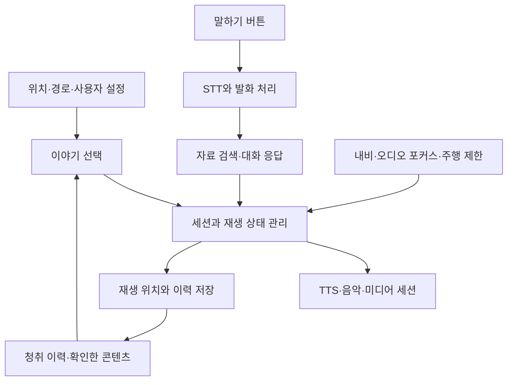

# 가는길 라디오 — 주제 기획 및 개발 검토

> **이전 기획 기록(v0.3).** 현재 브랜드와 요구사항은 [Petasos 기획서](./Petasos_기획서.md)를 따른다. 정밀 이동 경로·대화 요약 저장, 문단 종료 후 입력, 음악 전환, Gleo/OpenRouter, 수집 범위는 최신 문서가 우선한다. 아래 본문은 이전 논의 기록으로 보존한다.

작성일: 2026-11-05 (KST) · 버전: 0.3 · 이름은 가칭

**현재 상태:** 사용자가 이 방향으로 주제 문서화를 선택했다. 아래의 제품 원칙은 대화에서 합의한 방향이며, 세부 기능·구현 방식·일정은 개발 제안이다. SDK는 공식 문서까지 확인했으며 계정별 사용 권한, 에뮬레이터 실행, 실제 차량 연동은 아직 검증하지 않았다.

**추가 검토:** 사용자가 장소에 따른 게이미피케이션을 희망해 배지·칭호·이야기 수집을 비교했다. 방문·청취 기록을 모으는 요소를 허용하는 방향으로 이전 ‘게임 제외’ 범위를 조정한다. 아래 ‘이야기 여권’은 추천안이며 사용자가 최종 선택한 방식은 아니다.

공모전 공통 자료: [COMPETITION_CONTEXT.md](./COMPETITION_CONTEXT.md). 기존 선행 아이디어 조사: [ideas.json](./outputs/pleos-research-2026-11-04/ideas.json).

## 1. 주제와 해결하려는 문제

> **가는길 라디오 — 지나가는 지역의 이야기를 함께 듣고, 이동 자체를 즐기는 차 안의 여행 가이드.**

### 문제: 이동하는 동안 지나치는 장소를 알아갈 기회가 적다

출퇴근, 나들이, 장거리 여행에서 자동차 안의 시간은 목적지에 도착하기를 기다리는 시간으로 느껴질 수 있다. 여러 지역을 지나지만 표지판에서 이름만 접하고, 어떤 곳인지와 어떤 이야기가 있는지는 모른 채 지나가기도 한다. 운전자는 그때마다 검색하기 어렵고, 동승자도 미리 알지 못했던 장소의 이야기를 직접 찾아야 한다.

사용자가 예로 든 오창·망향처럼 도로 표지판이나 휴게소에서 접하는 이름은 호기심의 출발점이 될 수 있다. 실제 콘텐츠를 만들 때는 행정 지명과 시설명을 정확히 구분하고, 명칭의 유래나 지역 특징을 확인한 뒤 이야기한다. 이 문서에서는 두 명칭의 구체적인 유래를 사실로 제시하지 않는다.

이 기획의 문제는 지식을 충분히 공부하지 않는다는 데 있지 않다. **이동 중에 자연스럽게 즐기고, 발견하고, 함께 나눌 이야기를 만날 기회**에 초점을 둔다. 자동차에서 보내는 시간을 모두 무의미하다고 규정하거나 항상 생산적으로 써야 한다고 요구하지 않는다.

### 출발 경험: 여행 가이드 덕분에 즐거웠던 이동

사용자는 일본·대만 여행의 당일 투어에서 가이드가 지역의 유래, 재미있는 이야기, 여행 팁을 들려주어 이동 시간을 지루하지 않게 보낸 경험을 공유했다. 목적지에 도착하기 전부터 그곳을 이해하고 여행을 즐길 수 있었다는 경험이 이 기획의 출발점이다.

**제품 가설은 그 경험을 국내 자동차 이동으로 가져오는 것이다.** 가이드가 동행하지 않는 이동에서도 지금 지나는 곳의 이야기를 흥미롭게 들을 수 있다면, 운전자와 동승자가 이동 자체를 더 즐길 수 있을 것이다. 사용자의 개인 경험은 기획의 동기이며, 일반적인 수요·효과는 별도 검증한다. 당시 졸리지 않았다는 개인 경험을 제품의 졸음운전 방지 효과로 확대하지 않는다.

### 제품: 함께 듣는 지역 이야기, 원할 때 참여하는 대화

앱은 지역의 유래·사람들의 삶·음식·산업·문화·여행 팁 중 들려줄 만한 소재를 골라, 여행 가이드처럼 친근하게 풀어준다. 정보량보다 이야기의 재미와 이해하기 쉬운 전달을 우선한다. 운전자뿐 아니라 함께 탄 아이나 어르신도 화면을 조작하지 않고 같은 이야기를 들을 수 있는 경험을 지향한다.

기본은 듣기다. 사용자는 필요할 때만 **‘말하기’ 버튼으로 발언권을 얻어** 질문, 추억, 의견, 감상을 보탤 수 있다. 이는 가이드에게 손들고 말을 거는 경험을 돕는 기능이다. 버튼을 누르지 않아도 콘텐츠의 가치는 완성되어야 한다.

지역 이야기가 제품의 중심이지만 매 순간 지역에 묶일 필요는 없다. 관심사에 따라 다른 이야기로 이어가고, 같은 길에서는 이미 들은 설명을 반복하지 않으며, 적절한 소재가 없거나 사용자가 원하면 듣던 음악으로 돌아간다.

- **핵심 이용자:** 자동차로 이동하면서 지나가는 곳의 이야기를 즐기고 싶은 운전자와 동승자. 아이·어르신을 포함하되 가족 전용 앱으로 한정하지 않는다.
- **우선 시연 상황:** 나들이·장거리 이동에서 처음 접하는 지역을 함께 알아가는 장면. 같은 경로의 출퇴근에서도 반복 방지와 관심사·음악 전환을 별도로 검증한다.
- **핵심 가치 가설:** 무심히 지나쳤던 장소를 알아가는 즐거움과 함께 들을 이야기를 제공해 이동 경험을 풍부하게 한다.
- **보조 가치:** 콘텐츠를 직접 찾는 부담 감소, 궁금할 때만 참여하는 대화, 반복 경로에서도 원치 않는 설명을 강요하지 않는 청취.
- **차량에서의 가치:** 실제로 지나는 지역과 이야기의 시점이 연결되고, 같은 공간의 탑승자가 함께 듣는다. 위치·경로·내비 안내·미디어 조작이 이를 뒷받침한다. 휴대폰에서 구현할 수 없다는 주장은 하지 않는다.

### 기획서 도입문 초안

> 자동차로 이동하는 동안 우리는 수많은 지역을 지나지만, 그곳이 어떤 곳인지 모른 채 목적지로 향하곤 합니다. 반면 여행 가이드가 지역의 유래와 재미있는 이야기, 여행 팁을 들려주는 투어에서는 이동 시간도 여행의 즐거운 일부가 됩니다. 가는길 라디오는 이 경험을 일상의 자동차 이동으로 가져옵니다. 지금 지나가는 곳에 얽힌 이야기를 친근한 음성으로 들려주고, 궁금하면 버튼을 눌러 질문하거나 자신의 경험을 나눌 수 있습니다. 운전자부터 함께 탄 아이와 어르신까지, 지나치던 길을 알아가는 즐거움을 함께 누리는 것이 목표입니다.

## 2. 대화에서 정한 제품 원칙

| 원칙 | 제품에 반영할 내용 |
| --- | --- |
| 이동 자체를 즐겁게 만드는 것이 중심이다 | 지역의 이야기를 재미있게 전달하는 경험을 먼저 검증한다. 버튼 대화·취향 설정·음악 전환은 이를 돕는다. |
| 운전자와 동승자가 함께 듣는다 | 기본 대본부터 쉬운 말과 명료한 설명을 사용한다. 참여나 학습 성과를 요구하지 않는다. |
| 아무 말도 하지 않아도 된다 | 질문에 답하거나 대화를 유지하지 않아도 완결된 콘텐츠를 들을 수 있다. |
| 버튼을 누르면 내 이야기도 한다 | 버튼은 검색이나 질의응답에 한정되지 않는 ‘말하기’다. 가이드에게 손을 드는 느낌을 지향한다. |
| 지역 이야기를 중심에 두되 억지로 묶지 않는다 | 주변 장소에서 관심사로 연결하고, 익숙한 길에서는 다른 이야기나 음악도 선택한다. |
| 같은 길에서 같은 설명을 강요하지 않는다 | 들은 주제는 제외하거나 다른 주제를 고른다. 적절한 소재가 없으면 음악을 유지한다. |
| 앱이 계속 말할 필요는 없다 | 음악과 조용한 시간도 정상적인 사용 상태다. 침묵을 실패로 보지 않는다. |
| 가볍게 모으는 즐거움을 검토한다 | 지역·이야기 기록을 모으는 요소는 허용한다. 별도 게임을 주제로 삼거나 주행 중 퀴즈·속도·거리 경쟁을 요구하지 않는다. 구체적인 수집 방식은 미확정이다. |
| 발화와 콘텐츠 제작을 사용자에게 떠넘기지 않는다 | 이용자 사연 모집이나 운전자 커뮤니티 없이도 처음부터 작동해야 한다. |
| ‘이음’은 공통 재생 기능이다 | 안내·통화 등으로 끊긴 이야기를 적절히 이어주는 기능으로 사용한다. 별도 주제로 포장하지 않는다. |

## 3. 대표 사용 경험

### A. 처음 지나는 지역이 궁금해지는 이동

1. 라디오를 시작한다. 기본 구성으로 바로 들을 수 있고, 원하면 관심사와 이야기 빈도를 설정한다.
2. 지역을 지나면서 ‘이곳은 왜 이런 이름일까?’, ‘어떤 사람들이 어떤 일을 하며 살아왔을까?’처럼 호기심을 만드는 이야기로 시작한다. 사용자에게 답을 요구하는 퀴즈는 아니다.
3. 확인한 유래·지역 생활·음식·산업 이야기 중 하나를 풀어준다. 관심사에 따라 항구에서 음식 운송이나 무역으로 연결하는 식의 전개도 가능하다.
4. 사용자가 반응하지 않아도 이야기 자체가 마무리된다. 매번 질문하고 답을 기다리지 않는다.
5. 다음 장소가 나타나도 진행 중인 이야기를 끊지 않는다. 지나쳐서 의미가 없어진 장소 안내는 건너뛴다.

위 소재 연결은 기획 예시다. 실제 대본은 사실 확인과 출처 연결을 거쳐 작성한다.

### B. 손들듯 버튼을 눌러 내 이야기하기

1. 시장에 관한 이야기를 듣다가 사용자가 ‘말하기’를 누른다.
2. 앱이 재생을 멈추고, 음성 입력이 준비되면 짧은 소리와 상태 표시로 알린다.
3. 사용자가 “우리 할머니도 시장에서 국밥집 하셨는데”라고 이야기한다.
4. 앱은 개인적인 경험을 먼저 받아준다. 곧바로 국밥의 역사를 설명하거나 사용자의 기억을 임의로 만들어내지 않는다.
5. 사용자가 더 말하면 대화를 이어가고, 마무리하면 원래 이야기나 음악으로 돌아간다.

### C. 같은 출근길에서 다른 이야기 또는 음악

어제 들은 지역 설명을 오늘 다시 재생하지 않는다. 새로운 관심사 이야기가 있으면 선택하고, 사용자가 음악을 원하거나 좋은 이야깃거리가 없으면 음악을 유지한다. 새로운 장소나 키워드가 생겨도 음악을 반복해서 중단하지 않는다.

### D. 안내와 통화로 끊긴 이야기

플랫폼에서 제공하는 오디오·내비 이벤트에 따라 재생을 조정한다. 중단된 콘텐츠는 실제 재생 위치를 저장하고, 복귀할 때 필요한 경우 짧은 연결 문장이나 직전 문장부터 이어준다. 사용자가 직접 정지했거나 다른 앱으로 바꿨다면 임의로 재개하지 않는다.

### E. 아이·어르신과 함께 듣는 이동

같은 차에 탄 사람들이 같은 지역 이야기를 듣는다. 아이는 낯선 장소를 알아가고, 어르신은 자신의 경험을 떠올려 이야기할 수 있다. 앱이 세대별 반응을 가정하거나 발화를 요구하지는 않는다. 쉬운 용어와 명료한 발음, 짧게 완결되는 설명을 기본으로 하고, 자세한 이야기는 요청했을 때 이어간다. 여러 세대가 함께 듣는 가치와 별도의 가족 모드 구현은 구분한다.

## 4. 버튼 대화의 구체적인 설계

**MVP 제안은 ‘한 번 누르면 한 발화’다.** 버튼을 누른 뒤 계속 누르고 있을 필요는 없다. 인식 완료 또는 명시적인 취소 시 입력을 닫는다. 앱이 응답한 뒤 추가로 말하려면 다시 버튼을 누른다. 첫 버튼 이후 여러 번 주고받는 연속 대화는 조작 부담과 입력 종료의 명확성을 비교한 뒤 추가한다.

이 방식은 사용자에게 확정받은 세부 사양이 아니라 구현·사용성 검증을 위한 기본안이다.

| 항목 | 기본 동작 |
| --- | --- |
| 버튼 명칭 | ‘말하기’. 시각적인 손 모양은 사용할 수 있지만 실제 손동작 인식은 하지 않는다. |
| 입력 시작 | 콘텐츠를 멈춘 뒤 STT 준비 이벤트를 확인하고 입력 가능 신호를 준다. |
| 입력 종료 | 최종 인식 결과·인식 종료 이벤트를 처리하고 마이크를 닫는다. 무음·취소·오류도 종료 경로를 가진다. |
| 두 번 누르기 | 입력 중 재입력은 취소 동작으로 정한다. 중복 요청이나 이중 녹음이 생기지 않게 한다. |
| 질문 | 방금 들은 내용과 출처를 바탕으로 답하고, 부족한 정보는 단정하지 않는다. |
| 개인 경험·감상 | 경험을 받아주고 관련 대화를 이어간다. 사용자의 발화를 외부 사실의 근거로 삼지 않는다. |
| 재생 요청 | ‘다음 이야기’, ‘음악으로’, ‘그만’, ‘다시 들려줘’는 앱이 허용한 동작으로 처리한다. |
| 새로운 주제 | 관심사 콘텐츠나 근거를 확보한 답변으로 전환한다. 지역으로 억지로 돌아오지 않는다. |
| 응답 뒤 | 마이크는 자동으로 다시 열지 않는다. 후속 발화를 강요하는 질문을 상습적으로 붙이지 않는다. |
| 입력 실패 | 짧게 알리고 이전 청취 상태로 돌아간다. 자동 재시도로 입력을 반복하지 않는다. |

**물리 버튼은 우선 기술 검증 항목이다.** 공식 미디어 가이드는 핸들 키의 기본 재생 제어를 설명하지만 임의의 버튼을 앱 전용 음성 입력에 할당할 수 있다고 보장하지 않는다. Vehicle의 SteeringWheel API에도 현재 확인한 목록에는 각도·열선 기능이 있으며 버튼 재매핑은 확인되지 않았다. 초기 검증은 앱의 큰 ‘말하기’ 버튼으로 수행하고, 허용되는 하드웨어 입력 경로를 별도로 확인한다. 기본 재생·일시정지·다음 버튼의 의미를 임의로 바꾸지 않는다. [미디어 가이드](https://document.pleos.ai/en/docs/pleos-only/vehicle-app-developer-guide/music-audio-app-developement-guide), [SteeringWheel API](https://document.pleos.ai/docs/pleos-only/connect-sdk-pleos/Vehicle/vehicle/ai.pleos.playground.vehicle.api/steering-wheel/entry)

## 5. 무엇을 말하고, 언제 음악으로 돌아갈 것인가

### 콘텐츠 선택 순서

1. 사용자의 정지·음악·주제 변경 요청을 우선한다.
2. 이야기나 대화가 진행 중이면 그 흐름을 유지한다. 위치 이벤트는 즉시 끼어들 명령이 아니다.
3. 다음 이야기를 고를 때 현재 지나는 지역에서 들려줄 만한 소재를 먼저 검토하고, 관심사·이전 청취·사실 근거·이야기 길이를 함께 확인한다. 사용자가 특정 주제를 선택했다면 그 의도를 따른다.
4. 적절한 지역 소재가 없으면 지역과 무관한 관심사 콘텐츠도 후보에 넣는다.
5. 좋은 후보가 없거나 이야기 빈도를 이미 채웠으면 음악을 이어가거나 기다린다.

**시제품의 초기 조정값:** 한 이야기 45~90초, 이야기 사이에는 여유를 두고 ‘이야기 적게/보통’을 제공한다. 숫자는 공식 운전 안전 기준이 아니라 청취 평가를 위한 시작값이다. 지나가는 모든 장소를 설명하지 않는다.

### 반복 방지와 취향

- 장소 ID뿐 아니라 주제 ID·핵심 질문·사용한 사실을 기록한다. 같은 내용을 말투만 바꿔 새 이야기로 취급하지 않는다.
- 주제·문장 단위 재생 이력과 사용자가 직접 한 넘기기·더 듣기 요청을 구분한다.
- 끝까지 재생됐다는 이유만으로 좋아하거나 이해했다고 단정하지 않는다. 위치를 지나쳤다는 사실도 청취 완료와 다르다.
- 처음 입력한 키워드는 수정·삭제할 수 있다. 발화에서 추측한 취향을 조용히 영구 저장하지 않는다.
- 장소를 확인할 수 없으면 ‘지금 보이는 건물’이라고 말하지 않는다. 좌표로 확인한 인근 지역과 실제 시야를 구분한다.

### 음악 연동은 두 단계로 검증

| 범위 | 목표 | 구현·검증 방침 |
| --- | --- | --- |
| 앱 내부 음악 | 이야기 전환 뒤 같은 곡·같은 위치로 복귀 | 사용 권리를 확보한 데모 음원으로 먼저 구현한다. 재생 위치와 사용자의 정지 의도를 직접 관리할 수 있다. |
| 다른 앱에서 듣던 음악 | 사용자가 실제로 듣던 음악으로 돌아가기 | 외부 앱별 허용 API·미디어 세션·포커스 반응을 검증한다. 자동 재개가 안 되면 명시적 미디어 전환 경로를 제공한다. |

외부 음악 복귀는 제품이 지향하는 경험에 포함한다. 다만 내부 음원 시연을 외부 스트리밍 앱 연동이 완료된 것처럼 제시하지 않는다. 다른 앱의 곡 종료 시점이나 재생 위치를 읽을 수 없다면 ‘곡이 끝날 때만 이야기 시작’도 보장할 수 없다.

오디오 포커스는 충돌을 조정하는 장치이며, 모든 음악 앱을 원하는 곡·위치로 제어하는 권한은 아니다. 우리 앱의 콘텐츠 유형에 맞는 오디오 속성을 사용하고, 우선권을 얻기 위해 일반 해설을 내비 안내나 긴급음으로 위장하지 않는다. [Pleos Audio Focus](https://document.pleos.ai/en/docs/pleos-only/vehicle-app-developer-guide/audio-focus-development-guide/audio-focus-development)

## 6. Pleos SDK와 플랫폼 기능의 연결

아래의 ‘확인’은 2026-11-05 공식 문서 확인이다. 실제 사용 가능 여부 및 품질을 의미하지 않는다.

| 기능 | 공식 문서에서 확인한 수단 | 제품에서의 용도 | 추가 검증 |
| --- | --- | --- | --- |
| 위치 | FusedLocation 1.1.3: 마지막 위치, 위치 구독, 영역 진입·이탈 | 이야기 후보 지역 선택 | isSupported(), 권한, 위치 신선도·정확도, 에뮬레이터 이벤트 |
| 이동 경로 | NaviHelper 3.0.5: 경로·목적지·위치·TBT 관련 이벤트 | 경로 변경 시 후보 갱신, 도착 전 새 긴 이야기 제한 | 실제 제공 이벤트, 잔여 시간 필드, 내비 앱별 차이 |
| 음성 출력 | TextToSpeech 3.3.1: 초기화·합성·재생·중지 | 해설과 대화 응답 음성 | 한국어 품질, 지연, 완료 콜백, 오디오 포커스와의 관계 |
| 버튼 음성 입력 | SpeechToText 3.3.1: request(), stop(), 결과 리스너 | 요청한 순간만 사용자 발화 입력 | 한국어 자유 발화, 소음, 인식 종료, 긴 발화, 동시 발화 |
| 차량 상태 | Vehicle 2.3.2 / Service 2.3.21: capability·조회·구독 | 지원되는 상태를 콘텐츠 시작 판단에 보조 사용 | 필요한 상태의 실제 API·권한을 먼저 확인. 차량 제어는 핵심 범위에서 제외 |
| 기본 미디어 제어 | MediaSession 및 미디어 탐색 서비스 | 백그라운드 재생, 시스템 미디어 조작 | Media3 서비스와 Pleos 미디어 브라우저의 호환성 |
| 주행 화면 제한 | CarUxRestrictions | 주행 시 글·입력·설정 표시 조정 | 지역·플랫폼이 전달하는 ActiveRestrictions 반영 |
| Gleo 앱 명령 | App Schema 및 action/callback | 라디오 시작·정지·다음 이야기·저장 등 앱 기능 호출 | 스키마 등록·검토 및 에뮬레이터 반영 |

출처: [FusedLocation](https://document.pleos.ai/docs/pleos-only/connect-sdk-pleos/FusedLocation/intro), [NaviHelper](https://document.pleos.ai/docs/pleos-only/connect-sdk-pleos/NaviHelper/intro), [Navi 이벤트](https://document.pleos.ai/docs/pleos-only/connect-sdk-pleos/NaviHelper/event-listeners), [TTS](https://document.pleos.ai/docs/pleos-only/connect-sdk-pleos/TextToSpeech/intro), [STT](https://document.pleos.ai/docs/pleos-only/connect-sdk-pleos/SpeechToText/intro), [Vehicle](https://document.pleos.ai/docs/pleos-only/connect-sdk-pleos/Vehicle/intro), [주행 제한](https://document.pleos.ai/en/docs/pleos-only/vehicle-app-developer-guide/driving-restriction-development-guide).

### 구현 전에 풀어야 할 문서상 불확실성

1. **SDK 제공 상태:** SDK 개별 기능 문서는 있지만 신청 안내는 FusedLocation·TTS·STT·Vehicle Control을 준비 중, Vehicle State·NaviHelper를 사용 가능으로 표시한다. 계정과 설치된 서비스에서 확인한다. [사용 신청 안내](https://document.pleos.ai/docs/pleos-only/create-my-project)
2. **온디바이스 음성과 AI 대화는 별개:** TTS/STT는 ON_DEVICE 모드를 설명하지만, 이것이 생성형 AI 응답도 오프라인으로 된다는 뜻은 아니다. 서버 음성 모드는 별도 앱 등록·연결 조건을 갖는다.
3. **STT와 명령 실행은 별개:** STT는 인식 문자열을 돌려준다. 앱 동작 선택과 대화 문맥 관리는 우리 앱이 구현한다. request()는 차량 마이크 인식을 시작하고 stop()은 종료한다. [인식 시작·종료](https://document.pleos.ai/docs/pleos-only/connect-sdk-pleos/SpeechToText/start-and-stop), [인식 이벤트](https://document.pleos.ai/docs/pleos-only/connect-sdk-pleos/SpeechToText/result-listeners)
4. **Gleo는 확장 통로:** 문서에서 확인한 앱 함수 호출 인터페이스를 자유 대화 모델 API로 간주하지 않는다. 스키마 검토 의존성이 있으므로 첫 데모의 유일한 진입 경로로 삼지 않는다. [Gleo 개념](https://document.pleos.ai/docs/pleos-only/app-integration-guide/guide/core-concepts), [스키마 전달](https://document.pleos.ai/docs/pleos-only/app-integration-guide/guide/deliver-schema)
5. **내비 이벤트와 오디오 이벤트:** 모든 내비 발화가 반드시 포커스 상실을 만들지는 않는다. 실제 콜백을 관찰하고 구현 가능한 중단·감쇠·재개 정책을 정한다. ‘회전 몇 초 전 자동 정지’는 필요한 필드가 확인될 때만 약속한다.

Music/Audio 분류를 우선 검토한다. 브랜드 이름이 ‘라디오’여도 실제 제공 형태에 맞춰 에피소드와 음악의 미디어 탐색 구조를 구분한다. 앱 연결만으로 무조건 재생하지 않고 사용자의 시작 또는 시스템 재개 요청에서 세션을 시작한다. 미디어 서비스는 Media3 기반 후보로 잡고, 공식 가이드의 MBS 호환 요구를 에뮬레이터에서 확인한다. [Music/Audio 개발 가이드](https://document.pleos.ai/en/docs/pleos-only/vehicle-app-developer-guide/music-audio-app-developement-guide)

## 7. 콘텐츠와 대화의 품질을 만드는 방법

### 확보할 수 있는 원천

| 원천 | 확인한 제공 범위 | 활용 제안 |
| --- | --- | --- |
| [한국관광공사 국문 관광정보](https://www.data.go.kr/data/15101578/openapi.do) | 지역·위치·키워드 기반 관광정보, 상세 정보 등 | 장소 후보와 좌표·기본 설명. 실제 필드·호출량은 키 발급 후 확인 |
| [관광지 오디오 가이드정보](https://www.data.go.kr/data/15101971/openapi.do) | 오디의 음성·대본·사진, 위치·키워드 기반 정보 | 지역 이야기의 근거 및 참고 구조 |
| [관광 스토리텔링 DB](https://www.data.go.kr/data/3041768/fileData.do) | 스팟·오디오명·대본·재생시간을 포함한 1,624행 파일 | 초기 소규모 대본 검토. 전체 행 수가 서로 다른 한국어 이야기 수를 뜻하지는 않음 |
| 주제별 기관·박물관·연구기관 자료 | 소재에 맞춰 개별 확인 필요 | 음식·과학·경제·문화로 연결할 근거 |

관광 스토리텔링 파일은 2016년 기준 자료로 표시되어 있다. 페이지 수정일이 최신이라고 내용 전체가 최신이라는 뜻은 아니다. 공공데이터의 제공 조건과 원천별 표시·변형·재배포 조건을 기록한다. 국문 관광정보의 사진은 별도 조건이 안내되어 있으므로 텍스트와 동일하게 취급하지 않는다. 초기 제품은 사진 없이도 성립한다.

### 제작 흐름

1. 처음에는 한 경로의 장소 5곳과 관심사 3개만 선정한다.
2. 이야기마다 ‘핵심 질문 하나 → 확인한 사실 → 흥미로운 연결 → 짧은 마무리’를 작성한다. ‘이곳의 이름은 어디서 왔을까’, ‘왜 이 산업이나 음식이 자리 잡았을까’처럼 지역을 이해하는 소재를 우선한다.
3. 사실마다 출처 URL과 확인 날짜를 연결하고, 전승·설화·의견은 사실 설명과 구분한다.
4. 편집한 대본을 소리 내어 검토한다. 도입이 길거나 지명을 나열하는 대본은 줄인다. 어려운 용어는 풀어 말하고, 지역을 모르는 동승자도 이해할 수 있는지 확인한다.
5. AI는 근거 자료를 바탕으로 표현과 연결을 조정한다. 사실 생성과 말투 생성을 구분한다.
6. 자유 질문은 확보한 자료에서 답하고, 근거가 부족하면 한계를 짧게 밝힌다. 출처가 있다는 이유만으로 모든 생성 문장을 검증됐다고 표시하지 않는다.

여행 팁은 이야기와 관련된 맥락에서 선택적으로 제공한다. 운영시간·요금처럼 바뀌는 정보는 확인 날짜와 최신성을 관리한다. ‘유명한 맛집’ 같은 평가나 지명 유래를 근거 없이 단정하지 않으며, 앱이 모든 이야기를 방문·예약·구매 권유로 끝내지 않게 한다.

청취용 본편은 미리 준비하고, 버튼으로 들어온 발화에만 실시간 생성 처리를 집중한다. 위치가 바뀔 때마다 새 대본을 생성하는 구조보다 지연·비용·품질을 관리하기 쉽다는 설계 판단이다.

### 최소 데이터 항목

- **이야기:** ID, 주제 ID, 장소 ID(선택), 관심사 태그, 핵심 질문, 사실·출처 연결, 대본 버전, 예상 길이, 음원·문장 경계, 확인 날짜.
- **재생 이력:** 재생된 문장·구간, 중단 이유, 마지막 위치, 사용자의 명시적인 넘기기·저장·더 듣기.
- **설정:** 사용자가 선택한 키워드, 이야기 빈도, 음성 설정, 위치 사용 선택.
- **대화:** 현재 세션 문맥과 사용자가 실제로 들은 범위. 아직 재생하지 않은 대본을 이미 들었다고 가정하지 않는다.

## 8. 앱 구조와 재생 상태

다음은 구현 제안이며 작성된 코드 구조가 아니다.

| 상태 | 의미 | 중요한 전환 |
| --- | --- | --- |
| 대기/정지 | 사용자 시작을 기다리거나 명시적으로 정지됨 | 위치 이벤트만으로 무조건 재생하지 않음 |
| 이야기 재생 | 지역 또는 관심사 이야기 청취 | 버튼 → 입력, 끝 → 다음 편성, 일시 방해 → 중단 |
| 음악 | 내부 음악 재생 또는 검증된 외부 미디어 전환 | 직접 요청이나 허용된 편성 시점에 이야기 전환 |
| 음성 입력 | 사용자가 요청한 발화 수신 | 완료 → 응답 준비, 취소·오류 → 입력 종료 |
| 응답 준비/재생 | 생성 결과를 기다리거나 답변 청취 | 취소·정지·새 요청이 들어오면 오래된 결과 폐기 |
| 일시 중단 | 통화 등 일시적 방해 | 복귀 가능 상태와 사용자 의도를 확인한 뒤 재개 |

‘사용자가 정지함’, ‘일시적 방해’, ‘다른 앱으로 전환함’을 별도 이유로 저장한다. 비동기 STT·생성·TTS 결과에는 세션/요청 식별자를 붙여 취소된 요청이 나중에 갑자기 재생되지 않게 한다.

장문 TTS를 통째로 읽기보다 의미가 완결되는 짧은 구간으로 관리한다. 재개 문장은 실제 재생 기록에서 만들고, 매번 긴 요약을 붙이지 않는다. SDK가 문장별 위치를 제공하지 않으면 앱이 구간 경계를 관리하되 정밀한 위치 복구가 가능하다고 미리 단정하지 않는다.

## 9. 부가 기능의 우선순위

| 우선순위 | 기능 | 이유 |
| --- | --- | --- |
| P0 | 가이드처럼 재미있게 들려주는 지역 이야기 | 제품의 중심 가치. 버튼을 한 번도 누르지 않아도 성립해야 함 |
| P0 | 함께 듣기 쉬운 대본과 음성 | 아이·어르신을 포함한 동승자의 경험을 기본 콘텐츠에서 고려 |
| P0 | 관심사 이야기·음악으로 자연스러운 전환 | 익숙한 길과 콘텐츠 공백에서도 강제 해설을 피함 |
| P0 | 말하기 버튼, 질문·개인 경험·재생 요청 처리 | 사용자가 참여하는 방식 |
| P0 | 청취 이력과 중복 방지 | 같은 길에서 반복 설명을 줄임 |
| P0 | 내비·오디오 중단 처리와 적절한 재개 | 차량에서 청취 흐름 유지 |
| P0 | 권리 확보한 내부 음원으로 복귀 | 음악 전환 경험을 확실히 검증 |
| P0 | 기본 미디어 제어·주행 화면 제한·권한 거부 처리 | 차량 앱의 필수 동작 기반 |
| P1 | 외부 음악 앱 복귀 | 실제 사용에서 중요한 기술 검증 과제. 초기부터 가능성을 확인하되 성공 전에는 지원을 약속하지 않음 |
| P1 | 물리 버튼으로 말하기 | 시선·조작 부담을 줄일 후보. 허용된 입력 연결 여부를 먼저 확인 |
| P1 | Gleo 명령 연결 | 앱 실행·정지·다음·저장 등 명시적 명령 |
| P1 | ‘이 이야기 저장’과 도착 후 출처 보기 | 운전 중 자세히 볼 필요 없이 나중에 확인 |
| P1·추천안 | 이야기 여권: 지역별 이야기 카드 수집 | 지나간 길과 들은 이야기가 기억에 남는 기록이 됨. 세부 방식은 아래 검토안 참고 |
| P1 | 사전 다운로드와 네트워크 단절 대응 | 약한 통신에서 준비된 이야기·음악 유지 |
| P2 | 가족별 세부 설정, 다국어, 여러 경로 | 기본적인 공동 청취는 P0. 별도 연령별 모드는 추후 검토하며 좌석 신호로 나이·신원을 추정하지 않음 |
| 보류 | 여러 AI 진행자, 실시간 뉴스, 자유 연속 대화 | 제작·검증·지연·운영 부담을 늘림. 한 명의 좋은 진행자로 먼저 검증 |
| 제외 | 주행 중 게임·경쟁형 미션, 운전자 사연 커뮤니티, 일정 비서, 감정·피로 진단, 차량 분위기 제어 | 현재 문제와 사용자 선호에서 벗어나거나 추가 의존성이 큼 |

### 게이미피케이션 검토안: 이야기 여권

**추천은 지역별 이야기 카드를 모으는 작은 여권이다.** 배지는 수집한 것을 표시하는 도장으로 활용할 수 있고, 칭호는 이후 선택적으로 추가한다. 첫 구현에 배지·칭호·레벨·순위표를 모두 넣지는 않는다.

| 후보 | 장점 | 이 앱에서의 한계 | 판단 |
| --- | --- | --- | --- |
| 배지·스탬프 | 무엇을 모았는지 직관적이고 지역 일러스트와 잘 어울림 | 방문 횟수만 표시하면 지역 이야기와 연결이 약함 | 지역별 기록의 시각적 표시로 적합 |
| 칭호 | 취향이나 성취를 간단히 표현 | 칭호를 보여줄 맥락이 적고, 명칭만 늘어나면 의미가 약해짐 | 핵심 수집 경험 이후 선택 기능으로 보류 |
| 이야기 카드·여권 | 어느 길에서 무슨 이야기를 만났는지 남고 다시 들을 수 있음 | 대본에 맞는 카드 편집과 재생 이력 연결 필요 | 우선 추천 |
| 지도 채우기 | 이동하며 발견한 곳을 한눈에 볼 수 있음 | 통과만으로 넓은 지역 전체를 탐방한 것처럼 보일 수 있음 | 추후 지역별 점·도장 표시로 보완 |

#### 수집 경험 예시

1. 사용자가 이동 중 한 지역의 이야기를 듣는다. 별도 퀴즈나 수령 버튼은 요구하지 않는다.
2. 지역 통과와 해당 이야기의 재생 기록을 바탕으로 카드가 여권에 남는다. 완료 판정은 실제 재생 구간으로 구현하고, 이해도나 주의 집중을 추정하지 않는다.
3. 주차 후 오늘의 기록에서 지역 일러스트, 이야기 제목, 확인된 사실 한 줄, 날짜, 다시 듣기·출처를 볼 수 있다. 주행 중 수집 화면을 확인하도록 요구하지 않는다.
4. 같은 지역에서 다른 이야기를 들으면 기존 지역 페이지에 추가한다. 같은 이야기를 재생할 때마다 배지 개수나 점수가 늘어나지는 않는다.

예를 들어 오창 인근에서 준비된 지역 이야기를 들었다면 ‘오창에서 만난 이야기’ 페이지가 생기고, 그날 들은 이야기의 카드가 남는 식이다. 예시 명칭이며 실제 카드의 사실·그림·출처는 콘텐츠 제작 단계에서 정한다.

**‘지나친 곳’, ‘들은 이야기’, ‘실제로 방문한 장소’를 구분한다.** 고속도로를 지나갔다고 지역 관광지를 방문한 것으로 인증하지 않는다. GPS가 불확실하거나 위치 사용을 거부한 경우에도 이야기는 저장할 수 있으나 현장 기록 도장을 붙이지 않는다. 세부 좌표 전체 대신 지역 ID·이야기 ID·날짜 등 필요한 기록만 저장하고 삭제할 수 있게 한다.

관광지 방문을 여권과 도장으로 기념하는 선행 방식은 이미 있다. 미국 국립공원 안내에서도 장소 방문을 기념하는 Passport 스탬프를 소개한다. 이 앱에서는 단순 방문 횟수보다 ‘이동 중 만난 이야기’를 다시 꺼내보는 가치로 발전시키는 것이 제안의 핵심이다. 이 방식의 독창성이나 유지율 향상은 아직 검증하지 않았다. [NPS Passport 안내](https://www.nps.gov/thingstodo/get-a-passport-stamp.htm)

#### 이후에 검토할 작은 확장

- 음식·옛길·바다 등 이야기 주제별로 모아볼 수 있게 한다. 지역 수집과 함께 있어 같은 출퇴근길에서도 새 이야기를 보탤 수 있다.
- 관련 이야기가 쌓였을 때 ‘맛 이야기 수집가’ 같은 선택형 칭호를 제안할 수 있다. 방문·청취 횟수를 전문 지식의 증명으로 표현하지 않는다.
- 여러 지역에서 들은 이야기를 한 장의 여행 엽서로 묶는 기능은 추후 검토한다. 사용자의 대화 원문·집 위치·이동 경로를 자동 공개하지 않는다.

첫 범위는 **지역 페이지 + 이야기 카드 + 다시 듣기**까지로 잡는다. 지도·칭호·공유는 수집 기록을 실제로 다시 보는지 확인한 뒤 추가한다. 매일 출석, 주행 거리 순위, 시간 제한 수집, 놓치기 전에 우회하라는 알림은 넣지 않는다. 이야기와 음악을 원하는 대로 듣는 경험이 수집 조건보다 우선한다.

## 10. 운영에서 고려할 요소

- **주행 중 UI:** 현재 재생 상태와 최소 조작에 집중한다. 긴 대본·출처 열람·키워드 편집은 플랫폼 주행 제한에 맞춘다. 속도가 0이라는 이유만으로 주차 상태라고 판단하지 않는다. 음성 경험도 주의를 요구할 수 있으므로 ‘오디오라서 안전하다’고 주장하지 않는다.
- **마이크와 기록:** 버튼을 누른 세션에서만 입력한다. 원음은 기본 저장하지 않는 방향으로 설계하고, 외부 음성·AI 서비스를 쓰는 경우 전송 범위를 설명한다. 원음 미저장과 외부 전송 없음은 다르다.
- **취향과 개인 이야기:** 사용자의 경험은 현재 대화 문맥으로 우선 처리한다. 장기 기억은 별도 선택으로 두고, 취향·이력 삭제 경로를 마련한다. 정밀 이동 경로를 장기 저장하는 기능은 MVP에 넣지 않는다.
- **서버 역할:** 콘텐츠 근거 검색, 대화 생성, 비용 제한을 담당한다. 일반 모델 서비스의 서버 키를 APK에 넣지 않는다. SDK 인증 정보는 공식 등록 방식과 별도로 관리한다.
- **권한·통신 실패:** 위치 거부 시 관심사 이야기·음악은 유지한다. 통신 단절 시 캐시 콘텐츠를 재생하고 새로운 자유 질문은 처리 가능한 범위를 알린다. 실패를 일반 답변처럼 꾸미지 않는다.
- **비용:** ‘회차당 콘텐츠 생성·합성 비용 + 발화당 인식·생성 비용 + 저장·전송 비용’을 기록한다. 준비된 이야기 재사용과 명시적 발화에만 실시간 호출하는 방식으로 관리한다. 아직 실제 단가·사용량·월 비용을 산출하지 않았다.
- **확장 사업:** 반복 이용과 지불 의사를 확인한 뒤 콘텐츠 팩이나 구독을 검토한다. 초기에는 광고를 넣어 지역 이야기의 선정 기준을 흐리지 않는다. 확보하지 않은 제휴나 MAU를 실적으로 제시하지 않는다.

## 11. 기존 서비스와 심사 관점

공개 소개 자료 기준 비교이며 실제 앱의 완성도나 성능을 평가한 결과가 아니다.

| 선행 사례 | 이미 제시된 기능 | 우리 기획에서 검증할 차이 |
| --- | --- | --- |
| [Roadio — 차창 밖 이야기](https://github.com/WhoisHOO/pleos-app-challenge) | 경로에 따른 장소 이야기와 차량 미디어 재생 | 함께 듣고 싶은 이야기의 전달, 관심사 전개, 사용자의 경험 참여, 음악으로 물러나는 흐름 |
| [Road Docent](https://github.com/728haven-oss/road-docent) | 대화체 지역 해설, 심화 설명, 이동 상황별 콘텐츠 | 관광 코스 외의 반복 출퇴근, 자유 발화 이후의 이야기 변화 |
| [Passenger Seat](https://www.passengerseat.app/features) | 위치 기반 해설, 스타일 선택, 이전 이야기 반복 방지 | 반복 방지만으로는 차별화가 안 됨. 듣기·참여·음악 전환의 실제 경험을 비교 |
| [HearHere History](https://www.hearherehistory.com/) | 장소 이야기와 후속 질문 | 질의응답 이외의 개인 경험·감상까지 자연스럽게 수용하는지 검증 |

**여행 가이드 경험을 재현한다는 동기는 필요성을 설명하지만, 그 자체가 새로운 기능이라는 뜻은 아니다.** 먼저 듣고 싶은 지역 이야기와 공동 청취 경험을 만들고, 이야기 선택·대화 반응·음악 복귀로 완성도를 높이는 것이 현재의 경쟁 전략이다. 차별성이 충분한지는 시연과 사용자 비교 전까지 미확정이다.

| 공식 평가 항목 | 제출물에서 보여줄 내용 | 현재 약점과 검증 |
| --- | --- | --- |
| 차량특화성 | 지금 지나는 지역을 탑승자가 함께 알아가며, 이동·미디어 흐름에 맞춰 이야기를 들음 | 위치만 붙인 모바일 앱에 머물지 않도록 통합 시연 필요 |
| 창의성 | 가이드의 이야기처럼 듣다가 경험을 보태면 전개가 바뀌고, 필요 없을 때 음악을 유지 | 기존 가이드와 기능 중복이 큼. 동기와 차별성의 증거를 구분해 검증 |
| 기술 활용성 | FusedLocation·NaviHelper·음성·미디어 제어가 핵심 경험에 기여 | 계정/서비스 지원 상태와 실제 동작 확인 필요 |
| 사업성 | 나들이·장거리 이동의 공동 청취 수요와 반복 경로에서의 재사용 이유 | 여행 때만 쓰는 앱에 머무는지, 음악·팟캐스트 대비 선택 이유와 비용·지불 의사 검증 필요 |

세부 배점은 공개되어 있지 않다. [공식 심사 기준](https://appdevchallenge.auto-hmg.io/guide/judging-awards)

## 12. 2인 팀의 최소 구현 범위

### 첫 제출용 목표

- 한국어, 가이드 역할의 진행자 한 명, 경로 하나, 장소 5곳, 관심사 3개. 관심사 입력 없이도 기본 지역 이야기로 시작할 수 있게 한다.
- 출처 확인한 이야기 12개를 초기 편집 목표로 잡는다. 예: 지역 이야기 8개 + 연결하거나 독립적으로 들을 관심사 이야기 4개. 실제 품질을 보고 개수를 줄일 수 있다.
- 지역을 모르는 사람도 흥미롭게 들을 수 있는 대본과, 운전자·동승자가 함께 듣는 장면을 먼저 만든다.
- 권리 확보한 음악 2곡으로 재생 위치 유지와 이야기 전환을 검증한다.
- 앱 내 말하기 버튼으로 실제 발화를 받아 질문·경험·제어 요청을 구분한다.
- 청취 이력을 바꾸어 첫 방문·같은 경로 재방문·관심사 변경을 시연한다.
- 실제 위치/내비 이벤트와 시뮬레이션 입력을 구분해 표시한다. 시뮬레이션 성공을 실차 연동 완료로 표기하지 않는다.
- 범위에 없는 질문, 권한 거부, 네트워크 단절, 사용자의 정지에도 앱이 안정적으로 동작한다.

한 경로와 준비된 콘텐츠만으로 전국 서비스나 장기 이용성이 증명되는 것은 아니다. 초기 시연은 핵심 경험과 기술 연결을 확인하는 용도다.

### 역할 분담 제안

| 담당 | 주된 작업 | 함께 확인할 지점 |
| --- | --- | --- |
| 앱·차량 연동 | Kotlin 앱, SDK 어댑터, 미디어·입력·주행 제한, 재생 상태 | 버튼→응답→재개 흐름 |
| 콘텐츠·대화 | 사실 확인, 대본·음성 품질, 자료 검색, 대화 응답, 검증 시나리오 | 같은 길의 반복 청취와 음악 전환 |

담당자 배정은 아직 하지 않았다. 서버·모델 제공자도 응답 품질과 비용 측정 후 선택한다.

## 13. 검증과 시연

### 기술 검증 — 아직 수행하지 않은 체크리스트

- [ ] 계정에서 SDK 상태 확인, 설치된 에뮬레이터·서비스 버전 기록.
- [ ] 위치 수신과 위치 없음/오래된 위치/지원 불가 처리.
- [ ] 내비 목적지·경로 변경·도착 및 실제 전달 필드 확인.
- [ ] 버튼 입력 후 STT 준비→시작→최종 결과→마이크 종료 확인.
- [ ] 짧은 명령뿐 아니라 한국어 개인 경험 발화도 인식되는지 확인.
- [ ] 사용자가 정지·취소한 후 늦게 도착한 AI/TTS 결과가 재생되지 않는지 확인.
- [ ] 앱 내부 음악의 같은 위치 복귀와 수동 정지 의도 보존.
- [ ] 외부 음악 앱에서 포커스 상실·복귀·앱 전환을 별도 측정.
- [ ] 내비 안내·통화·다른 미디어·주행 제한 상황에서 실제 이벤트와 반응 기록.
- [ ] 백그라운드 재생, 시스템 기본 미디어 조작, 프로세스 복원 확인.
- [ ] 물리 버튼의 사용자 정의 입력 허용 범위 확인. 불가하면 지원 기능에서 제외.

반응 시간은 버튼→입력 준비, 발화 종료→첫 응답 음성으로 나눠 중앙값과 느린 경우를 기록한다. 아직 달성한 지연 수치나 인식률은 없다.

### 경험 검증

초기 5~8명에게 정차·동승·시뮬레이션 환경에서 음악만 듣기, 고정 해설 듣기, 본 앱 듣기를 비교하게 한다. 작은 탐색 평가이며 시장 수요나 운전 안전성을 입증하는 연구로 제시하지 않는다.

관찰할 것은 ‘질문을 많이 했는가’나 ‘지역 정보를 얼마나 외웠는가’가 아니다. 말없이 들어도 재미있는지, 지나가는 장소에 관심이 생기는지, 동승자와 함께 듣기 좋은지, 다시 켜고 싶은지, 원치 않는 끼어들기가 있는지를 확인한다. 버튼 동작과 마이크 종료 이해도도 별도로 본다. 실제 반복 사용은 이후 여러 날짜의 재사용으로 따로 측정한다.

수집 기능을 추가하면 카드 획득 수와 별개로, 주차 후 기록을 다시 보는지·이야기를 다시 듣는지·실제 방문과 통과를 혼동하지 않는지 확인한다. 수집을 위해 듣기 싫은 이야기를 끝까지 재생하게 되는지도 관찰한다.

### 3분 시연 제안

| 구간 | 보여줄 장면 | 증명하려는 점 |
| --- | --- | --- |
| 0:00–0:30 | 이름만 알고 지나치던 지역에 관한 흥미로운 이야기를 함께 들음 | 버튼 조작 전에 이동의 즐거움과 지역 발견이라는 가치 전달 |
| 0:30–1:10 | 버튼으로 사용자의 실제 질문 또는 개인 경험을 전달 | 정해진 설명에서 사용자 대화로 전환 |
| 1:10–1:40 | 대화 내용을 반영한 응답 뒤 이야기·음악 복귀 | 입력이 결과를 바꾸고 재생 문맥을 유지 |
| 1:40–2:15 | 내비 또는 일시 중단 이벤트와 재개 | 차량 오디오와 함께 동작 |
| 2:15–2:45 | 같은 경로 재방문 시 설명을 반복하지 않고 다른 소재·음악 선택 | 익숙한 길에서도 강제 해설하지 않음 |
| 2:45–3:00 | 사용자가 정지하면 늦은 응답까지 재생하지 않음 | 사용자가 주도권을 가짐 |

편집으로 압축한 주행과 실제 응답 시간은 구분한다. 실제 실행한 기능, 준비된 콘텐츠, 시뮬레이션 입력을 제출 자료에 각각 표시한다.

## 14. 제출까지의 진행안

공식 접수 마감은 **2026-11-15**, 1차 발표는 **11-23**, 2차 PT는 **12-03~12-04**다. 접수양식이 필수 기획서이며 영상·소스·APK는 1차 선택 가산점 자료, 실제 동작 앱은 2차 PT 전에 필요하다. 이 Markdown은 내부 기획 문서이고 공식 접수양식을 대체하지 않는다. [공식 일정](https://appdevchallenge.auto-hmg.io/guide/schedule), [제출 방법](https://appdevchallenge.auto-hmg.io/guide/submission)

| 제안 기간 | 완료 목표 |
| --- | --- |
| 11/05–11/06 | SDK 가용성, 버튼 입력, 음성·음악 전환의 작은 실험. 기술적으로 안 되는 가정을 조기에 수정 |
| 11/07–11/09 | 위치→이야기→버튼→응답→재개 한 흐름과 초기 대본 구현 |
| 11/10–11/12 | 반복 경로·오류 처리·미디어 통합, 소규모 청취 평가 |
| 11/13–11/14 | 작동 범위에 맞춰 문서·영상·실행 안내·APK 정리. 내부 제출 목표는 11/14 |
| 1차 제출 후 | 외부 음악·물리 버튼·Gleo 등 검증된 확장 기능과 안정화 |

일정은 2인 팀을 위한 제안이며 투입 가능 시간에 따라 조정한다. 접수 마감 시각은 확인한 안내에 명시되어 있지 않으므로 마지막 순간 제출을 전제로 하지 않는다.

## 15. 다음 개발에서 먼저 답할 질문

1. **실제 사용 가능한 음성 SDK로 자유로운 한국어 한 문장을 받고 답할 수 있는가?** 고정 키워드 데모만으로 통과시키지 않는다.
2. **음악과 이야기 사이를 전환한 뒤 사용자의 재생 의도를 보존할 수 있는가?** 내부 음악과 외부 앱을 구분해 결과를 남긴다.
3. **차량의 물리 버튼으로 말하기를 시작할 수 있는가?** 표준 미디어 제어 지원과 사용자 정의 발화 버튼 지원은 별도로 검증한다.
4. **사용자가 아무 말도 하지 않는 5분이 재미있는가?** 지역을 새롭게 알아가는 즐거움이 있는지, 동승자와 함께 들어도 이해하기 좋은지 콘텐츠 자체로 판단한다.
5. **같은 길에서는 말을 줄이거나 다른 콘텐츠를 고르는 판단이 자연스러운가?** 새 지역 설명 생성량을 성공 지표로 삼지 않는다.

제품 방향은 선택되었다. 경험 검증은 먼저 한 편의 지역 이야기를 실제로 들어보는 것에서 시작한다. 이후 위 질문에 답하는 작은 작동 흐름을 만든다.
